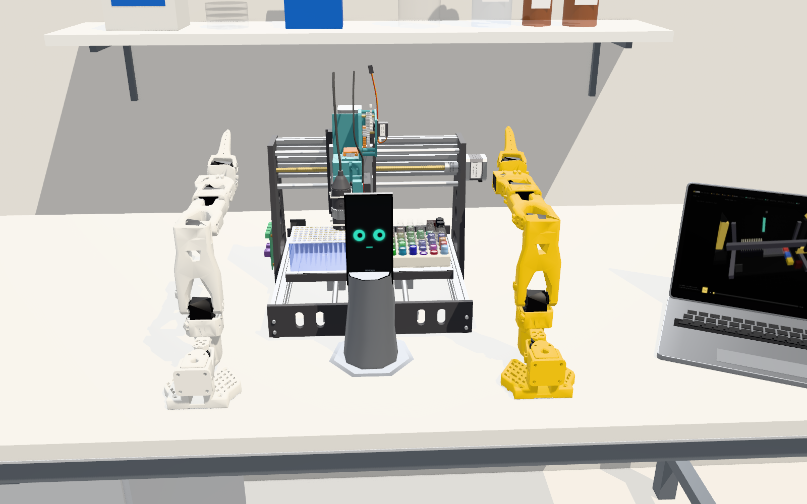
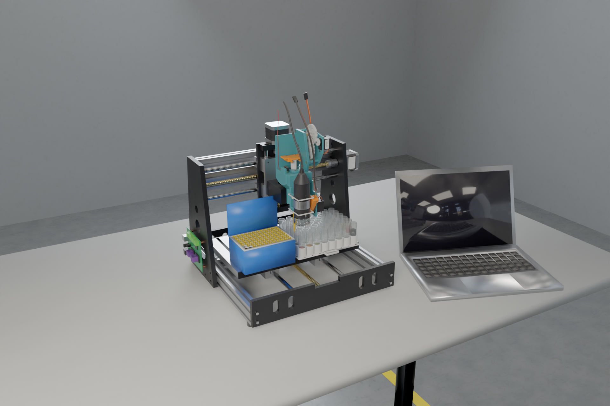

# LabRat

**A voice-operated, simulation-first desk-lab robot that learns from its own results.**

You talk to it through a phone on a pan/tilt stand (its face, eyes, ears and voice), chat with it from the laptop
console, or script it from Python. Every experiment is dry-run on a digital twin before it touches hardware, a human
approves the real run, and the measured results go into a CSV, the lab notebook and the colour model.

The hardware is a 3018 desktop CNC carrying a geared syringe pipette (plus a USB microscope and a capacitive
liquid-level probe on a tool rail) in place of its spindle, a printed beaker matrix, and an SO-101 arm on each side.

LabRat started at the Harness Engineering & Model Wrangling Hackathon (SF, October 2026), where it took 2nd place.


| Digital twin (console) | Tool head on the 3018 (Cycles render) |
|---|---|
|  |  |

## How it works

An **experiment is one plate**: you say what goes into each beaker (µL of water, red, yellow, blue), LabRat dry-runs
it on the digital twin (checks, time, predicted colour per beaker), you approve, the robot fills the plate, the phone
photographs it and every beaker gets a measured colour next to its prediction. Results export to CSV and refit the
colour model. Full guide: **[docs/experiments.md](docs/experiments.md)**.

Three ways in:

- **Console** (`/console/`): new experiment, edit the sample table, run, approve, read the plate.
- **Voice or chat**: "find the most orange mix of red and yellow". The agent (Claude, or simple rules without an API
  key) writes the samples, dry-runs them and asks you to approve.
- **Python**: `from labrat_cli import Lab`; scripts live in [`experiments/`](experiments).

## Layout

```
                      ┌──────────── cloud/ ─────────────┐
 apps/console ─ws/ui─►│ Worker ─► Lab Durable Object    │◄─ws/bridge─ bridge/ ─USB─┬─ SO-101 arms so_a, so_b
 apps/cli ─────ws/ui─►│   experiments · sim · agent     │                          ├─ 3018 CNC (GRBL)
 apps/phone ─ws/phone►│   pipette / probe / stand       │                          ├─ USB microscope
   (face, voice,      │   drivers ─► D1                 │                          └─ servo hub ─┐
    camera, BLE) ─────┼─────────────────────────────────┼──── BLE (alternative) ──────────────►│
                      └──────────── Anthropic API ──────┘          firmware/servo-hub (ESP32 + PCA9685)
```

| Path | What |
|---|---|
| [`cloud/`](cloud) | Cloudflare Worker + one Durable Object (`Lab`) + D1: WebSocket hub, REST API, experiments, dry-run simulator, colour model, camera measuring, notebook, agent, and the pipette / probe / stand drivers on top of the servo hub. Serves the apps. [README](cloud/README.md) |
| [`apps/console/`](apps/console) | Laptop console: experiments (plate map, samples, run, results, CSV), chat, three.js digital twin with 3D replay, notebook, model, deck / camera / device calibration |
| [`apps/phone/`](apps/phone) | Phone page: animated face, camera frames, on-device voice; drives the servo hub over Web Bluetooth when paired |
| [`apps/cli/`](apps/cli) | Terminal REPL (`labrat`) and the Python client (`from labrat_cli import Lab`) |
| [`experiments/`](experiments) | Experiment scripts |
| [`bridge/`](bridge) | Laptop USB bridge: SO-101 arms, GRBL CNC, USB microscope, servo hub over serial; every device has a mock. [README](bridge/README.md) |
| [`firmware/servo-hub/`](firmware/servo-hub) | ESP32 / ESP32-S3 + PCA9685 firmware (PlatformIO): 16 servo channels, inputs, e-stop, watchdog, JSON lines over USB and BLE. [README](firmware/servo-hub/README.md) |
| [`hardware/`](hardware) | Tool head, deck, 3018 model, phone stand, SO-101 parts, electronics: CAD, BOMs, renders. [Index](hardware/README.md) |
| [`docs/experiments.md`](docs/experiments.md) | **How to run experiments**: samples, dry run, results, CSV, Python, REST |
| [`docs/protocol.md`](docs/protocol.md) | The wire contract: providers, phone, UI, servo-hub firmware |
| [`docs/architecture.md`](docs/architecture.md) | System design: the DO, devices, agent, simulator, colour model, safety, [endpoints](docs/architecture.md#endpoints) |

## Quickstart

Needs Node 22+ (cloud), [uv](https://docs.astral.sh/uv/) (bridge, CLI) and PlatformIO (firmware, only for the real
hub). Everything runs locally; nothing needs a Cloudflare account until you deploy.

```bash
# 1. Coordinator (local Worker + DO + D1)
cd cloud
npm i
cp .dev.vars.example .dev.vars           # LABRAT_TOKEN=labrat; optionally ANTHROPIC_API_KEY
npx wrangler d1 migrations apply labrat --local   # schema changed? rm -rf .wrangler/state/v3/d1 first
npx wrangler dev                         # http://127.0.0.1:8787
```

- Console: <http://127.0.0.1:8787/console/> (add `?token=...` if you changed `LABRAT_TOKEN`).
- Phone: `/phone/` on the same origin. Camera, microphone and Web Bluetooth need a secure context, so a real phone
  needs HTTPS (a deployed Worker or a tunnel). Web Bluetooth works in Chrome on Android, not on iOS.

```bash
# 2. Bridge (another terminal; --mock all runs without any hardware)
cd bridge
uv run python -m labrat_bridge --server ws://127.0.0.1:8787 --token labrat --mock all
uv run python -m labrat_bridge --server ws://127.0.0.1:8787 --token labrat      # real hardware, auto-discovered

# 3. CLI
cd apps/cli
uv run labrat --server http://127.0.0.1:8787 --token labrat

# 4. Servo hub firmware
cd firmware/servo-hub
pio test -e native                       # host-side unit tests
pio run                                  # build (default env esp32s3; -e esp32 for a classic DevKit)
pio run -e esp32s3 -t upload             # flash
```

Tests: `cd cloud && npm test && npm run typecheck`, `cd bridge && uv run --group dev pytest -q`,
`cd apps/cli && uv run pytest`, `cd apps/phone && npm test`, `cd firmware/servo-hub && pio test -e native`,
`cd hardware/electronics && python3 gen_wiring.py` (checks the pin map against the firmware).

Deploying: see [`cloud/README.md`](cloud/README.md) (create the D1 database, apply migrations with `--remote`, set
`LABRAT_TOKEN` and `ANTHROPIC_API_KEY` as secrets, `npx wrangler deploy`).

## Hardware

- **3018 CNC** (GRBL 1.1) with the [tool head](hardware/tool-head) in its 42 mm spindle holder: a 12 mL syringe with a
  200 µL tip, driven by a continuous-rotation FS90R through a 12:1 printed gear train and rack; a tool rail with a USB
  microscope and a servo-deployed capacitive probe. Every printed part prints without supports.
- **[Deck](hardware/deck):** a printed 6 × 8 beaker matrix (columns 1–7 for mixing, column 8 for water and the red,
  yellow and blue dyes) and an FT-200L-RS tip rack.
- **[Phone stand](hardware/phone-stand):** a weighted pan/tilt stand front-centre that aims the phone at the deck for
  photos and at the operator while it talks.
- **2 × [SO-101](hardware/so101)** arms (Feetech STS3215) with stock grippers, one at each front corner.
- **[Servo hub](hardware/electronics):** ESP32 + PCA9685 on a 5 V servo rail: ch0 syringe, ch1 probe arm, ch2/ch3
  stand; a plunger home switch and an e-stop.

## Credits

- SO-101 arm (parts in `hardware/so101/`, URDF and decimated meshes in `apps/console/models/so101/`):
  [TheRobotStudio/SO-ARM100](https://github.com/TheRobotStudio/SO-ARM100), Apache-2.0.
- 3018 model (`apps/console/models/cnc3018.glb`): original, generated by `hardware/cnc3018/cnc3018.py`.
- Laptop, bench and labware in the twin are procedural (`apps/console/twin.js`, `apps/console/twin/`).

License: [MIT](LICENSE).
