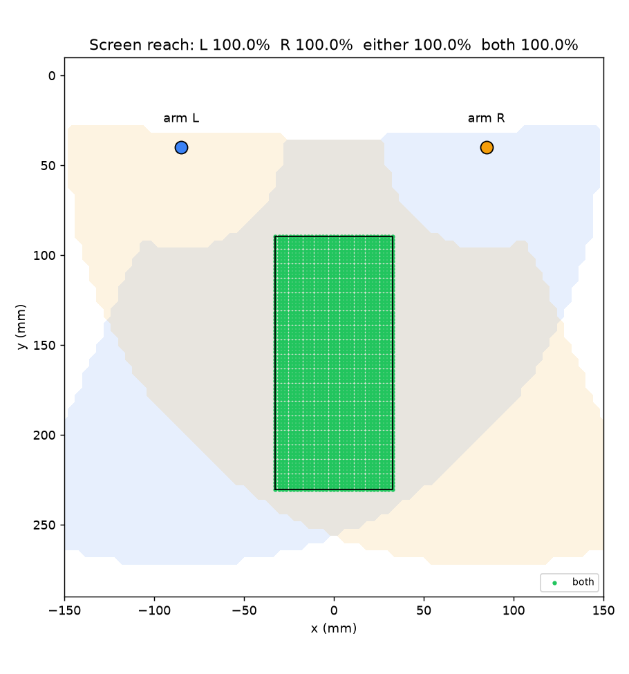

# Tappet

**A ~$99 desktop robot that uses your phones.** Your old Android phone becomes its head: face,
eyes, ears, voice and brain. Two small stylus arms reach down and operate your iPhone (or any
touchscreen) lying in a tray in front of it. Talk to it, or control it from your iPhone's browser, and
it handles desktop productivity jobs: briefings, timers, reminders, tasks and memory. It also taps
through apps that have no API.


| | |
|---|---|
| **Head** | User-supplied Android phone on a 2-axis neck (pan/tilt). Camera, mic, speaker, display, Wi-Fi, compute. Charged by the robot over USB. |
| **Arms** | 2 × 3-DOF (yaw + shoulder + elbow), MeArm-style parallel linkage, wrist parallelogram keeps a **compliant capacitive stylus** vertical. Positional SG90/MG90S servos, 1.5:1 printed gearing on yaw. |
| **Body** | ESP32-S3 (USB host, Android Open Accessory) → I²C → PCA9685 16-ch PWM → 8 servos. USB-C PD input (9 V) → two 5 V bucks (servo rail and logic/phone). |
| **Interfaces** | Voice + animated face on the head, web remote on any phone/laptop (`http://<head>:8080`, PIN pairing), JSON-lines protocol over USB/UART/TCP. |
| **Brain** | Claude agent with tools: tap / swipe / type / look at the device / look at the user / move head / timers / reminders / tasks / memory. |
| **Price** | $99 kit (Android not included). COGS ≈ $43 landed at 1k units. See [docs/business.md](docs/business.md). |

## Repository map

| Path | What |
|------|------|
| [`docs/SPEC.md`](docs/SPEC.md) | **System spec**: architecture, joint map, kinematics, body protocol, AOA handshake, web API |
| [`config/robot.json`](config/robot.json) | Single source of truth for geometry, joints, pins and link settings (checked by every component's tests) |
| [`firmware/`](firmware) | ESP32-S3 PlatformIO firmware: PCA9685 driver, IK, min-jerk motion queue, tap/swipe, watchdog, AOA USB host, NVS calibration |
| [`android/`](android) | Android head app (Kotlin/Compose): face, voice, camera, Claude agent, calibration, web server |
| [`web/`](web) | Browser remote (works on iPhone, installable as a PWA) and `touchpad.html` touch-probe page |
| [`host/`](host) | Python package `tappet`: kinematics, protocol client, **full firmware simulator**, PC bridge, auto-calibration, 100-tap test, workspace analysis |
| [`hardware/cad/`](hardware/cad) | Parametric build123d CAD → STL / STEP / renders, with kinematic and interference checks |
| [`hardware/electronics/`](hardware/electronics) | Schematics, wiring harness, pinout, netlist, electronics BOM, power budget |
| [`docs/`](docs) | [architecture](docs/architecture.md) · [kinematics](docs/kinematics.md) · [calibration](docs/calibration.md) · [assembly](docs/assembly.md) · [BOM](docs/bom.md) · [test plan](docs/test-plan.md) · [roadmap](docs/roadmap.md) · [business](docs/business.md) · [safety](docs/safety.md) · [FAQ](docs/faq.md) · [decisions](docs/decisions) |

## How it fits together


1. Plug a ≥20 W USB-C PD charger (30 W recommended) into the base. Dock the Android phone in the
   neck clamp and plug it into the **HEAD** port.
2. The ESP32-S3 enumerates the phone as a USB host, switches it into **Android Open Accessory**
   mode, and starts charging it. The Tappet app launches automatically.
3. The app shows a face and a pairing PIN/QR. Open the URL on your iPhone and pair.
4. Put the iPhone in the tray, open `http://<head>:8080/touchpad.html` on it, and run
   **auto-calibration**. The robot taps a 3×3 grid, the page reports where the touches landed, and
   a homography maps screen coordinates to arm coordinates.
5. Talk to it ("hey tappet…") or tap on the virtual phone in the web UI.

## Quick start (no hardware needed)

```bash
# Simulator + PC bridge + web UI
cd host
uv run tappet sim &                      # firmware simulator on :7777
uv run tappet bridge --sim               # web UI on http://localhost:8080 (PIN printed)
uv run tappet taptest --sim -n 100       # v0 acceptance test in simulation
uv run tappet workspace                  # reachability of the target screen
uv run --extra dev pytest -q             # 98 tests
```

```bash
# Firmware
cd firmware
pio test -e native                       # 40 host-side unit tests
pio run -e esp32s3 -t upload             # flash the DevKit (UART USB port)
```

```bash
# Android head app (JDK 17)
cd android
./gradlew :app:assembleDebug :app:testDebugUnitTest
adb install app/build/outputs/apk/debug/app-debug.apk
```

```bash
# CAD: regenerate STL/STEP/renders and run kinematic + interference checks
cd hardware/cad
uv run --python 3.12 --with build123d --with trimesh --with matplotlib --with numpy python build.py

# Electronics drawings + netlist + config cross-check
cd hardware/electronics && python3 gen_drawings.py
```

## Kinematics and precision

Each arm reaches **100%** of a 6.1" iPhone screen at both press depth and approach height, within
joint and linkage limits. Simulated 100-tap test with 0.3° servo noise and 0.5° backlash: 100%
registration, 0.81 mm mean error, 1.70 mm p95. Real-hardware numbers come from the
[test plan](docs/test-plan.md). The error budget is in [docs/kinematics.md](docs/kinematics.md).



## Electronics

| Power tree | Logic |
|---|---|
|  |  |
| **Servos** | **Wiring harness** |
|  |  |

## Design decisions in brief

* **Positional servos, not continuous rotation.** Continuous servos control speed, not position.
  Without encoders a stylus can't come back to the same pixel twice.
  ([ADR 0002](docs/decisions/0002-positional-servos-yaw-gearing.md))
* **The robot is the USB host (AOA).** The robot powers and charges the head phone; with
  phone-as-host OTG, the phone's battery would drain. ([ADR 0004](docs/decisions/0004-usb-aoa-link.md))
* **Parallel-linkage arms.** Both arm servos sit at the shoulder, so the moving mass is tiny and
  the stylus stays vertical. ([kinematics](docs/kinematics.md))
* **Compliant, grounded stylus with touch-probe calibration.** This absorbs z error and closes the
  loop using the target phone's own touchscreen.
  ([ADR 0005](docs/decisions/0005-compliant-capacitive-stylus.md),
  [ADR 0006](docs/decisions/0006-touch-probe-homography-calibration.md))

## Status

v0.1 (2026-10-11): complete design package. Firmware, app, simulator and CAD all build and pass
their tests. **Nothing has been validated on physical hardware yet.** Next milestone: single-arm
100-tap test on a printed prototype ([roadmap](docs/roadmap.md)).

## License

MIT, covering software, hardware design files and docs. See [LICENSE](LICENSE).
