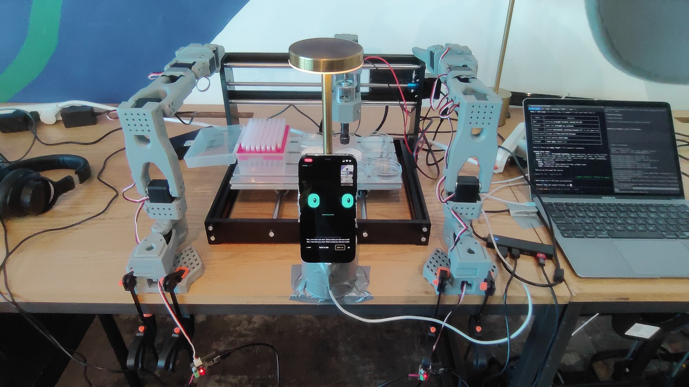
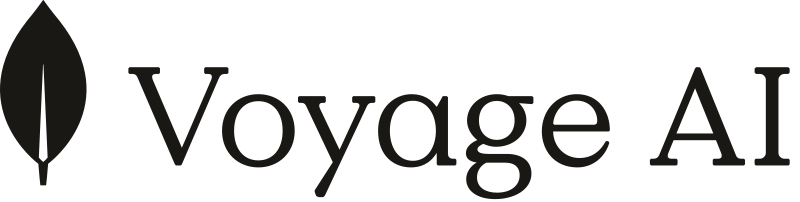

# LabRat 🐀🧪

**A voice-operated, simulation-first desk-lab agent with persistent memory that improves itself.**
Built for the Harness Engineering & Model Wrangling Hackathon (SF, 2026-10-11).



**Built with**

<p align="left">
 &nbsp;&nbsp;  &nbsp;&nbsp;  &nbsp;&nbsp;  &nbsp;&nbsp;  &nbsp;&nbsp;  &nbsp;&nbsp; 
</p>

Talk to it through an iPhone on a static stand looking down at the deck (its eyes, ears and voice), or
chat with it on the laptop. It designs an experiment, **simulates many variants in a 3D digital twin**,
picks the best one, asks for approval, and then runs it for real. The hardware is a 3018 CNC carrying a
rack-and-pinion syringe pipette in place of its spindle, with an SO-101 gripper arm on each side. It then compares the result with its prediction, **refits its own
simulator**, and stores what it learned in typed memory (semantic / episodic / procedural / taxonomic).

## Hardware
Layout: the 3018 CNC is in the middle, `so_a` and `so_b` stand on either side of it, the iPhone is on a fixed
stand looking straight down at the CNC bed, and the laptop sits to the side.
- **3018 CNC** (GRBL 1.1) with a **tool head** in the spindle holder (CAD in [`cad/syringe`](cad/syringe), every printed part support-free):
  - a syringe pipette: a disposable syringe with a 200 µL tip on a luer-to-tip adapter, its plunger on a rack carriage that slides on a plain square bar moulded on the body, driven through a 12:1 gear train by a continuous-rotation FS90R servo;
  - a tool rail with interchangeable modules: a USB microscope (snapshots of any beaker) and a capacitive liquid-level probe (TTP223 on the GRBL probe pin).
- **Syringe servo driver:** an ESP32-S3 + PCA9685 Tappet board (`tap_a`, firmware in [`tappet/`](tappet), JSON lines over USB at 115200). PCA9685 **channel 8 drives the syringe servo**. The Tappet arms themselves are optional and not part of the demo setup.
- **2× SO-101 arms** (Feetech STS3215), `so_a` and `so_b`: plain manipulators with the stock gripper, one on each side of the CNC.
- **iPhone** on a static stand above the CNC bed: camera, mic, speaker and animated eyes. It does not move.
- A **laptop** to the side running the USB bridge and the console, plus an FT-200L-RS tip rack and a printed beaker
  matrix (6 × 8 beakers of 15.3 × 50 mm; columns 1–7 for mixing, column 8 for the stock dyes and water), CAD in
  [`cad/deck`](cad/deck).

## Architecture
```
iPhone SPA (static stand) ──wss /ws/phone──┐                        ┌─ MongoDB Atlas  (typed memory + $vectorSearch)
Laptop console (chat/twin) ─wss /ws/ui─────┼── LabRat server ───────┼─ Voyage AI      (embeddings; hashed fallback)
Terminal CLI (cli/) ───────wss /ws/ui──────┤   FastAPI: agent,      ├─ Anthropic      (agent LLM + vision fallback)
Laptop USB bridge ─────────wss /ws/bridge──┘   sim twin, lab,       ├─ ElevenLabs     (TTS + STT)
  │                                            vision, learn (RSI)  ├─ Raindrop       (traces, rsi.update events)
  ├─ SO-101 ×2 gripper arms (Feetech STS)                           └─ Modelence      (Mission Control event ingest)
  ├─ Tappet ESP32 board tap_a (syringe servo, PCA9685 ch 8)
  └─ 3018 CNC (GRBL)
```
Full system design (components, endpoints, memory, sim, learning loop, safety, sponsor map):
**[docs/ARCHITECTURE.md](docs/ARCHITECTURE.md)**.

## The loop (why it's a harness, not a demo)
1. **Ask:** by voice or chat, e.g. "make the most orange well from red and yellow".
2. **Recall:** Voyage + Atlas vector search over prior episodic, semantic and procedural memories.
3. **Design and simulate:** N protocol variants are run in the digital twin (CNC motion, pipette
   volumes, tip tracking, dye mixing, safety checks), then scored.
4. **Select and approve:** the best passing variant needs explicit approval before real actuation.
5. **Execute:** the bridge drives the hardware with local limits, a gcode whitelist and a watchdog.
6. **Observe:** a phone photo and/or your rating.
7. **Self-improve:** `learn.py` refits the simulator parameters and adopts them only if prediction
   error drops. It re-scores past variants, promotes the protocol to procedural memory, and logs
   `rsi.update` to Raindrop. The Learning tab charts error over versions.

## Repo
| Dir | What |
|---|---|
| [`docs/ARCHITECTURE.md`](docs/ARCHITECTURE.md) | The single system-design doc: components, data flow, all endpoints, memory, sim, safety, sponsors, deployment |
| [`CONTRACT.md`](CONTRACT.md) | Pointer to ARCHITECTURE.md plus the hardware/bridge protocol tables |
| [`server/`](server) | FastAPI server: hubs, agent (LLM tool use + rule fallback), simulator, learning loop, vision, sponsor integrations |
| [`web/`](web) | Laptop console: chat, three.js digital twin, experiment gallery, Learning and Memory tabs, approvals, camera/deck calibration |
| [`phone/`](phone) | Static overhead iPhone: animated eyes, camera frames, push-to-talk / VAD voice, TTS playback |
| [`cli/`](cli) | Terminal REPL (`labrat`): streams `/ws/ui`, chat, `/sim`, `/run`, `/approve`, `/abort` |
| [`bridge/`](bridge) | USB bridge: SO-101 (Feetech STS), Tappet ESP32, GRBL CNC, rack-and-pinion syringe, each with a mock |
| [`tappet/`](tappet) | Tappet hardware (merged from the former `JacobFV/tappet` repo): ESP32 firmware, Python host, Android head app, CAD, web UI, docs |
| [`cad/`](cad) | Syringe head for the 3018's motor holder and the printed beaker matrix (build123d → STEP/STL/3MF, every printed part support-free), the parametric 3018 + bench model, renders |
| [`deploy/`](deploy) | `aws_ec2.sh`: EC2 + Docker + Caddy HTTPS (`<ip>.sslip.io`, needed for iPhone camera/mic) |
| [`.github/workflows/ci.yml`](.github/workflows/ci.yml) | CI: server, bridge, JS syntax, Tappet host/firmware/Android/CAD |

## Quickstart
```bash
cp .env.example .env    # fill in keys; anything blank falls back to a local mock
# 1. server (port 8000 here; any port works)
cd server && uv run uvicorn labrat.app:app --host 0.0.0.0 --port 8000
# 2. USB bridge (add --mock all without hardware)
cd bridge && uv run python -m labrat_bridge --server ws://localhost:8000 --token labrat
# 3. laptop console
open "http://localhost:8000/?token=labrat"
# 4. iPhone on its stand: https://<server>/phone/?token=labrat   (HTTPS is required for camera/mic)
# 5. terminal CLI
cd cli && uv run labrat --server http://localhost:8000 --token labrat
```
Tests: `cd server && uv run --group dev pytest -q`, `cd bridge && uv run --group dev pytest -q`,
`cd tappet/host && uv run --extra dev pytest -q`, `cd tappet/firmware && pio test -e native`.

## Deployed endpoints
- **Modelence Mission Control:** https://labrat-mission-mv4c6k4pk66-prod.cloud.modelence.app.
  The server POSTs events to `/api/events` on it (`MODELENCE_URL`), authenticated with
  `Authorization: Bearer <MODELENCE_KEY>`, which must equal the Modelence config value `labrat.ingestKey`.
- **AWS:** `deploy/aws_ec2.sh` (EC2 + Docker + Caddy auto-HTTPS on `<ip>.sslip.io`) is written but
  **not yet deployed**. Until then the server runs on the laptop.

Sponsor-to-file mapping: [docs/ARCHITECTURE.md](docs/ARCHITECTURE.md) and [server/README.md](server/README.md#sponsor-integrations).
License: [MIT](LICENSE).

## 3D asset credits
- SO-101 arm URDF and meshes (`web/models/so101/`): [TheRobotStudio/SO-ARM100](https://github.com/TheRobotStudio/SO-ARM100), Apache-2.0 (LICENSE copied alongside). The meshes are decimated.
- 3018 CNC model (`web/models/cnc3018.glb`): original, generated by `cad/cnc3018/cnc3018.py`.
- Laptop, lab bench, phone stand: procedural in `web/twin.js`. The laptop screen uses a LabRat console screenshot (`web/models/laptop/console.jpg`).
