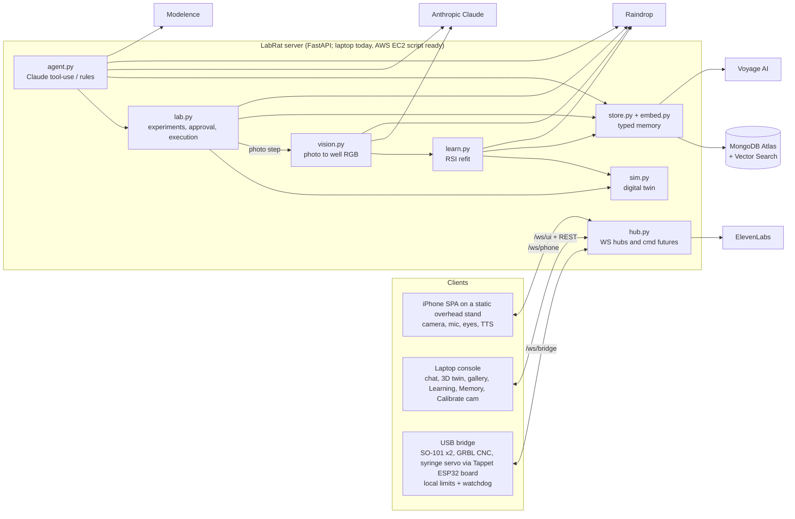

# LabRat: hackathon submission

**One-liner:** LabRat is a voice-operated desk-lab agent. It simulates every experiment in a digital twin before touching a liquid, runs the best one on real robots, looks at the result through its own camera, and refits its simulator so the next prediction is better.

## Problem
Lab automation is either rigid, with scripted liquid handlers that never learn, or unsafe, with LLM agents driving hardware directly. Scientists want to say what they want ("the most orange well from red and yellow") and get a system that plans, checks itself before acting, and gets measurably better with every run.

## What it does
1. **Ask** by voice (an iPhone on a static stand above the deck, using ElevenLabs STT/TTS) or by chat in the laptop console.
2. **Recall** relevant typed memories through Voyage embeddings and MongoDB Atlas Vector Search.
3. **Design** N protocol variants (Claude, or a deterministic generator) and **simulate** each one in the digital twin: CNC timing, pipette volumes, tip reuse, Beer–Lambert dye mixing to RGB, and bounds/collision checks. Then score them.
4. **Select and approve.** Only a sim-passing variant can be queued, and it waits for human approval.
5. **Execute** through the USB bridge: 3018 CNC with a rack-and-pinion syringe pipette, plus an SO-101 gripper arm on each side of it.
6. **Observe automatically.** The CNC parks out of view and the server waits for a fresh frame from the overhead iPhone (no arm moves). A camera→plate homography (from 4 clicked wells) samples the target well, white-balanced against an empty well; Claude vision is the fallback. The result goes into the learning loop.
7. **Self-improve.** The loop refits the simulator's dye absorbance and pipette gain, adopts the new parameters only if prediction error drops, re-scores past variants, and promotes the protocol to procedural memory.

## Architecture

## Memory: four types (`server/labrat/store.py`, `MEMORY_TYPES`)
| type | written by | example | used for |
|---|---|---|---|
| **semantic** | `learn.observe` | "red+yellow at ratios [0.3,0.7] looked rgb(225,95,25); predicted rgb(240,140,40): real result was more red." | facts recalled while designing the next experiment |
| **episodic** | `lab._execute` | "Ran 'make orange' variant v3 … in 94 s on real hardware." | what happened, when, and with what score |
| **procedural** | `learn.observe` (only when the refit improved this run's prediction and rating ≥ 3) | "PROCEDURE for 'make orange': {params} → pick_tip …; aspirate …" | reusable protocols the agent can start from |
| **taxonomic** | `learn.seed_taxonomy` | device, reagent, labware and colour hierarchies | grounding names and categories |

All memories are Voyage-embedded (`embed.embed`) and retrieved with `store.recall` (Atlas `$vectorSearch` on index `memories_vector` with a `type` filter, falling back to cosine similarity in Python). The agent reaches them through the `recall` and `remember` tools.

## The RSI loop and its metric (`server/labrat/learn.py::observe`)
Each observation goes through these steps: (1) compare predicted with observed RGB; (2) fit dye absorbance with ridge least squares in absorbance space, pulled toward the previous params, plus pipette volume gain; (3) write a versioned `sim_params` doc that is **accepted only if the mean prediction error over all observations drops**; (4) re-score every past variant; (5) promote to procedural memory; (6) emit the `rsi.update` event (Mongo `events` plus Raindrop).
**Metric:** mean RGB Euclidean prediction error. These numbers come from a scripted local run of 3 observations for "orange", not from the physical plate. Run 1: 39.2 → 12.2 (accepted, 12 variants re-scored, procedure promoted). Run 2: 25.0 → 24.3. Run 3: 31.0 → 26.6. Per-run error dropped from 37.8 to 26.6 and from 44.2 to 30.3. The Learning tab charts error by version. `vision.py` makes the loop close without a human: `source="vision"` is stored on the observation.

## Sponsors: exact usage
| sponsor | where | what |
|---|---|---|
| **MongoDB Atlas + agent memory** | `server/labrat/store.py` (`Store.put`, `Store.remember`, `Store.recall`, `_bootstrap`) | Write-through collections: experiments, variants, runs, memories, events, sim_params, observations, camera_cal. Creates the Atlas Vector Search index `memories_vector` and queries it with `$vectorSearch` and a type filter. Falls back to in-memory storage. |
| **Voyage AI** | `server/labrat/embed.py::embed` | `voyage-3.5` embeddings for every memory and query. Falls back to hashed bag-of-words. **Status: key not yet set, so the hashed fallback is in use.** |
| **AWS** | `deploy/aws_ec2.sh`, `Dockerfile` | EC2 t3.small running Docker, with Caddy providing auto-HTTPS on `<ip>.sslip.io` (the iPhone needs HTTPS for camera and mic). Code and `.env` are shipped via a private S3 bucket and presigned URLs. **Status: script written, not yet deployed.** |
| **Raindrop** | `server/labrat/telemetry.py::track`, called from `agent.py`, `lab.py`, `learn.py` (`rsi.update`) and `vision.py` (`vision.observe`) | AI traces and events for each chat turn, tool call, sim, run, RSI update and vision observation. Uses the SDK when it is installed, otherwise REST. |
| **Modelence** | `server/labrat/telemetry.py::modelence`, called from `app.py` (session_start) and mirrored from every `track()` call | Session and event hook: POSTs `{app, session, event, data}` to `MODELENCE_URL` = Mission Control `https://labrat-mission-mv4c6k4pk66-prod.cloud.modelence.app/api/events`, bearer `MODELENCE_KEY` (= Modelence config `labrat.ingestKey`). |
| **ElevenLabs** | `server/labrat/voice.py::tts`, `::stt` | `eleven_flash_v2_5` TTS (mp3 sent to the phone) and `scribe_v1` STT for phone audio. |
| **Anthropic** | `server/labrat/agent.py` (`_anthropic_loop`, `_llm_variants`, `TOOLS`), `server/labrat/vision.py::llm_rgb` | Claude tool-use agent (12 tools), LLM-proposed variants, and a Claude vision fallback that reads well colour from the photo. A Fireworks Llama provider is also supported. |

Every integration degrades gracefully when its key is missing, so the demo never blocks.

## Hardware
Layout: the CNC in the middle, an SO-101 arm on each side, the iPhone on a fixed stand looking down at the CNC bed, and the laptop off to the side.
- 3018 CNC (GRBL 1.1) carrying a rack-and-pinion syringe pipette (CAD in `cad/syringe`) in the spindle clamp.
- The syringe servo (continuous rotation) is driven by PCA9685 channel 8 on an ESP32-S3 Tappet board (`tap_a`, our firmware in [`tappet/`](tappet/README.md)). The Tappet arms are optional and not part of the demo setup.
- 2× SO-101 arms (Feetech STS3215), `so_a` and `so_b`: plain manipulators with stock grippers, one on each side of the CNC.
- iPhone on a static stand (camera, mic, speaker, animated face); it never moves.
- A laptop running the USB bridge and console, a 96-well plate, a tip rack, and dye reservoirs.

## Safety and governance
- **Sim-before-actuation invariant:** `lab.request_run` refuses any variant whose simulation did not pass (volume caps, single-use tips, bounds and reach checks).
- **Approval gate:** runs start in `awaiting_approval` and need a click or voice "approve" (`lab.approve`). `LABRAT_AUTO_APPROVE` is off by default.
- **Local limits in the bridge** (`bridge/labrat_bridge/grbl.py`): soft limits X 0..300, Y 0..180, Z -45..0, feed caps, and a G-code whitelist (`ALLOWED`). SO-101 joint limits are enforced on the bridge side.
- **Watchdog** (`bridge/labrat_bridge/bridge.py`, `WATCHDOG_S = 3.0`): motion stops if the server link drops for more than 3 s. The **Abort** button issues a feed hold plus soft reset.
- **Learning is gated:** new simulator parameters are adopted only when they lower error, and every version is kept for audit and rollback.

## Real vs mocked (honest status)
- **Live integrations verified at 14:59 PDT on 2026-10-11** (each returned HTTP 200): Anthropic LLM, MongoDB Atlas, Raindrop (REST), ElevenLabs TTS, and Modelence (POST to `/api/events`).
- **Not yet live:** Voyage AI (no key set, so embeddings use the hashed bag-of-words fallback and recall quality is lower); physical hardware (SO-101s, CNC, pipette and its Tappet servo board) is not yet connected, so the bridge runs with `--mock`; AWS is not yet deployed (the server runs on the laptop).
- **Real:** the FastAPI server, agent, digital twin, RSI refit, typed memory, all sponsor clients (when keys are set), the bridge drivers for GRBL, SO-101 and Tappet, the phone SPA, the web console, the vision sampler (homography and white balance, tested on synthetic images) and the AWS deploy script.
- **Mock or partial:** every device has a `--mock` mode with the same code path, and the demo can run fully mocked. The deck coordinates and camera calibration must be done on site. The vision estimate is only as good as the lighting and calibration, and has not been validated against a spectrophotometer. The Claude vision fallback is untested against real plates. The RSI numbers above come from scripted observations, not a physical-run series.
- **Tests:** `cd server && uv run --group dev pytest -q` covers the sim, end-to-end (fake bridge and UI), and vision (synthetic plate, homography, white balance, auto-observe into RSI).

## Team and links
- Repo: https://github.com/JacobFV/labrat
- Hardware (Tappet arms and firmware): [`tappet/`](tappet/README.md) in the same repo (merged from the former `JacobFV/tappet` repo, which is archived)
- Team: Jacob Valdez (JacobFV)
- Demo script: [DEMO.md](DEMO.md) · System design: [docs/ARCHITECTURE.md](docs/ARCHITECTURE.md) · Protocol tables: [CONTRACT.md](CONTRACT.md)
