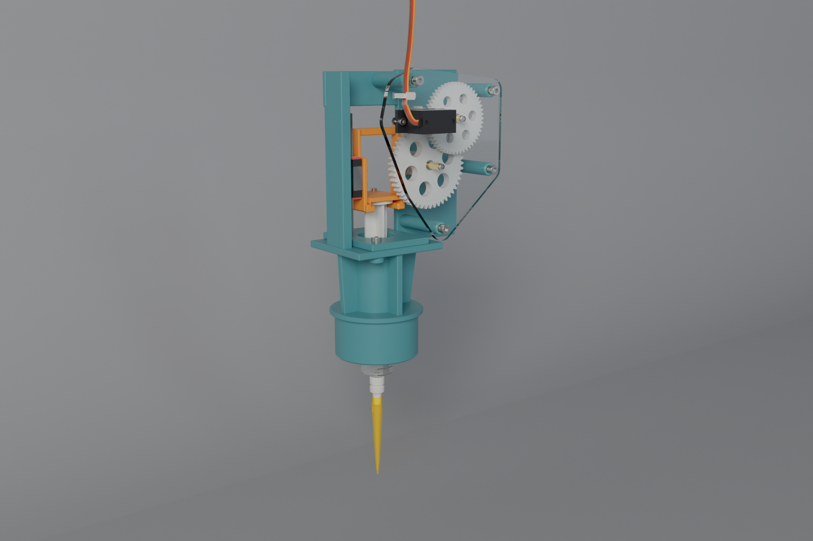

# 3018 syringe head (v1.0): 12:1 geared rack and pinion



This head replaces the 3018's spindle motor. A disposable 12 mL luer-slip syringe hangs in the 52 mm spindle clamp,
coaxial with the old spindle. A turned adapter carries a 200 µL tip on the syringe's luer nozzle. A continuous-rotation
FS90R servo drives the plunger through a **12.01:1 printed gear train** and a rack on an **MGN7 linear guide**.

The design is parametric **build123d** in [`syrhead/`](syrhead), and every exported file is generated from it. Each part has a
part number, material, process and, for purchased parts, a vendor family; purchased parts are modelled as the product
itself. The project uses the design-check and Cycles-render pipeline of `~/Documents/microfab_3d_atlas_bundle`, with
the same rules: real fasteners into real receivers, a purpose for every hole, sweeps of every pose, and photographs
that someone has looked at.

| | |
|---|---|
| plunger travel | 30 mm (7.5 mL of the 12 mL syringe; bore 17.8 mm estimated → **249 µL/mm**) |
| drive | FS90R → G1 17T : G2 50T (m0.8) → G3 12T : G4 49T (m1.0) → G5 12T pinion (m1.0, r 6 mm) → rack |
| ratio | **12.01 : 1** (17:50 × 12:49) → **0.50 mm of plunger per servo radian**, ≈ 2.17 µL per servo degree (18× finer than v0.2) |
| speed | ≈ 5.8 mm/s at the servo's 110 rpm no-load; ≈ 1.4 mm/s at the default 25 % command |
| pressure angle | 25° throughout (12T pinions mesh with 49T and the rack without undercut interference) |
| contact ratios | 1.38 (G1/G2), 1.36 (G3/G4), 1.42 (G5/rack), including the 0.08 mm backlash centre-distance offset |
| guide | HIWIN MGN7 rail L70 + MGN7C block; the rack and thumb-disc clamp are one printed carriage on the block |
| shafts | Ø3 m6 dowels supported at both ends (laser-cut acrylic cover / printed back plate), 4× MR63ZZ, brass spacers |
| tip height | tip end **60.0 mm** above the bed at CNC z = 0 (the twin's `SAFE_H` and the simulator's Z table) |
| tip XY | on the spindle axis: `deck_cal` `pipette_offset` = 0, 0, 0 |

## Parts
This is a summary. [`bom.csv`](bom.csv) has the full list with quantities, vendors and costs.

**Make (FDM PETG, 0.2 mm layers, 6 walls):**
- `SYR-100` **head body**:
  - Ø50.2 plug filling the clamp's full 26 mm, with a lip that sets the height;
  - syringe bore, and a flange table with a 1 mm locating pocket;
  - MGN7 rail spine with five M2 inserts;
  - back plate carrying the two dowels and four cover standoffs (M3 inserts);
  - top bar.
  - Prints upright with tree supports under the lip and the table.
- `SYR-102` **flange clamp**: two M3×10 screws clamp the finger flange into the table pocket.
- `SYR-103` **plunger carriage**, one ring frame:
  - a jaw with a 1 mm disc pocket and a fork for the rod;
  - a plate on the MGN7C (4× M2×4);
  - a top bridge;
  - an m1 25° rack with 0.04 mm backlash per flank.
  - Printed on its side so the rack teeth lie in the XY plane.
- `SYR-105` **thumb-disc cap**: two M2×8 screws into the jaw's rear block. Its 0.9 mm pocket lands on the disc and
  clears the jaw by 0.1 mm, so tightening the screws clamps the disc with zero backlash.
- `SYR-110` **G1** 17T m0.8, 4.4 wide, on the servo's cross horn. The horn arms are trimmed to r = 4.6 mm and sit in a
  pocket. A 0.3 mm recess clears the servo's output tower by 1.1 mm. An M2×5 screw goes through G1 and the horn into
  the output spline.
- `SYR-111` **G2/G3**: compound 50T m0.8 + 12T m1, on two MR63ZZ, with lightening holes.
- `SYR-112` **G4/G5**: 49T m1 + 12T m1 output pinion on a 10.5 mm hub, on two MR63ZZ.

**Make (other processes):**
- `SYR-101` **gearbox cover**: 3 mm cast acrylic, laser cut from [`dxf/SYR-101.dxf`](dxf). It carries the servo (tabs on
  its front face, 2× M2×8 + nuts), the dowels (slip fit) and 4× M3×8 into the standoffs, plus a cable-tie slot pair
  for the servo lead.
- `SYR-104` **luer-to-tip adapter**, turned POM. A bare luer slip nozzle (Ø3.9–4.4) cannot seal in a 200 µL tip
  (rim ID ≈ 5.4), so the adapter has a female ISO 80369-7 socket and a 5.8→4.6 cone that the tip seals on.
- `SYR-130-*` **bearing spacers**, cut from Ø4 × 0.45 brass tube (K&S 9220) and deburred. They bear on the bearing
  inner rings only.

**Buy:**
- Feetech FS90R servo;
- 12 mL luer-slip syringe;
- 200 µL tips;
- HIWIN MGNR7 L70 rail + MGN7C block;
- 4× MR63ZZ bearings;
- 2× ISO 2338 3m6×40 dowels;
- ruthex heat-set inserts: 7× M2×4, 6× M3×5.7;
- ISO 4762 A2 screws: M2×4/5/6/8, M3×8/10;
- 2× ISO 4032 M2 nuts;
- one cable tie.

## Assembly
1. **Inserts.** Heat-set the inserts (ruthex, at 230 °C):
   - body: 2× M3 in the table, 5× M2 in the spine, 4× M3 in the standoffs;
   - carriage: 2× M2 in the jaw.
2. **Rail.** Screw the MGN7 rail to the spine (5× M2×6), sliding the block aside to reach each hole. Bolt the carriage
   to the block (4× M2×4, short hex key from the right).
3. **Syringe.** Drop the barrel through the table into the bore, with the flange flats along Y. Fit the flange clamp
   (2× M3×10).
4. **Plunger.** Draw the plunger up, slide the thumb disc into the jaw pocket from the front, and fit the cap
   (2× M2×8).
5. **Adapter and tip.** Press the adapter onto the luer nozzle with a quarter turn, then push a 200 µL tip onto the
   adapter cone.
6. **Gear train.** Press each bearing pair into G2/G3 and G4/G5.
   - Press the dowels into the back plate.
   - Stack the rear spacer, gear and front spacer on each dowel.
   - G5 meshes the rack, G3 meshes G4.
7. **Servo.** Mount it on the cover:
   - Trim the cross horn to r = 4.6, press it on the spline, and seat G1 over it with the M2×5 horn screw.
   - Push the servo through the cover cut-out from the front, with its tabs on the cover; fit 2× M2×8 with nuts
     behind the cover.
8. **Cover.** Fit the cover over the dowels so G1 meshes G2, and fix it with 4× M3×8. Route the lead through the
   cable tie to the Tappet board's PCA9685 ch 8.
9. **Into the machine.** Remove the spindle motor and its sleeve, drop the plug into the 52 mm clamp until the lip sits
   on the clamp's top face, and tighten the clamp.
10. **Calibrate.** Follow [`../../bridge/README.md`](../../bridge/README.md): neutral, direction, speed, backlash and
    volume.

## Checks
The build fails if any of these checks fails.

**`python -m syrhead.build`** (pure build123d; also runs in CI) writes `report.json`:
- **spec:** tip height, ratio, mm per servo radian, stroke volume, contact ratios, rack coverage of the stroke with ±1.5
  pitch, and jaw clearance above the flange clamp.
- **mesh:** the coupled drive train (rack → G5/G4 → G3/G2 → G1) swept over the stroke with exact OCCT booleans. Every
  mesh must have zero overlap **and** stay engaged, with a working gap of ≤ 0.35 mm. The measured gaps are
  0.04–0.05 mm.
- **sweep:** every moving part against every static part and every other motion group, over 25 poses. The only
  exceptions are contacts the design declares: bearings on pins and spacers, stopper in the barrel, block on the rail.
- **machine:** clearance to the 3018:
  - above the Z-stepper line, nothing goes further back than y = 16.5 (the stepper's front face is at 26);
  - beside the Z plate, y ≤ 28.

**microfab checks** (`python -m syrhead.check_mf` with microfab's venv; results in [`mf_checks.json`](mf_checks.json)).
Current result: **0 errors**. The warnings are the three reviewed FS90R hole warnings and FDM overhang notes. The
suite covers:
- static interference of every pair;
- fastener stacks: clearance, receiver tap or insert, thread engagement ≥ 1 d, head seating;
- every hole has a fastener or a declared purpose;
- joint sweeps at 401 poses with 1 mm running clearance;
- geometry (walls, slivers);
- manufacturability;
- edge breaks: every printed outer edge is chamfered 0.4–0.5 mm, with smaller retries where 0.4 mm won't fit.

[`checks.yaml`](checks.yaml) holds the head's short lists, each with a reason:
- permitted sharp edges: the laser-cut cover, tube-cut spacers, gear and rack teeth;
- accepted problems: one entry, the rack-teeth walls;
- reviewed warnings: the FS90R's own Ø2.2 tab and horn holes, and FDM overhangs printed with supports.

## Files

| path | |
|---|---|
| `step/` | STEP for every make part, plus `syringe_head_assembly.step` (all parts at pos 0) |
| `stl/` | FDM parts in print orientation; `plate_fdm.3mf` holds the small parts (the body prints alone) |
| `dxf/SYR-101.dxf` | cover cut profile |
| `bom.csv` | bill of materials, rolled up by product |
| `twin/` | meshes per motion group and finish, and `rig.json` (pivots, motion per mm), for `../cnc3018` and the web twin |
| `renders/` | Cycles stills (microfab pipeline: Blender 4.0 CUDA, OIDN, AgX, metered exposure) |

## Rebuild

```bash
cd cad/syringe
# exports + checks (pure build123d)
uv run --python 3.12 --with build123d==0.13.0 --with bd_warehouse==0.4.0 --with trimesh --with networkx \
    --with lxml --with numpy --with pyyaml python -m syrhead.build
# microfab design checks + photoreal renders (needs ~/Documents/microfab_3d_atlas_bundle and its venv)
MF=~/Documents/microfab_3d_atlas_bundle/.venv/bin/python
$MF -m syrhead.render --quality final        # studio + bench stills -> renders/
cd ../cnc3018 && uv run --python 3.12 --with build123d --with trimesh --with matplotlib --with numpy \
    --with networkx --with lxml python cnc3018.py   # 3018 GLB + web/models/syringe_rig.json
```

## Still open
- **Measurements.** `spec.py` marks what is measured and what is assumed.
  - Measured: barrel OD 20.2 and barrel length 80.
  - To measure: bore (17.8 assumed), flange 34×24×2.2, disc Ø20×2, rod span 15, and the stopper-bottomed disc height (8).
- **Clamp fit.** The plug is 50.2 mm in the repo's 52 mm clamp, which leaves 0.9 mm radial. Shim it, or set `plug_od`
  to your bore − 0.3.
- **Force.** At full duty, the FS90R's stall torque × 12 ÷ 6 mm is about 280 N at the rack. That is more than the
  printed m1 teeth (≈ 100 N for PETG, 6 mm face) or the syringe should see. The bridge homes at 12 % duty and moves at
  25 %. Keep the servo current-limited, or add a slip clutch, before running unattended.
- **FDM tolerances.** Bearing pockets, dowel seats and insert holes are modelled at their nominal sizes (press fits).
  Print a test coupon for your printer and adjust `parts.py` (`M2_INSERT`, `M3_INSERT`, `S.brg_D`).
