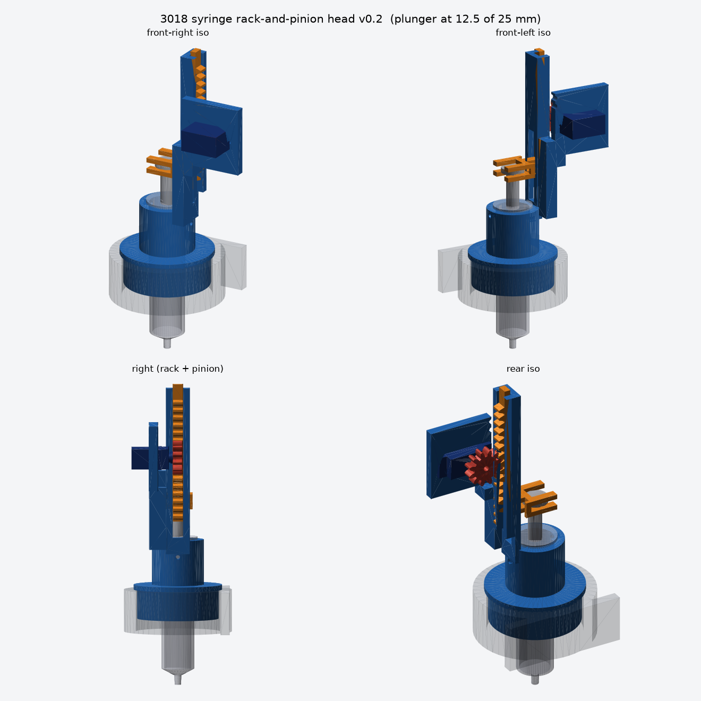

# 3018 syringe rack-and-pinion head (v0.2)

This is a parametric spindle replacement for the 3018 CNC. The design has three printed parts, defined in
`syringe_3018_rack.py` (CadQuery):

- `mount_body`: **one rigid printed part**. It has:
  - a 50.2 mm spindle-shaped plug with a lip that rests on the clamp top;
  - a 20.75 mm syringe bore and an upper retention collar with 2× M3 pilot holes (barrel set screws);
  - a vertical rack guide with a window for the fork;
  - the SG90-class servo plate (cut-out + 2 tab screw holes) with gussets.
- `rack`: slides vertically in the guide. Two fork plates capture the plunger thumb disk, so it pushes **and** pulls.
- `pinion`: module 1.5, 12 teeth (pitch radius 9 mm), involute flanks. It has a pocket on its back face for the stock
  single-arm horn **trimmed to ≤ 6.8 mm from its centre**, and a Ø3.1 hole for the horn screw. It is not a printed
  spline.

Outputs:
- `step/{mount_body,rack,pinion}.step`: editable solids.
- `step/assembly.step`: the parts plus mock syringe, plunger, servo and clamp.
- `stl/*.stl`, plus `stl/mock_*.stl`, which `../cnc3018/cnc3018.py` uses.
- `plate_syringe.3mf`: all three parts on one 220×220 plate, in print orientation.
- `assembly.glb`, `preview.png`, `report.json`.

## Checks (`report.json`; the build fails on any of them)
- All printed solids are valid. There is zero overlap between body/rack/pinion, servo/body/pinion/rack,
  syringe/body/rack, and clamp/body.
- **Kinematic sweep:** 11 positions over the stroke. The rack moves down and the pinion rotates by `travel/r`, with zero
  rack/housing and rack/pinion overlap. The center distance gives 2.8 mm of working depth, so the gears are meshed, not
  just apart.
- The plunger rod and head move with the rack and never touch the fork (6 positions). The head stays captured in the
  fork gap. At full stroke the fork stays 5.2 mm above the barrel flange.
- The syringe flange's envelope can drop in from the top without hitting the body (insertion path).
- **Servo stack** (SG90: tab 2.5, gearbox 4.3 above the tab, spline 8.3 above the tab): the horn arm sits inside the
  pinion pocket, and the pinion stays ≥ 2 mm off the gearbox top (asserted).

### Fixed in v0.2 (found by the new checks)
1. The syringe finger flange (Ø24) hit the rack guide wall at x = 11, so the syringe could not be inserted. The rack,
   guide, gussets and servo plate moved 2 mm outward (`guide_wall_x0 = 13`, `rack_rib_x = 17`, `rack_root_x = 20.5`).
2. The fork entry slot stopped at x = 1.2, but the plunger rod reaches x = 3.8. The slot now runs to the rod radius + 0.8.
3. With real SG90 dimensions, the servo's gearbox top overlapped the pinion. The plate moved 2.6 mm back
   (`plate_y1 = −12.6`), and `gear_back_y` follows from the horn stack.
4. The horn pocket (±8 mm) cut into the tooth roots. It is now ±6.8 mm, inside the root circle.
5. `plug_len` went from 42 to 18, so the tip ends at the twin/simulator safe height. The plug fills the top 18 mm of the
   26 mm clamp.

## Parameters
Edit `Params` at the top of the script.

Syringe:
- `syringe_barrel_od = 20.2` and `syringe_barrel_len = 80` are your measurements.
- These are **assumed** values; measure them before a final print:
  - `syringe_head_d = 14` and `syringe_head_thickness = 3` (thumb disk);
  - `syringe_rod_d = 7.6`;
  - `syringe_flange_d = 24.2`;
  - `syringe_plunger_protrusion = 35`;
  - `syringe_stroke = 25`.

Machine: `spindle_plug_od = 50.2` (as requested) and `machine_clamp_id = 52`.

## Actuation
- Travel is `θ × 9 mm`, so 25 mm of stroke takes about 159° of pinion rotation.
- The servo is continuous-rotation, so the bridge commands **speed** and dead-reckons the position. It re-zeroes against
  the bottom stop (`home`) and takes camera/NN estimates through `observe`. See [`../../bridge/README.md`](../../bridge/README.md).
- Force: an SG90 stalls at about 0.15 N·m, which is about 16 N at the 9 mm pitch radius, before friction.
- Volume: the bore is about 17.8 mm, which gives about 250 µL per mm of plunger. A 50 µL aspirate is a 0.2 mm move. That
  is too fine for open-loop timing. Close the loop with the camera, or use a smaller syringe (it is all parametric).

## Assembly
1. Print `plate_syringe.3mf` in PETG or PLA. The body prints upright and needs supports under the servo plate and the lip.
   The rack and pinion lie flat.
2. Trim the servo's single-arm horn to ≤ 6.8 mm. Press it into the pinion pocket and keep the horn screw handy.
3. Push the servo through the plate cut-out from the pinion side (+y, which faces the machine's back). The body hangs
   out toward the front, the tabs sit on the plate face, and the shaft points +y. Fit the tab screws.
4. Drop the empty barrel into the bore from the top until the flange sits on the collar. Fix it with 2× M3 set screws
   (pilot holes are Ø2.8).
5. Slide the plunger thumb disk sideways into the rack fork. Lower the rack into its guide from the top while the plunger
   enters the barrel.
6. Press the pinion and horn onto the spline so it meshes with the rack, then fit the horn screw.
7. Remove the spindle motor and its 52→44.5 sleeve. Drop the plug into the clamp until the lip sits on the top face.
   Tighten the clamp (shim if needed; see below).
8. Calibrate the servo (bridge README), then press a 200 µL tip onto the luer nozzle.

## Still open before relying on it
1. **Clamp fit.** The plug is 50.2 mm, but the clamp in `cnc3018.py` is 52 mm (0.9 mm radial gap). Wrap it with a
   0.9 mm shim, or set `spindle_plug_od` to your measured bore minus 0.3.
2. **Servo and horn.** SG90 clones differ. Measure the tab hole pitch (`servo_tab_hole_pitch = 28`), the body size and
   the horn.
3. **Syringe.** Measure the thumb disk, rod section and flange, and the real stroke (see Parameters).
4. **Printed clearances.** The checks are CAD booleans. They do not cover FDM tolerances, backlash, guide friction or
   the stall current of the servo. Test dry, then with water, at low speed, before any CNC motion.
