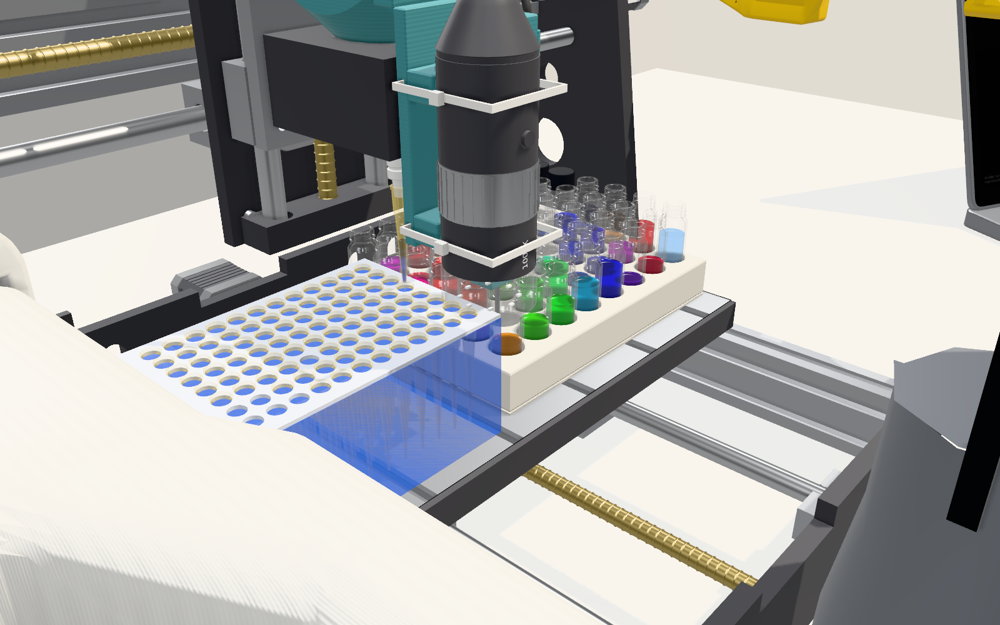

# LabRat architecture

How the pieces fit, written from the code in `cloud/`, `apps/`, `bridge/` and `firmware/`. When the code and this
page disagree, the code is right: fix this page. The wire messages are specified in [protocol.md](protocol.md); this
page does not repeat them.

## 1. Components

| Piece | Code | Runs on | Role |
|---|---|---|---|
| **Coordinator** | [`cloud/`](../cloud): one Cloudflare Worker, one Durable Object (`Lab`, a single instance named `lab`), one D1 database | Cloudflare (or `wrangler dev` on the laptop) | WebSocket hub, REST API, experiments (dry run, run, results), agent, colour model, notebook, the logical devices (pipette, probe arm, phone stand). Also serves the browser apps as static assets |
| **Console** | [`apps/console/`](../apps/console) (`app.js`, `twin.js` + `twin/`, `deck.js`, `camera_cal.js`) | laptop browser, `/console/` | experiments (plate map, sample table, run, approve, results, CSV), chat, three.js digital twin with 3D replay, notebook, model, deck / camera / device calibration |
| **Phone** | [`apps/phone/`](../apps/phone) (`phone.js`, `face.js`, `voice.js`, `hub_ble.js`, `hub_proto.js`) | phone on the pan/tilt stand, `/phone/` | animated face, camera frames, on-device voice (Web Speech recognition and synthesis). With the servo hub paired over Web Bluetooth it is also a device provider |
| **CLI + Python** | [`apps/cli/`](../apps/cli) (`uv run labrat`, `from labrat_cli import Lab`) | terminal, scripts | REPL over `/ws/ui` and REST, and a small Python client for experiment scripts ([`experiments/`](../experiments)) |
| **Bridge** | [`bridge/`](../bridge) (`python -m labrat_bridge`) | laptop with the USB devices | dials out to `/ws/bridge`, drives the SO-101 arms, the GRBL CNC, the USB microscope and the servo hub over serial, with local limits and a watchdog. Every device has a mock |
| **Servo hub firmware** | [`firmware/servo-hub/`](../firmware/servo-hub) (PlatformIO) | ESP32 / ESP32-S3 + PCA9685 | a generic 16-channel servo and input hub speaking JSON lines over USB serial and BLE. It knows nothing about pipettes or stands |
| **Hardware** | [`hardware/`](../hardware) | | tool head, deck, 3018 model, phone stand, SO-101 parts, electronics |

Anthropic's Messages API is the only outside service. Without `ANTHROPIC_API_KEY` a rule-based agent answers and vision
falls back to the calibrated sampler only.

## 2. Topology

```
 apps/console ──┐
 apps/cli ──────┼── wss /ws/ui ──┐
                │                ▼
 apps/phone ────┴── /ws/phone ─► Lab DO ◄── /ws/bridge ── bridge (laptop) ─┬─ so_a, so_b  SO-101 (Feetech bus, 1 Mbps)
   face, voice, camera,          │  + D1                                   ├─ cnc         3018 GRBL 1.1
   optional BLE → hub            │                                         ├─ microscope  UVC
                                 ├─ Anthropic Messages API                 └─ hub ── USB serial ─┐
                                 │  (agent,                                                      │
                                 │   vision fallback)                 servo hub (ESP32 + PCA9685)◄┘ (or BLE from the phone)
                                                                       ch0 syringe, ch1 probe arm, ch2/3 stand pan/tilt
```

Everything dials out to the DO, so nothing needs an inbound port. The Worker (`cloud/src/index.ts`) checks the token on
every `/api/*` and `/ws/*` request (`?token=`, `Authorization: Bearer`, or `x-labrat-token`; default `labrat`),
forwards `/healthz`, `/api/*` and `/ws/*` to the DO, redirects `/` and `/console` to `/console/`, and serves everything
else from `apps/` (`apps/.assetsignore` keeps the CLI and Python files out). Unauthenticated sockets are accepted and
closed with 4401.

## 3. Inside the Durable Object

Source map: [`cloud/README.md`](../cloud/README.md). Requests reach the DO's route table (`do.ts`); `hub.ts` routes
device commands to providers; `lab.ts` runs experiments on top of `sim.ts`, `learn.ts` and `vision.ts`.

### Providers

A provider is any non-UI socket that sent `hello`. The bridge is one; the phone becomes one when it has the hub paired.
Provider sets survive DO hibernation through the sockets' serialized attachments (their `hello`), and device state comes
back with the next `state` message. A provider that closes marks its devices `offline` (unless another provider also
offers them) and fails its pending commands.

### Persistence

D1 (`cloud/migrations/0001_init.sql`):

| table | contents |
|---|---|
| `experiments` | title, status and the full JSON document (samples, steps, dry-run check and predictions, run log; never frames). See [experiments.md](experiments.md) |
| `results` | one beaker reading: experiment, well, measured RGB, rating, note, source (`operator` / `camera`), what went in, the prediction at the time |
| `notes` + `notes_fts` | the lab notebook; FTS5 (porter), bm25-ranked search. Results write an auto-note |
| `model` | colour-model versions; the newest accepted row is installed at boot |
| `events` | audit log (`chat`, `tool`, `experiment_*`, `measure`, `model_refit`, `deck_teach`, `calibrate`, `device_event`, `provider_hello`, ...), trimmed to 5000 rows at boot |
| `config` | `deck_cal`, `camera_cal`, `cal:pipette`, `cal:probe`, `cal:stand` |

DO storage holds the agent's chat history and each logical device's last state (dead-reckoned plunger position, probe
and stand angles). Sim frames are never stored: the simulator is deterministic, so frames are re-simulated on request.

## 4. Devices

Provider devices (bridge or phone): `so_a`, `so_b` (SO-101), `cnc` (GRBL), `microscope` (UVC), `hub` (servo hub,
raw `line` passthrough). The DO adds three logical devices on top of `hub` (`cloud/src/devices/`):

| id | file | channel | what |
|---|---|---|---|
| `pipette` | `pipette.ts` | 0, FS90R continuous | syringe pipette. No position feedback: the plunger is dead-reckoned from calibrated speeds, every drive is a firmware-timed `pulse {ms}` so its length does not depend on network latency, `home` drives into the bottom stop with `until: "syr_home"`, and `observe` accepts an outside estimate. Defaults in `PIPETTE_DEFAULTS` |
| `probe` | `probe.ts` | 1, SG90 positional | swings the capacitive liquid-level probe down (`deploy`) and up (`retract`) |
| `stand` | `stand.ts` | 2 pan, 3 tilt | phone pan/tilt: `aim {pan, tilt}` relative to the deck-centre view, `look {at}` computed from the stand geometry in `cal:stand` (defaults from `hardware/phone-stand/stand.json`) |

`base.ts` serialises each device's actions (`stop` and the pipette's `observe` skip the queue), sends the channels'
`cfg` before the first hub command and again after the hub reconnects, reboots or trips its watchdog, persists state
after every action, and turns a firmware `ok:false` into an error. Calibration defaults live in the source and are
overridden by the D1 `cal:<id>` rows (`/api/cal/{id}`).

Rules enforced in `hub.cmd` (details in [protocol.md](protocol.md)):

- `cnc.probe` is refused unless the probe arm is deployed; the arm is retracted after every probe cycle.
- Before any CNC command that can go below safe Z (`move` with `z < 0`, `jog` with `dz < 0`, any `gcode`) the arm is
  retracted unless it is known to be retracted.
- An experiment's photo step parks the head, runs `stand.look {at: "deck"}` (when a hub is connected), sends
  `{"t":"snap"}` to the phones and waits for a frame newer than that.
- A hub `estop` event aborts everything; `wd` / `boot` events make the drivers resend their channel `cfg`.

`stand.look operator` turns the phone's screen (its face) toward the operator, so the camera points away from it.

## 5. Agent

`agent.ts`. One turn at a time (serialised); input comes from the phone (`{"t":"text"}`, recognised on the device),
the console or CLI (`{"t":"chat"}`), or `POST /api/chat`.

- **LLM loop.** With a key: the Messages API with the system prompt (bench layout, deck, reagents, how experiments
  work) and tools: `list_devices`, `look`, `search_notes`, `add_note`, `list_experiments`, `get_experiment`,
  `new_experiment` (the model writes the samples itself), `run_experiment`, `move_arm`, `cnc_move`, `tool`, `pipette`,
  `stand`, `say`. Up to 10 tool rounds per turn; the last 12 history turns are sent. `look` returns the phone frame as
  an image block. Model: `ANTHROPIC_MODEL` (default `claude-sonnet-5-5`).
- **Rule fallback.** No key, or an LLM error for this turn: regex rules cover make / mix a colour (a ratio sweep),
  run, approve, abort, home, look, status, note and recall.
- **Output.** The reply goes to the UIs as `chat`, to the phone as `transcript` and `say` (the phone speaks it with
  speech synthesis), and the face goes thinking → speaking → idle.

## 6. Simulator and digital twin

`sim.ts`, deterministic; every experiment is dry-run on it before anything moves ([experiments.md](experiments.md)):

- **Deck** (machine mm; source of truth [`hardware/deck/deck.json`](../hardware/deck), checked by
  `cloud/test/sim.test.ts`): FT-200L-RS tip rack 8 × 12 on 9 mm with A1 at (17, 19.25); printed beaker matrix 6 × 8 of
  15.3 × 50 mm beakers on 19 mm with A1 at (153.25, 32). Columns 1–7 are the mixing beakers (`plate`, A1–F7, 5 mL
  each); column 8 holds the stocks A8 water, B8 red, C8 yellow, D8 blue (4.5 mL each). Waste (280, 170), eject bar
  (10, 170).
- **Z:** the tip end is 55 mm above the bed at z = 0 and the beaker rims are at 51.2. Safe 0, dispense −9, aspirate /
  mix −45. Bounds X 0..300, Y 0..180, Z −45..0. The tip only reaches liquid while a beaker holds about 1.2 mL
  (`REACH_UL`). Tip pick-up does not fit the 3018's Z travel with this rack ([`hardware/deck`](../hardware/deck/README.md)),
  so `Z_TIP` is the travel limit until real `tip_rack` points are taught.
- **Ops:** `pick_tip`, `aspirate`, `dispense`, `mix`, `eject_tip`, `photo`, `wait`. `stepsFor(samples)` builds them: one
  tip per stock dispensing from above, a fresh tip per mix, a photo at the end.
- **Motion:** trapezoidal timing (400 mm/s², 3000 mm/min XY, 600 mm/min Z); the pipette at 100 µL/s.
- **Liquid and colour:** per-beaker composition in µL per dye; colour by subtractive Beer–Lambert mixing from per-dye
  absorbance, with a pipette volume gain.
- **Checks** (any error makes the experiment a `draft`): out of bounds, XY travel below safe Z, tip reuse / contamination, tip
  overfill (200 µL), aspirating more than a source holds or below the reachable level, beaker overflow, liquid handling
  without a tip. Warnings (shown, not blocking): skipped mixes, ending with a tip.

The console's twin (`apps/console/twin.js`, `twin/`) loads `models/cnc3018.glb` and `models/syringe_rig.json`
(generated by `hardware/cnc3018/cnc3018.py` from the tool-head CAD), the upstream SO-101 URDF with decimated meshes,
and procedural labware, and is driven either by live `devices` state or by `sim` frames for replay.



## 7. Colour model

`learn.ts`, after new results (typed in, or measured by the camera):

1. Refit dye absorbance in absorbance space by ridge-regularised least squares (λ = 0.3, pulled toward the current
   values) over every reading so far.
2. Store a new `model` version; install it only if the mean prediction error over all readings drops.
3. If accepted, dry-run every experiment that has not run yet again. Experiments that ran keep the prediction they
   had, so results are always compared with what was predicted at the time.
4. Broadcast `model` to the UIs; `lab.addResults` also writes an auto-note with the readings.

**Measuring** (`vision.ts`): after a run with a photo step (`LABRAT_AUTO_OBSERVE=1`), the DO takes the first phone frame
captured after the photo step's park and reads every beaker of the experiment, either through the camera homography
(four clicked beaker centres A1, A7, F7, F1; median of a disk at each projected centre, white-balanced against an
empty beaker) or, without a camera calibration, by asking Claude for every beaker's RGB.

## 8. Calibration

- **Deck** (`deck_cal.ts`, console `deck.js`, CLI `/cal`): taught points are CNC coordinates of the pipette tip;
  spindle = tip − `pipette_offset` (default 0: the tip is on the spindle axis). Targets `tip_rack.A1/H12`,
  `plate.A1/F7`, the four reservoirs, waste, eject bar; teaching A1 and the far corner of a grid derives its pitch and
  rotation. Tool offsets (`tools`) put the microscope or probe over a target instead (`tooling.ts`).
- **Camera** (`vision.ts`, console `camera_cal.js`): `POST /api/camera_cal` with the four corner beakers' pixels.
- **Logical devices:** `GET/POST /api/cal/{pipette|probe|stand}` (`{reset:true}` restores the defaults).
- **Bridge-side:** SO-101 joint offsets, limits and poses in `bridge/calib/` (see [`bridge/README.md`](../bridge/README.md)).

## 9. Safety

- **No real run without a passing dry run** (`lab.requestRun`), **human approval** unless `auto` or
  `LABRAT_AUTO_APPROVE=1`, and one experiment at a time.
- **Abort** (`POST /api/abort`, UI `abort`, agent / rules "stop", hub e-stop button): flags the running experiment, fails
  every pending command, sends `stop` to `cnc`, `so_a`, `so_b` and the hub.
- **Probe-arm interlock** in the DO (§4).
- **Bridge limits**, enforced even if the DO is wrong: GRBL soft limits X 0..300, Y 0..180, Z −45..0; feed caps 1500 XY
  / 500 Z mm/min; a G-code whitelist with bounds checks; SO-101 joints clamped to their calibrated range.
- **Watchdogs:** the provider pings the hub every 1 s while its DO link is up; without a line for 2 s the firmware
  relaxes every servo by itself (`ev:"wd"`). The bridge also stops the CNC, holds the arms and stops the hub after 3 s
  without the DO.
- **Firmware:** a normally-closed e-stop input stops every servo in the firmware first, then reports `estop`; `pulse`
  with `until` always needs a bounded `ms`.
- **Timeouts:** every command has one (30 s default, 120 s max over REST); a provider disconnect fails its pending
  commands, which fails the experiment.
- **REST jog:** CNC only, ≤ 50 mm per axis.

## 10. Running and configuration

Commands: the [root README](../README.md#quickstart). Worker vars and secrets: [`cloud/README.md`](../cloud/README.md#run).
The phone needs a secure context for camera, microphone and Web Bluetooth: `localhost` works on the laptop itself; a
phone needs HTTPS (a deployed Worker, or a tunnel to `wrangler dev`).

## Endpoints

Route table: `cloud/src/do.ts` (`routeTable`), reached through `cloud/src/index.ts`. Every route except `/healthz`
needs the token. Request bodies are JSON; errors are `{"error": "..."}` with 400 / 401 / 404 / 409 / 500.

Static (Worker): `/` and `/console` → 302 `/console/` (query string kept); `/console/` → `apps/console`; `/phone/` →
`apps/phone`.

WebSockets ([protocol.md](protocol.md) §1–3): `/ws/ui`, `/ws/phone`, `/ws/bridge`.

| Method | Path | Body / query | Returns |
|---|---|---|---|
| GET | `/healthz` | | `{ok, error, bridge, providers, llm, d1}` (no token) |
| GET | `/api/state` | | the `devices` message plus `uis`, `llm_configured`, `has_frame`, `active` (experiments awaiting approval or running) |
| | `/api/experiments*`, `/api/results.csv`, `/api/dry_run`, `/api/notes`, `/api/model` | | see [experiments.md](experiments.md#rest) |
| POST | `/api/chat` | `{text}` | `{reply}` after one agent turn |
| POST | `/api/abort` | | `{ok:true}` after stopping everything |
| GET | `/api/events` | `?kind=&limit=100` (≤ 1000) | audit log |
| GET | `/api/deck_cal` | | calibration summary (offset, tools, points, targets, fitted grids, spindle coordinates) |
| POST | `/api/deck_cal` | `{pipette_offset?, tools?, points?}` (`null` point forgets it) | the summary |
| POST | `/api/deck_cal/teach` | `{target, pos?}` | `{target, spindle, tip, deck_cal}`; `pos` defaults to the CNC's current position (409 if unknown) |
| POST | `/api/jog` | `{device:"cnc", dx, dy, dz, f?}` | `{ok, pos}`; ≤ 50 mm per axis |
| POST | `/api/device` | `{device, action, args?, timeout?}` | `{ok, data}`; any provider or logical device, interlocks apply, timeout ≤ 120 s |
| GET | `/api/cal/{pipette\|probe\|stand}` | | `{device, cal, defaults, state}` |
| POST | `/api/cal/{pipette\|probe\|stand}` | a patch, or `{reset:true}` | `{device, cal}` |
| GET | `/api/camera_cal` | | the camera calibration, or `{corners:null}` |
| POST | `/api/camera_cal` | `{corners, image_w, image_h}` | the stored calibration with its homography |
| GET | `/api/camera_frame` | | the latest phone frame `{jpeg, w, h, ts}` (404 before the first) |
