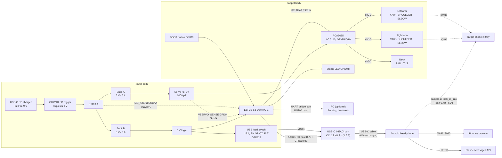
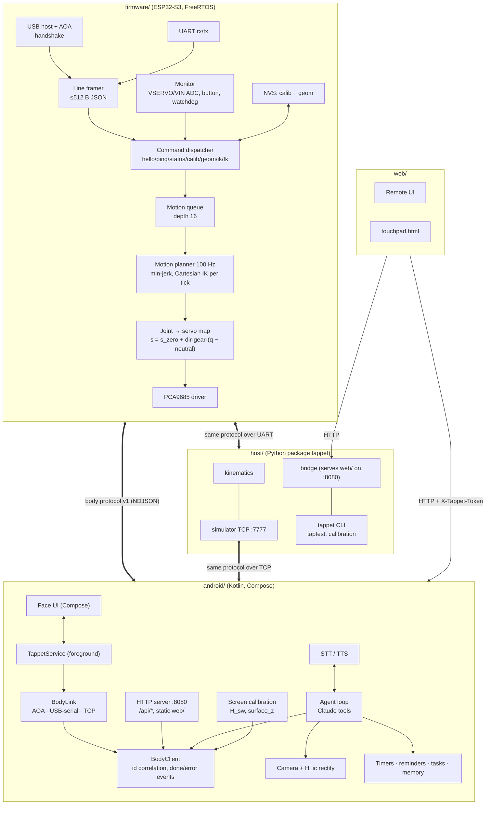
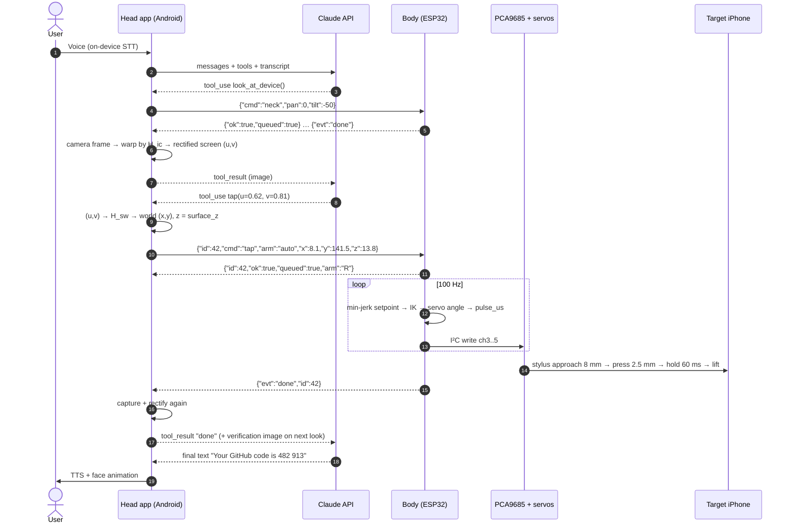
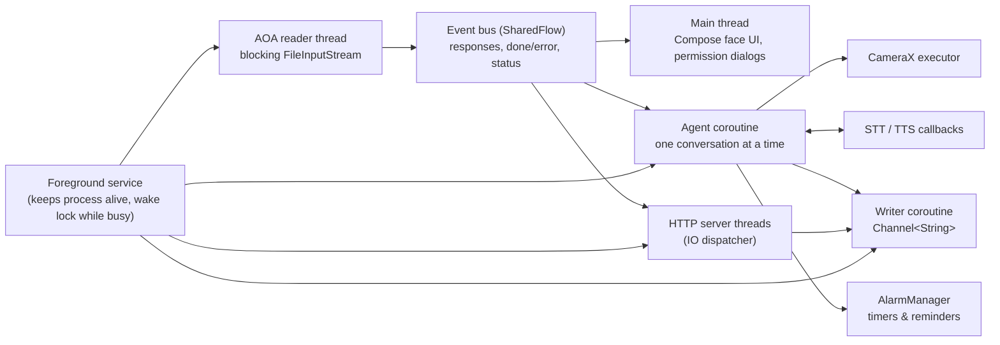

# Tappet — System Architecture

> Source of truth for numbers, pins, joint maps and protocol: [`SPEC.md`](SPEC.md) and
> [`config/robot.json`](../config/robot.json). This document explains *how the pieces fit*; if it
> ever disagrees with those two files, they win.

Tappet is a ~$99 desktop robot made of three cooperating computers:

| Device | Role | Supplied by |
|---|---|---|
| **Android phone ("head")** | Face display, camera, microphone, speaker, Wi-Fi, agent runtime (Claude), web server on `:8080`, screen-calibration math | User |
| **ESP32-S3 ("body")** | Real-time motion: IK, minimum-jerk interpolation at 100 Hz, servo PWM via PCA9685, safety (watchdog, brownout), USB host for AOA, charges the head | Tappet |
| **iPhone / any browser ("remote")** | Remote control web UI, `touchpad.html` for calibration and tap tests | User (optional) |

The **target device** (typically an iPhone) lies screen-up in the tray at `y = 160 mm` and is
*operated physically* by the two stylus arms. It can be the same iPhone that runs the remote web UI.

---

## 1. Hardware block diagram

Electrical details (schematics, netlist, power budget) live in
[`hardware/electronics/`](../hardware/electronics/). Mechanical CAD lives in
[`hardware/cad/`](../hardware/cad/).

## 2. Software block diagram

Key property: **one protocol, three transports.** The newline-delimited JSON body protocol
([SPEC §4](SPEC.md#4-body-protocol-esp32--host--v1)) is byte-identical over AOA bulk endpoints,
UART (115200 baud) and simulator TCP (port 7777). Any client (Android app, Python tools) can drive
the real robot or the simulator without code changes. Kinematics are implemented three times (C++,
Python, Kotlin) and pinned together by [`config/kinematics_vectors.json`](../config/kinematics_vectors.json).

## 3. Repository map

| Path | Contents | Doc |
|---|---|---|
| [`config/`](../config/) | `robot.json`, shared kinematics test vectors | [kinematics.md](kinematics.md) |
| [`firmware/`](../firmware/) | PlatformIO ESP32-S3 firmware + native tests | this doc §5.1 |
| [`android/`](../android/) | Head app | this doc §5.2 |
| [`host/`](../host/) | Python `tappet`: kinematics, client, simulator, bridge, calibration, taptest | [test-plan.md](test-plan.md) |
| [`web/`](../web/) | Remote UI, `touchpad.html` | [calibration.md](calibration.md) |
| [`hardware/cad/`](../hardware/cad/) | build123d CAD → `stl/`, `step/`, `renders/` | [assembly.md](assembly.md) |
| [`hardware/electronics/`](../hardware/electronics/) | Schematic SVGs, netlist, electronics BOM, power budget | [bom.md](bom.md) |

## 4. End-to-end data flow: "Hey Tappet, open Authenticator and read me the GitHub code"

Notes on the flow:

* **Coordinate chain.** The agent works only in normalized screen coordinates `(u,v)` (0..1,
  as a person holding the phone sees it). The head converts to world mm with the screen homography
  `H_sw` and `surface_z` ([calibration.md](calibration.md)). The body works only in world mm and joint
  degrees. Nothing upstream of the body ever sees servo angles.
* **Verification.** After each physical action the agent may call `look_at_device()` again. A tap is
  considered *unverified* if the rectified screen does not change within 1.5 s; the agent may retry
  once at the same point and then reports failure instead of looping. (Policy lives in the agent
  system prompt; see [safety.md](safety.md) for confirmation rules on irreversible actions.)
* **Latency budget (typical):** STT 0.5–1.5 s · Claude turn 1–4 s per tool round-trip · neck move
  0.3 s · camera + rectify 0.15 s · tap 0.6–1.2 s (target ≤ 1.5 s, see [test-plan.md](test-plan.md)).
  The LLM round-trips dominate; motion is never the bottleneck.

### Other flows

| Flow | Path |
|---|---|
| Remote tap from iPhone | Browser → `POST /api/tap {u,v}` (token) → head maps via `H_sw` → body `tap` |
| Jog / teach | Browser → `POST /api/jog {arm,dx,dy,dz}` → body `fk` + `move` → returns new `{x,y,z}` |
| Touch-probe calibration | `POST /api/calibrate/auto` → body taps 3×3 grid → `touchpad.html` posts `/api/touchpad/event` → DLT fit → new `H_sw` |
| Development | Android app or `tappet` CLI → TCP `:7777` → Python simulator (same protocol) |
| Flashing / bench | PC → DevKit UART port (115200) → same protocol; PlatformIO for firmware upload |

## 5. Threading / process model

### 5.1 ESP32-S3 firmware (FreeRTOS, dual core)

Exact task names are owned by [`firmware/`](../firmware/); the intended structure is:

| Task | Core | Priority | Period / trigger | Responsibility |
|---|---|---|---|---|
| `motion` | 1 | highest app prio | 10 ms tick (100 Hz) | Pop queue, min-jerk interpolation, Cartesian IK per tick, joint→pulse, PCA9685 I²C writes (8 ch ≈ 0.4 ms at 400 kHz) |
| `usb_host` | 0 | high | event-driven | Enumerate, AOA handshake ([SPEC §5](SPEC.md#5-aoa-android-open-accessory-handshake-firmware--android)), bulk IN/OUT, re-enumeration |
| `proto` | 0 | medium | on line received | Parse NDJSON (≤512 B), validate, run immediate commands, enqueue motion, emit responses |
| `uart` | 0 | medium | ISR + ring buffer | Same framer as AOA |
| `monitor` | 0 | low | 20 ms | ADC VSERVO/VIN (brownout < 4.3 V), BOOT button (short/long > 1.5 s), watchdog timer, LED, `stream` events |
| NVS writes | – | – | deferred | `calib_set`/`geom_set` with `save:true` are written outside the motion task |

Shared state (current joint targets, queue) is protected by a mutex; the motion task never blocks on
I/O other than I²C. Responses from all transports go to the transport that originated the request;
events are broadcast to all connected transports.

### 5.2 Android head app

* A single `BodyClient` owns request IDs and maps `{"evt":"done","id":n}` back to suspended callers,
  so the HTTP server and the agent can issue motion concurrently; the body serializes them in its
  queue.
* **Arbitration:** one "motion owner" at a time. A remote-UI command while the agent is mid-task
  pauses the agent (it receives a `user_interrupted` tool error) — the human always wins.
* The agent never blocks the main thread; TTS/STT callbacks hop to the agent coroutine.

### 5.3 Python host tools

`tappet` CLI commands are short-lived processes. The bridge (HTTP `:8080`, mirrors the head API) and
the simulator (TCP `:7777`) are single-process `asyncio` servers. See [`host/`](../host/).

### 5.4 Browser (remote)

Stateless pages. The remote UI polls `GET /api/status` (≈2 Hz) and fetches `camera.jpg` on demand.
`touchpad.html` posts every touch to `POST /api/touchpad/event` immediately (no token; LAN only).

## 6. Failure modes and recovery

| # | Failure | Detection | Automatic response | User-visible recovery |
|---|---|---|---|---|
| F1 | Head unplugged / AOA link drops | USB detach on ESP32; `UsbManager` detach on Android | Body: if enabled, watchdog parks + relaxes after 5 s without commands. App: link state `disconnected`, agent pauses motion tools | Replug; firmware re-runs AOA handshake; app auto-launches via accessory filter |
| F2 | Phone ignores AOA (no accessory mode) | `GET_PROTOCOL` fails or returns 0 | Retries 3×, then `phone_power` cycle (VBUS off 1 s) | Fallback transports: OTG USB-serial or TCP; see compatibility matrix in [test-plan.md](test-plan.md) |
| F3 | Servo rail brownout (< 4.3 V) | ADC on VSERVO_SENSE | `fault{code:"brownout"}`, motion paused, queue held | Check charger is PD ≥ 20 W at 9 V; reduce speed; resume with `enable` |
| F4 | Non-PD (5 V-only) charger | VIN_SENSE < ~8 V at boot | Refuse `enable`, report `fault`, keep head charging off | Use a PD charger (see [ADR-0007](decisions/0007-power-usb-c-pd.md)) |
| F5 | Host crash / Wi-Fi client vanishes mid-motion | Watchdog (`watchdog_ms` = 5000 default) | Park both arms, relax, emit `watchdog` | Automatic once host reconnects and sends `enable` |
| F6 | Target unreachable / joint limit | IK at enqueue | Reject with `unreachable` / `limit`; no motion | Tray shim / device profile wrong → recalibrate |
| F7 | Missed tap (no screen change) | Camera verification or `touchpad` silence | Agent retries once; repeated misses raise "calibration suspect" | Run touch-probe calibration ([calibration.md](calibration.md)) |
| F8 | Target phone shifted in tray | Corner homography residual grows; systematic offset in tap tests | Agent asks user to re-seat phone | Re-seat, shims; recalibrate |
| F9 | Servo stall / jam (arm blocked by hand, cable) | Rail current sag visible as VSERVO dip; position cannot be sensed directly | Brownout path if severe; motion times out normally | Press BOOT (toggle relax), clear obstruction, `home` |
| F10 | PCA9685 not responding | I²C NACK | `fault{code:"i2c"}`, refuse `enable` | Reseat wiring, power-cycle |
| F11 | Corrupt / missing NVS calibration | CRC/version check at boot | Load compiled defaults from `robot.json` | Re-run servo trim |
| F12 | Claude API error / no internet | HTTP error / timeout | Agent speaks a short error; local tools (timers, tasks) still work | Check Wi-Fi / API key |
| F13 | Head overheating (charging + camera + screen) | Android thermal status API | Dim face, lower camera rate; at "severe" → `phone_power on:false` (stop charging) | Ventilation; lower brightness |
| F14 | Head VBUS over-current | PHONE_VBUS_FLT (GPIO15) low | Switch latches off, `fault{code:"vbus"}` | Replug cable; check cable damage |

Design principles behind the table:

1. **Fail limp, not fast.** Every unhandled path ends in *park → relax*. Servos at 5 V with ≤ 2.2 kg·cm
   cannot hurt a person, but a relaxed arm also cannot scratch a screen.
2. **Body is authoritative for safety.** Limits, linkage constraint, brownout and watchdog are
   enforced in firmware regardless of what any host sends.
3. **Agent is never trusted with hardware.** It only sees `(u,v)` tools; all mapping and clamping is
   deterministic code.
