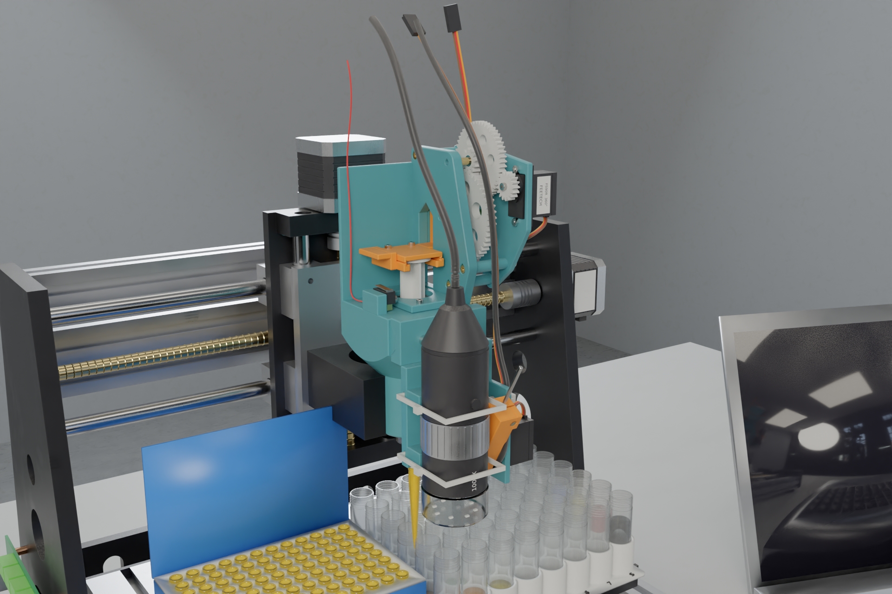

# Hardware

Everything physical on the LabRat bench. The CAD is parametric Python (build123d); every exported file (STEP, STL,
BOM, twin meshes, plates) is generated, so change the source and rebuild rather than editing outputs.

| Dir | What | Build / regenerate | Key files | BOM |
|---|---|---|---|---|
| [`tool-head/`](tool-head) | **Tool head** for the 3018's 42 mm spindle holder: a 12 mL syringe with a 200 µL tip, driven by an FS90R continuous servo through a 12.01:1 printed gear train and a rack that slides on its own back; a tool rail with a USB microscope (TM-110) and a capacitive probe on a servo arm (TM-120); a `syr_home` microswitch. Every printed part is support-free (checked) | `python -m syrhead.build` (exports + checks); optional microfab checks and Cycles renders. Commands in its [README](tool-head/README.md#rebuild) | `syrhead/` (source), `step/`, `stl/`, `tools.json` (tool offsets → `deck_cal` tools), `twin/` (meshes + `rig.json` for the 3018 model), `renders/` | [`tool-head/bom.csv`](tool-head/bom.csv) |
| [`deck/`](deck) | **Deck**: the printed 6 × 8 beaker matrix `DECK-001` (15.3 × 50 mm beakers; columns 1–7 mixing, column 8 stocks), the FT-200L-RS tip rack, the deck layout, and the reach checks against the 3018's Z travel | `cd hardware/deck && uv run --python 3.12 --with build123d==0.13.0 --with bd_warehouse==0.4.0 --with trimesh --with numpy --with pyyaml python deck.py` | `deck.py` (source of truth), `deck.json` (used by `cloud/src/sim.ts` and the twin), `step/`, `stl/` | one printed part; labware in its [README](deck/README.md) |
| [`cnc3018/`](cnc3018) | Parametric **3018 PRO** model with the tool head in its holder, for the console's digital twin | after the tool-head build: `cd hardware/cnc3018 && uv run --python 3.12 --with build123d --with trimesh --with numpy --with networkx --with lxml python cnc3018.py` | `cnc3018.py` → `apps/console/models/cnc3018.glb` + `syringe_rig.json` | the machine is bought as a kit |
| [`phone-stand/`](phone-stand) | **Phone stand** (PS-1xx): weighted base, 2020 post, pan (ch2) / tilt (ch3) on two 9 g servos, spring-loaded rack-and-pinion phone clamp, tongue under the 3018's front plate | `cd hardware/phone-stand && uv run python -m pstand.build` (exports, twin, `stand.json`, checks); `uv run python -m pstand.render` for Cycles stills. See its [README](phone-stand/README.md#rebuild) | `pstand/`, `stand.json` (kinematics; `cloud_cal_stand` = the cloud's `cal:stand` defaults), `step/`, `stl/`, `renders/`, `apps/console/models/phone_stand/` | [`phone-stand/bom.csv`](phone-stand/bom.csv) |
| [`so101/`](so101) | **SO-101 arms** (`so_a`, `so_b`, stock TheRobotStudio/SO-ARM100 follower builds, already built): how LabRat places, wires, powers and IDs them | nothing to build or print | [`README.md`](so101/README.md); calibration lives in `bridge/calib/`, the twin model in `apps/console/models/so101/` | bought / built from upstream |
| [`electronics/`](electronics) | **Low-voltage side**: the servo hub (ESP32 / ESP32-S3 DevKit + PCA9685), 5 V servo rail, `syr_home` and e-stop inputs, probe wiring to the 3018 board, arm power | `cd hardware/electronics && python3 gen_wiring.py` (stdlib only; fails if the pin map or channel defaults disagree with `firmware/servo-hub`) | `wiring.svg`, `pin_map.csv`, `power_budget.md`, `gen_wiring.py`; firmware in [`firmware/servo-hub`](../firmware/servo-hub) | [`electronics/bom.csv`](electronics/bom.csv) |
| [`print/`](print) | **Build plates** for an Ender-3 V3 SE: every printed part above packed onto five 220 × 220 plates, with materials, settings and estimates | `pack_plates.py` (plates from the `stl/` folders) then `slice_plates.py` (CuraEngine); commands in its [README](print/README.md#regenerate) | `plate_XX_*.3mf` (G-code is regenerated, not tracked) | |

Check reports (`report.json`, `mf_checks.json`) and render scratch go to each component's `build/`, which is not
tracked.

Servo hub channels: **ch0** syringe (FS90R), **ch1** probe arm (SG90), **ch2** stand pan, **ch3** stand tilt. The
cloud owns what they mean and their calibration ([`docs/protocol.md`](../docs/protocol.md) §1, §4).

## Rebuild order

The twin depends on the CAD, so rebuild in this order when the head changes:

1. `tool-head/`: `python -m syrhead.build` writes `twin/` (meshes and `rig.json`).
2. `deck/`: `deck.py` writes `deck.json` (the simulator's numbers; `cloud/test/sim.test.ts` checks they agree).
3. `cnc3018/`: `cnc3018.py` reads `tool-head/twin/` and writes `apps/console/models/cnc3018.glb` and
   `syringe_rig.json`.
4. `phone-stand/`: independent; writes `apps/console/models/phone_stand/` and `stand.json`.
5. `print/`: after any part change, `pack_plates.py` repacks the plates from the `stl/` folders.

The tool head's optional microfab design checks and photoreal renders need a local
`~/Documents/microfab_3d_atlas_bundle`; without it they are skipped with a note.

## Frames

- **Deck / machine:** mm on the bed, x 0..300 left → right, y 0..180 front → back, z up. The tip is on the spindle
  axis and its end is 55 mm above the bed at CNC z = 0 (the simulator's `SAFE_TIP_H`, the twin's `SAFE_H`).
- **Twin (three.js):** Y up; X = machine x − 150, Z = machine y − 90. `cnc3018.py` models in machine coordinates with
  Y and Z swapped, which three.js shows mirrored (the twin's convention); the head is mapped by the same
  swap. The Cycles bench renders use the true-handed machine frame.

