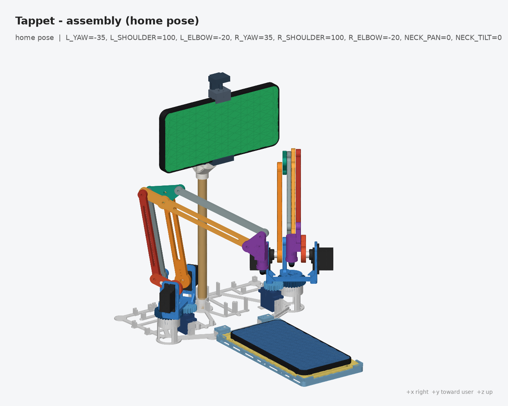
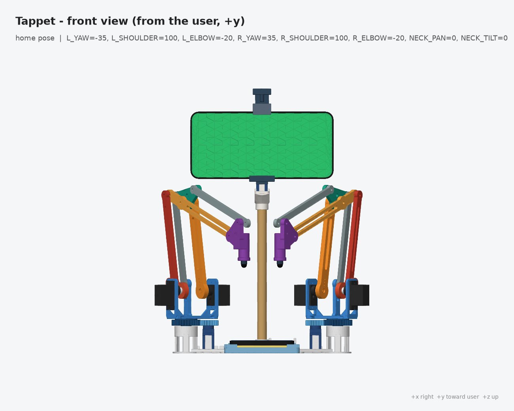
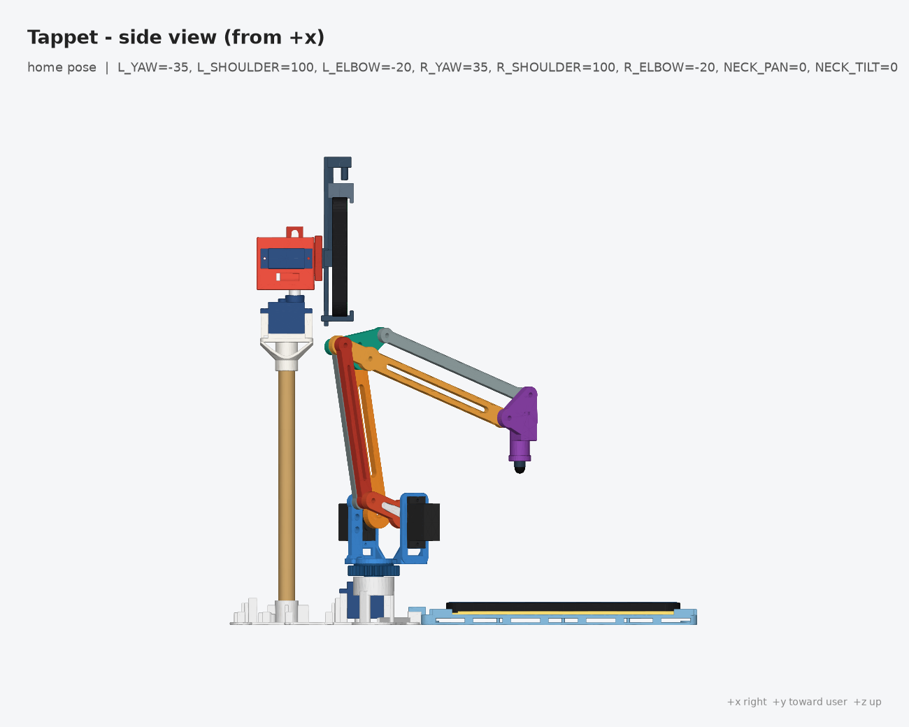
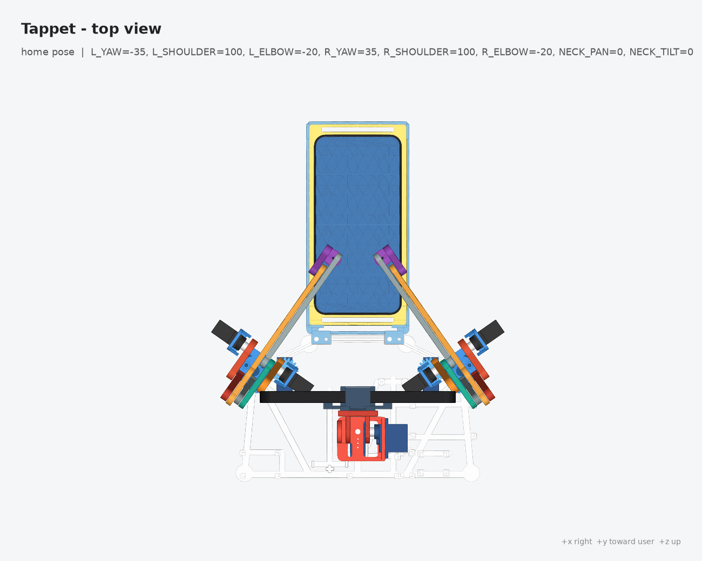
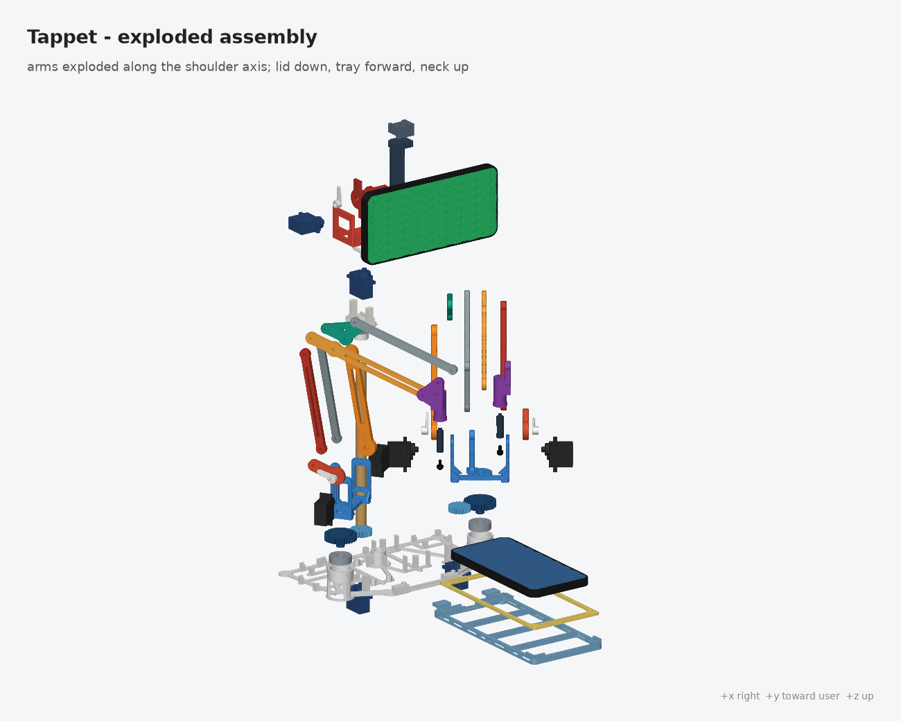

# Tappet — mechanical CAD (build123d)

> **Just want to print it?** Use the ready-made plates in [`plates/`](plates/README.md): plate 1 (chassis + tray), plate 2 (turrets, neck, clamp, shim) and plates 4–6 (arm links, gears/stylus, PETG clips). Every part count is included, laid out for a 220 × 220 bed (Ender 3 V3 SE), with one Cura profile per plate.

Parametric, fully scripted CAD for the Tappet desktop robot: a lightweight skeleton chassis with a
dowel column carrying the Android "head" on a pan/tilt neck, two 3-DOF parallel-linkage arms with compliant capacitive styluses,
and a fixed tray for the target phone. All kinematic geometry is read from
[`config/robot.json`](../../config/robot.json) (SPEC §3). Nothing kinematic is hard-coded here.



| | |
|---|---|
|  |  |
|  |  |

## Regenerate

```sh
cd hardware/cad
uv run --python 3.12 --with build123d --with trimesh --with matplotlib --with numpy python build.py
#   --no-render         skip PNGs (about 40 s faster)
#   --no-interference   skip the boolean interference checks
#   --no-export         checks only, do not write STL/STEP
```

Outputs:

* `stl/<part>.stl`, `step/<part>.step`: every printable part, **already in print orientation** (on the bed
  at z = 0, centred). Handed parts are exported as `_L` / `_R`.
* `step/assembly.step`: full robot at the **home pose** in the world frame (labelled, coloured
  components, including servo, horn, bearing, stylus-tip and phone mock-ups). `step/assembly_exploded.step`
  is the exploded variant.
* `renders/*.png`: assembly (iso, rear 3/4, front, side, top, exploded, left-arm close-up) and one
  render per printable part.
* `build_report.json`: raw results of every check. The tables below are regenerated into this README.

The process exits non-zero if any check fails.

## Layout and design (v2 "skeleton" chassis)

World frame (robot.json `frames.world`): origin on the desk under the neck column, +y toward the
user and the tray, +z up, +x the robot's right.

v2 replaces the closed base, lid, 180 mm printed column and solid tray with an **open skeleton**. Old
plates 1–3 were about 15 h; the new plates 1–2 are about 5 h and 90 g. The arm links, gears, stylus
parts and cable clips (plates 4–6) are **frozen**: their STLs are byte-identical to v1, checked by
SHA-256 before and after. The old enclosure variant was removed rather than kept behind a flag.

| subsystem | geometry (from robot.json unless noted) |
|---|---|
| Chassis | One flat open truss, 200 × 121 mm, printed in one piece. Thin T-beams (5 × 1.2 mm flange, with a 1.6 × 4 mm rib on the front arm/tray loop) tie together the parts below; **everything is open-mounted, with no enclosure**. The deck datum stays at z = 30, so the frozen gear stack is unchanged |
| ↳ yaw towers and servo posts | Two 608 seat towers at the arm bases (±85, 40): a ring on 3 legs, with the bearing on three 45° lip tabs. Two SG90 yaw-servo post pairs, 25 mm inboard, so the gear centre distance is unchanged; each servo is screwed down onto its posts |
| ↳ column and tray mounts | The column-dowel socket (with set screw), and two tray lugs |
| ↳ electronics | Cradles and standoffs for the ESP32-S3-DevKitC-1, PCA9685, XL4015, Mini560, PB power board, HEAD board and CH224K |
| Yaw drive | 20T (SG90 spline) → 30T (turret) module-1 involute spur gears = **1.5 : 1** (`joints.*_YAW.gear`). Centre distance 25 mm. The pinion phase is meshed in the assembly |
| Turret | Skeleton: a gear hub disc, two side bars, two 2.2 mm window-frame cheeks with gussets, and the ground post. It bolts to the 30T gear (3× M3). The 8 mm gear axle runs in the 608 and is retained by an M3 screw and a fender washer from below, through the tower. The cheeks hold the shoulder MG90S (−v) and elbow MG90S (+v) **coaxially on the shoulder axis** at r0 = 12, H = 70. The tab faces and pin positions are unchanged |
| Arm (frozen) | Upper arm L1 = 100 is keyed to the shoulder horn. A 25 mm elbow crank and a linkage rod (length L1) to the forearm's 25 mm rear arm form a parallelogram, so the forearm angle is **absolute θ2**. Forearm L2 = 110 |
| Wrist levelling (frozen) | Turret ground post → `wrist_link_a` (L1) → `elbow_triangle` → `wrist_link_b` (L2) → `stylus_holder`. The **stylus stays vertical** |
| Stylus (frozen) | Sleeve axis at tool_dx = 15 ahead of the wrist pin, with the tip point tool_dz = 35 below it. 6 mm plunger travel, M2 travel-stop screw, light spring, 6 mm conductive tip with a ground-lead channel |
| Column | **10 mm hardwood dowel** (or 10 mm aluminium / CF tube) cut to **177 mm**. It stands in the chassis socket at (0, −15.25), directly under the pan-servo body. A printed `column_head` holds the NECK_PAN SG90: a 45° funnel up from the dowel socket to the servo floor, and two tab posts. Each end is fixed with an M3 set screw plus a drop of CA glue. The pan axis (0, −10), `column_top_z` = 210 and tilt axis z = 232 are unchanged, so **`config/robot.json` needs no change** |
| Neck | Skeleton pan mount (3.2 mm plate with windows, 2.4 mm servo cheek) and a tilt U-yoke (3 mm cheeks, windowed bridge). Same servo positions as v1 |
| Head clamp | Skeleton cross: 13 mm spine carrying the dovetail rail, a bolt crossbar with two phone-rest pads, the fixed lower jaw, and the spring stop. The spring-loaded jaw handles phones 64–82 mm wide and 7–11 mm thick, held landscape with the screen facing +y |
| Tray | Open frame: perimeter rail with a 1.6 mm ledge at the floor and side windows, 3 cross ribs whose tops are the floor (z = 6), 4 raised L corner stops, and a rear cable notch. The pocket is 80 × 165 centred at (0, 160), so the v1 shims still fit (now 2 mm tall). The two rear tabs sit on the chassis lugs, located by an integral Ø3.8 pin on each lug and held by 2× M3. The iPhone 6.1" surface = 6 + 7.8 = **13.8** = `default_device.surface_z` |

Lateral (v) layout of one arm, from the shoulder servo side (L arm; R is the mirror image):

| v (mm) | member |
|---|---|
| −47 … −14.5 | shoulder MG90S (body, tabs on the turret cheek at −28.6), horn face at −14.5 |
| −16 … −11 | upper arm (horn pocket 1.7 deep) |
| −10 … −6 | elbow triangle / turret ground post |
| −5 … −1 | wrist_link_a, wrist_link_b |
| 0 … 4 | forearm |
| 5 … 10 | linkage rod / stylus-holder plate (stylus axis itself at v = 0, as FK requires) |
| 11 … 16 | elbow drive crank |
| 14.5 … 47 | elbow MG90S |

There is a 1 mm gap between planes. Fill each gap with a 0.5–1 mm M3 nylon washer at every pin.

### Notable decisions

* **Passive links are solved, not placed.** `assembly.py` closes every parallelogram by circle
  intersection from the pin distances. A wrong hole spacing would therefore show up as a stylus
  position or tilt error.
* The R arm is the exact mirror of the L arm about the world YZ plane, with ψ_L = −ψ_R. Only the
  turret and the stylus holder are chiral (`_L` / `_R`).
* **Frozen parts:** `upper_arm`, `forearm`, `linkage_rod`, `wrist_link_a`, `wrist_link_b`,
  `elbow_triangle`, `elbow_drive_link`, `yaw_gear_turret`, `yaw_gear_servo`, `stylus_holder_L/R`,
  `stylus_plunger` and `cable_clip`. Any edit to their modules, to `params.py`, to `lib/servos.py`, to
  `lib/gears.py`, or to the gear-bolt constants in `turret.py` would change them. Keep those as they are.
* Skeleton rules: every feature stands on the bed. The bearing lip is a 45° cone, the column head has
  a 45° funnel, and windows bridge at most about 20 mm. Neither new plate needs supports.
* The chassis lies flat on the desk (z = 0). Optional Ø10 × 0.8 mm silicone pads sit flush in 4
  recesses, so the world z datum is kept.
* The tray shims centre the phone in the pocket, matching the default screen homography. For the
  iPhone SE (7.3 mm), set `surface_z` = 13.3.
* Electronics are open-mounted on the chassis. Positions are kept in `tappet_cad/parts/base.py` and read
  by `hardware/electronics/gen_drawings.py`.
  * DevKitC-1 on its headers in a cradle at x −35.75…−10.25, with the UART port at the rear for flashing.
  * PCA9685 on 4 standoffs at (29, 3).
  * XL4015 cradle at (70, −1). Mini560 cradle at (62, −36).
  * PB board at x −7…33, y −47…−30.
  * HEAD board at x −95…−65, y −47…−27. Its USB-C J2 is at x = −80 on the rear edge; the phone cable
    runs up the dowel.
  * CH224K cradle at x = 40 on the rear edge.
  * Cradles locate the board edges, so any hole pattern works. Add a zip tie or a dab of hot glue.

## Parts, mass and print settings

Defaults are PLA with a 0.4 mm nozzle; the layer height is per part (see the table). Use PETG for the cable clips.
Grams and hours come from a shell model: surface area × shell thickness is printed solid, and the rest
at the infill fraction. See plates/README.md for the method and the per-plate numbers.

<!-- PARTS_TABLE_START -->
| part (STL) | qty | material | bbox as printed (mm) | solid cm3 | est. g (each) | settings / orientation |
|---|---|---|---|---|---|---|
| `chassis` | 1 | PLA | 200 x 121 x 30 | 21.76 | 27.0 | 0.28 mm, 2 walls, 10% infill. Print as modelled (flat on the bed, towers up). No supports, skirt only. 0.28 mm draft, 2 walls, 10% infill (it is almost all walls anyway). |
| `column_head` | 1 | PLA | 16 x 33 x 36.2 | 3.81 | 4.7 | 0.24 mm, 3 walls, 20% infill. Print upright (socket down); the 45-degree funnel carries the servo floor, no supports. |
| `neck_pan_mount` | 1 | PLA | 38.6 x 36 x 32.5 | 6.11 | 7.6 | 0.24 mm, 3 walls, 20% infill. Print plate-down. Servo window bridges ~13 mm. |
| `neck_tilt_bracket` | 1 | PLA | 32 x 34 x 26.5 | 4.4 | 5.5 | 0.24 mm, 3 walls, 20% infill. Print on the bridge front face (cheeks standing up, no supports). |
| `phone_clamp` | 1 | PLA | 56 x 106.5 x 20 | 9.87 | 11.6 | 0.24 mm, 3 walls, 20% infill. Print back down (rail, pads, jaws up; no supports). |
| `phone_clamp_jaw` | 1 | PLA | 20 x 15.7 x 12 | 2.29 | 2.5 | 0.24 mm, 3 walls, 20% infill. Print upside down (top face on the bed, lip up). |
| `turret_L` | 1 | PLA | 36 x 57.2 x 44.7 | 6.1 | 7.6 | 0.24 mm, 3 walls, 20% infill. Print platform-down, no supports (servo windows bridge 13 mm). 0.24 mm, 3 walls, 20% infill. Export turret_L and turret_R (mirror). |
| `turret_R` | 1 | PLA | 36 x 57.2 x 44.7 | 6.1 | 7.6 | 0.24 mm, 3 walls, 20% infill. Print platform-down, no supports (servo windows bridge 13 mm). 0.24 mm, 3 walls, 20% infill. Export turret_L and turret_R (mirror). |
| `yaw_gear_servo` | 2 | PLA | 22 x 22 x 5.5 | 1.6 | 2.0 | 0.12 mm, 3 walls, 100% infill. Print spline-bore down, 0.12 mm layers, 100% infill. Bore is a light press on the SG90 spline. |
| `yaw_gear_turret` | 2 | PLA | 32 x 31.9 x 15.1 | 5.18 | 6.4 | 0.12 mm, 3 walls, 100% infill. Print upside down (hub face on bed, axle up). 0.12 mm layers, 100% infill for crisp teeth. |
| `upper_arm` | 2 | PLA | 116 x 18 x 5 | 5.85 | 7.3 | 0.2 mm, 4 walls, 40% infill. Print flat (horn pocket face up). 4 walls, 40% infill for stiffness. Same part for L and R (flip over). |
| `forearm` | 2 | PLA | 147 x 15 x 4 | 5.08 | 6.3 | 0.2 mm, 4 walls, 40% infill. Print flat. 4 walls, 40% infill. Same part for L and R. |
| `elbow_drive_link` | 2 | PLA | 39.5 x 18 x 5 | 2.11 | 2.6 | 0.2 mm, 3 walls, 100% infill. Print flat, horn pocket up. 100% infill (small, torque-carrying). |
| `linkage_rod` | 2 | PLA | 110 x 10 x 5 | 3.39 | 4.2 | 0.2 mm, 4 walls, 30% infill. Print flat. 4 walls. |
| `wrist_link_a` | 2 | PLA | 109.2 x 9.2 x 4 | 3.03 | 3.8 | 0.2 mm, 4 walls, 30% infill. Print flat. 4 walls. |
| `wrist_link_b` | 2 | PLA | 119.2 x 9.2 x 4 | 3.31 | 4.1 | 0.2 mm, 4 walls, 30% infill. Print flat. 4 walls. |
| `elbow_triangle` | 2 | PLA | 47 x 26.7 x 4 | 2.63 | 3.3 | 0.2 mm, 3 walls, 100% infill. Print flat. 100% infill. |
| `stylus_holder_L` | 1 | PLA | 27.8 x 16.8 x 46.7 | 5.43 | 6.7 | 0.2 mm, 4 walls, 60% infill. Print upright on the sleeve flare (round bore), tree supports under the pin plate only; ream bore with a 7 mm drill. L and R are mirror images (export _L/_R). |
| `stylus_holder_R` | 1 | PLA | 27.8 x 16.8 x 46.7 | 5.43 | 6.7 | 0.2 mm, 4 walls, 60% infill. Print upright on the sleeve flare (round bore), tree supports under the pin plate only; ream bore with a 7 mm drill. L and R are mirror images (export _L/_R). |
| `stylus_plunger` | 2 | PLA | 6.6 x 6.6 x 24.5 | 0.66 | 0.8 | 0.12 mm, 3 walls, 100% infill. Print upright, 0.12 mm layers, 100% infill; sand lightly to slide freely. |
| `tray` | 1 | PLA | 84 x 182.2 x 11 | 9.23 | 11.4 | 0.28 mm, 2 walls, 10% infill. Print flat. 0.28 mm draft, 2 walls, 10% infill, no supports. |
| `tray_shim_iphone_61` | 1 | PLA | 79.7 x 164.7 x 2 | 3.8 | 4.7 | 0.24 mm, 3 walls, 20% infill. For iPhone 15 / 15 Pro / 16 / 16 Pro (6.1in). Print flat (2 mm tall frame). |
| `tray_shim_iphone_67` | 1 | PLA | 79.7 x 164.7 x 2 | 1.21 | 1.5 | 0.24 mm, 3 walls, 20% infill. For iPhone 15/16 Plus, 15 Pro Max (6.7in); 16 Pro Max needs no shim. Print flat (2 mm tall frame). |
| `tray_shim_iphone_se` | 1 | PLA | 79.7 x 164.7 x 2 | 3.99 | 4.9 | 0.24 mm, 3 walls, 20% infill. For iPhone SE 2nd/3rd gen. Print flat (2 mm tall frame). |
| `cable_clip` | 12 | PETG | 16.4 x 16.2 x 6 | 0.5 | 0.6 | 0.2 mm, 3 walls, 100% infill. Print on its side (C profile flat on the bed) in PETG for springiness, 100% infill. |

**All parts, all quantities: ~199 g, ~13.8 h of extrusion** (shell model: surface area x shell thickness solid + infill; Ender 3 V3 SE average 5.0/4.2/3.5/1.8 mm3/s at 0.28/0.24/0.20/0.12 mm + 1.5 s per layer). Per-plate figures (incl. heat-up) are in plates/README.md.
<!-- PARTS_TABLE_END -->

## Hardware (non-printed)

| item | qty | used for |
|---|---|---|
| MG90S metal-gear micro servo | 4 | shoulder + elbow, both arms |
| SG90 micro servo | 4 | 2× arm yaw, neck pan, neck tilt |
| 608-2RS bearing 8×22×7 | 2 | turret yaw axles |
| **10 mm hardwood dowel (or 10 mm Al / CF tube), cut to 177 mm** | 1 | **column (new in v2)** |
| **M3 × 8 set screw (or M3 × 8 socket head)** | 2 | **dowel in the chassis socket and in the column head (new)**, plus a drop of CA glue |
| M3 × 25 socket head + nylock | 2 | elbow pins |
| M3 × 20 socket head + nylock | 2 | holder-to-wrist_link_b pins |
| M3 × 16 socket head + nylock | 12 | remaining arm pins (6 per arm), tilt idler + 1 spare |
| M3 nylon washers 0.5–1 mm | ~40 | spacers in the 1 mm inter-plane gaps |
| M3 × 10 socket head | 6 | 30T gear → turret (3 per turret) |
| M3 × 10 + Ø12 fender washer | 2 | yaw axle retainers under the bearings (from below, through the tower) |
| M3 × 12 socket head | 2 | tray tabs → chassis lugs (thread-forming into the lug) |
| M3 × 10 + nut | 2 | phone clamp → tilt bracket |
| M2 × 8 self-tapping | 16 | servo tabs (usually supplied with the servos) |
| M2 × 4 | 2 | stylus plunger retaining screws |
| compression spring Ø5 × 12 mm, 0.3 mm wire | 2 | stylus plunger |
| compression spring Ø6 × 32 mm, 0.5 mm wire | 1 | head clamp jaw |
| 6 mm conductive stylus tip (~2.5 mm stem) | 2 | tool tips |
| 30 AWG silicone wire | 2 × 40 cm | stylus ground leads |
| small zip ties (2.5 mm) | ~15 | boards on their cradles, cable runs along the chassis and dowel |
| Ø10 × 0.8 mm silicone anti-slip pads | 8 | chassis (4) + tray (4), recessed flush |

**No longer needed (v1 enclosure):** 4× M3 × 10 countersunk lid screws, 4× M3 × 12 column-foot screws and nuts, and
the 2× M3 × 25 tray dovetail locks.

## Checks (`tappet_cad/checks.py`)

1. **Kinematics vs SPEC §3.** For each pose, the arm is assembled through the real linkage. The driven
   links are posed from (ψ, θ1, θ2), and the passive links are closed by circle intersection. The
   assembled pose then places the stylus-tip solid. The tool point is measured from the placed
   **CAD geometry**: the lowest point of the tip dome, on its axis, taken from the solid's bounding box.
   It is compared with the SPEC FK formula. The check fails if the error exceeds 1 mm, or if the stylus
   tilts by more than 0.05°.
   * Poses: home, park, and 4 IK vectors per arm from `config/kinematics_vectors.json`. These include
     taps on the screen at z = 13.8.
2. **Pin joints.** The M3 pin-hole centres are extracted from the edges of every placed link. The check
   verifies that all parts meeting at each joint (elbow, wrist, crank pin, forearm rear pin, ground
   pin, triangle pins, holder pin) are concentric within 0.02 mm. It also checks that θ1 − θ2 is
   inside `linkage.rel_min..rel_max`.
3. **Printability.** Every exported part must be a valid single solid that fits a 220 × 220 × 250 bed in
   its print orientation.
4. **Interference.** Every pair of assembly components whose bounding boxes overlap is boolean-intersected.
   Any intersection over 0.5 mm³ is a failure. The components are: chassis, dowel, column head, neck, clamp, phones,
   tray, shim, both arms, servos, horns, bearings and gears (the gear teeth are phase-meshed). This runs
   at the home pose, and again with each arm tapping the tray centre or a far corner while the other arm
   is parked.

<!-- CHECKS_START -->
- Kinematics (CAD tip vs SPEC FK, tol 1 mm): **PASS**
- Pin-joint coincidence (hole centres of mating links, tol 0.02 mm): **PASS**
- Printability (valid single solid, fits 220x220x250): **PASS**
- Home-pose interference (96 overlapping-bbox pairs boolean-tested): **PASS**
- Tap-pose interference (each arm tapping tray centre / corners, other arm parked; 398 pairs): **PASS**

| pose | arm | q (yaw, th1, th2) | FK (SPEC §3) | CAD tip | err mm | |
|---|---|---|---|---|---|---|
| home | L | -35.00, 100.00, -20.00 | -20.18, 132.56, 95.86 | -20.18, 132.56, 95.86 | 0.0000 | PASS |
| home | R | 35.00, 100.00, -20.00 | 20.18, 132.56, 95.86 | 20.18, 132.56, 95.86 | 0.0000 | PASS |
| park | L | 20.00, 110.00, -10.00 | -119.59, 135.03, 109.87 | -119.59, 135.03, 109.87 | 0.0000 | PASS |
| park | R | -20.00, 110.00, -10.00 | 119.59, 135.03, 109.87 | 119.59, 135.03, 109.87 | 0.0000 | PASS |
| vector0_L(0, 160, 13.8) | L | -35.31, 48.42, -60.78 | -0.00, 160.00, 13.80 | -0.00, 160.00, 13.80 | 0.0000 | PASS |
| vector1_L(-30, 95, 13.8) | L | -45.00, 62.50, -87.60 | -30.00, 95.00, 13.80 | -30.00, 95.00, 13.80 | 0.0000 | PASS |
| vector2_L(30, 225, 13.8) | L | -31.87, 18.79, -29.05 | 30.00, 225.00, 13.80 | 30.00, 225.00, 13.80 | 0.0000 | PASS |
| vector3_L(-30, 225, 13.8) | L | -16.56, 32.01, -42.42 | -30.00, 225.00, 13.80 | -30.00, 225.00, 13.80 | 0.0000 | PASS |
| vector4_R(0, 160, 13.8) | R | 35.31, 48.42, -60.78 | 0.00, 160.00, 13.80 | 0.00, 160.00, 13.80 | 0.0000 | PASS |
| vector5_R(-30, 95, 13.8) | R | 64.44, 53.81, -67.88 | -30.00, 95.00, 13.80 | -30.00, 95.00, 13.80 | 0.0000 | PASS |
| vector6_R(30, 225, 13.8) | R | 16.56, 32.01, -42.42 | 30.00, 225.00, 13.80 | 30.00, 225.00, 13.80 | 0.0000 | PASS |
| vector7_R(-30, 225, 13.8) | R | 31.87, 18.79, -29.05 | -30.00, 225.00, 13.80 | -30.00, 225.00, 13.80 | 0.0000 | PASS |
<!-- CHECKS_END -->

## Source layout

```
build.py                       entry point (export, assembly, checks, renders, README tables)
plates.py                      packs stl/ into print plates (plates 4-6 frozen; --rewrite-frozen to force)
tappet_cad/params.py           reads ../../config/robot.json; tolerances (0.2 mm), M2/M3, layout
tappet_cad/lib/                servos (SG90/MG90S + horns + pockets), gears (involute), bearing (608),
                               fasteners, phones (mock-ups), util (solids + 4x4 transforms)
tappet_cad/parts/              one module per part (model frame = assembly frame)
tappet_cad/assembly.py         pose solver + home / exploded assemblies
tappet_cad/checks.py           kinematic, joint, printability, interference checks
tappet_cad/render.py           matplotlib (Agg) Poly3DCollection renderer
```
