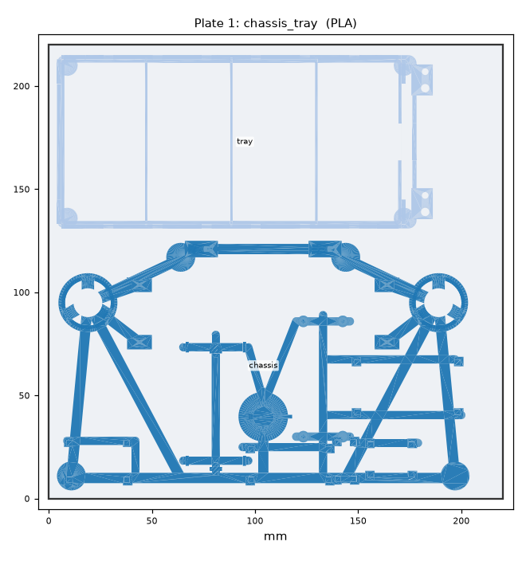
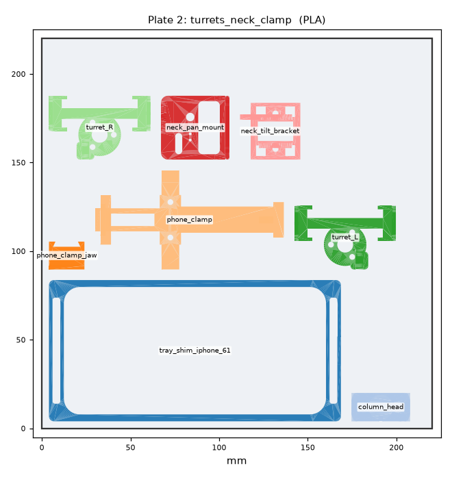
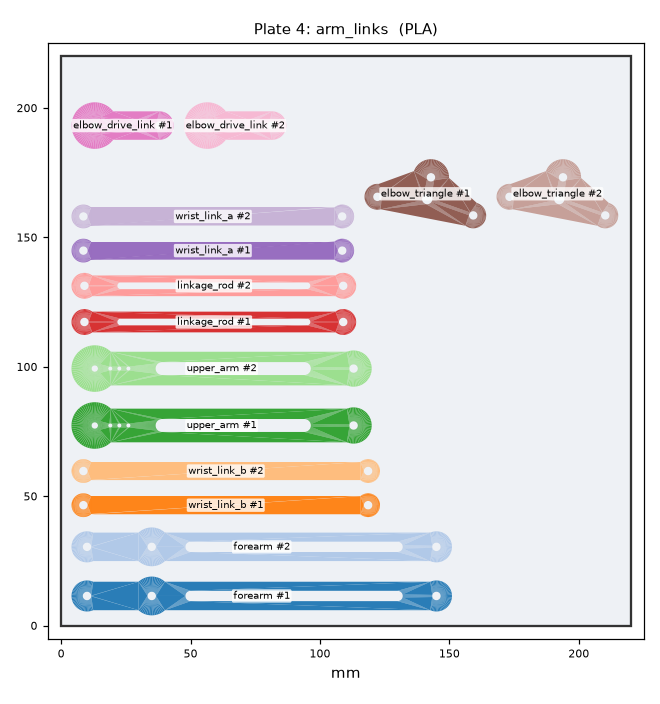
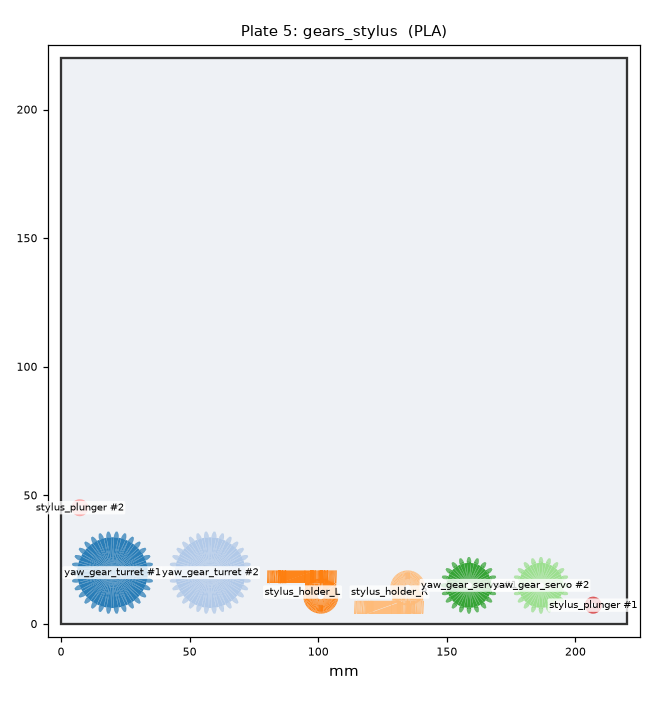
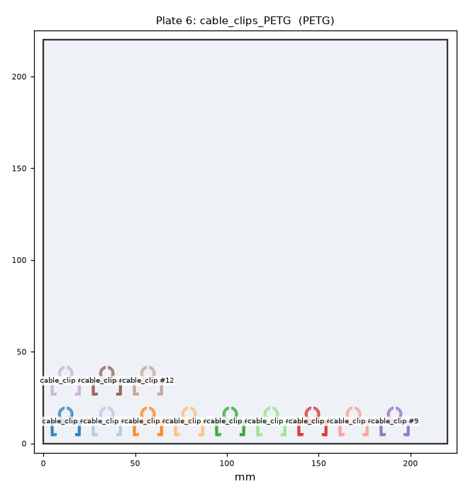

# Print plates (Ender 3 V3 SE, 220 × 220 mm)

v2 "skeleton" build. **Plates 1 and 2 replace the old plates 1–3** (closed base, lid, 180 mm printed
column and solid tray, which took about 15 h). The column is now a 10 mm dowel, so it isn't printed.

**Plates 4, 5 and 6 are unchanged.** Their files, and the per-part STLs inside them, are byte-identical
to v1 (SHA-256 checked). If they are already printed or printing, keep them. There is no plate 3 any more.

**In Cura:**
1. File → Open → `plateN_*.3mf`.
2. Apply that plate's settings below.
3. Slice. Don't auto-arrange plate 1, because it fills the bed edge to edge.

The `.stl` of the same name is the same layout merged into one mesh, for other slicers.

| # | File | Parts (all quantities included) | Cura settings | Est. filament | Est. time* |
|---|------|------------------------------|---------------|---------------|-------------|
| 1 | `plate1_chassis_tray.3mf` | chassis ×1, tray ×1 | PLA, **0.28 mm (Draft)**, 2 walls, 10% gyroid, **adhesion: skirt**, no supports | ~38 g | ~1.9 h |
| 2 | `plate2_turrets_neck_clamp.3mf` | turret_L ×1, turret_R ×1, column_head ×1, neck_pan_mount ×1, neck_tilt_bracket ×1, phone_clamp ×1, phone_clamp_jaw ×1, tray shim ×1 (iPhone 6.1") | PLA, **0.24 mm**, 3 walls, 20% gyroid, no supports | ~52 g | ~3.2 h |
| | **New plates total** | **10 pieces** | | **~90 g** | **~5.1 h** |
| 4 | `plate4_arm_links.3mf` *(frozen)* | forearm ×2, upper_arm ×2, wrist_link_a ×2, wrist_link_b ×2, linkage_rod ×2, elbow_triangle ×2, elbow_drive_link ×2 | PLA, 0.20 mm, 4 walls, 40% gyroid, no supports | ~63 g | ~4.3 h |
| 5 | `plate5_gears_stylus.3mf` *(frozen)* | yaw_gear_turret ×2, yaw_gear_servo ×2, stylus_holder_L ×1, stylus_holder_R ×1, stylus_plunger ×2 | PLA, **0.12 mm**, 4 walls, **100% infill**, **tree supports: touching buildplate** | ~32 g | ~4.7 h |
| 6 | `plate6_cable_clips_PETG.3mf` *(frozen)* | cable_clip ×12 | **PETG**, 0.20 mm, 3 walls, 100% infill, no supports | ~8 g | ~0.8 h |
| | **Whole robot** | **44 pieces** | | **~193 g** | **~15 h** |

\* **How the estimate is made** (`plates.py`, per object):
- **Grams.** Surface area × shell thickness is printed solid. The shell thickness is max(walls × 0.42 mm, 4 layers). The remaining volume is printed at the infill fraction. Extruded volume × 1.24 g/cm³ (PETG 1.27).
- **Time.** 6 min heat-up, plus extruded volume ÷ an average volumetric rate, plus 1.5 s per object-layer for travel, retraction and layer change.
- **Volumetric rates.** For the V3 SE on Cura's stock profiles: 5.0 mm³/s at 0.28 mm, 4.2 at 0.24, 3.5 at 0.20 and 1.8 at 0.12 (×0.85 for PETG).

Expect ±25 %. Cura shows the real number after slicing. Plates 4–6 come out higher than the old
README's figures (2.5 / 3 / 0.7 h) because the same method is now used for every plate.

 
 


## Notes

- **Plate 1:** the parts are a 200 × 121 mm chassis and a 85 × 183 mm tray, laid out with 4 mm margins.
  Use skirt (there is no room for a brim) and a clean bed. Use glue stick if the thin beams lift.
- **Plate 2:** the tray shim is the 2 mm-tall iPhone 6.1" frame. Run `--shim 67` (iPhone Plus / 15 Pro
  Max) or `--shim se` to swap it. The iPhone 16 Pro Max needs no shim.
- **Not printed:** the column is a **10 mm hardwood dowel** (or 10 mm aluminium / CF tube) cut to
  **177 mm**. Lock both ends with an M3 set screw and a drop of CA glue.
- **Plate 5:** only the two stylus holders need support (under the pin plate). Ream the stylus-holder
  bores with a 7 mm drill, and sand the plungers lightly until they slide freely.

## Regenerate

```bash
cd hardware/cad
uv run --with trimesh --with numpy --with matplotlib --with networkx --with lxml python plates.py            # 6.1" shim
uv run --with trimesh --with numpy --with matplotlib --with networkx --with lxml python plates.py --shim 67  # 6.7" shim
```

The script packs the per-part STLs from `stl/` (made by `build.py`). It leaves existing plate 4–6
files untouched unless you pass `--rewrite-frozen`. It fails if anything overflows the bed or overlaps.
