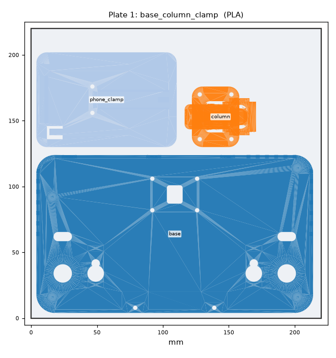
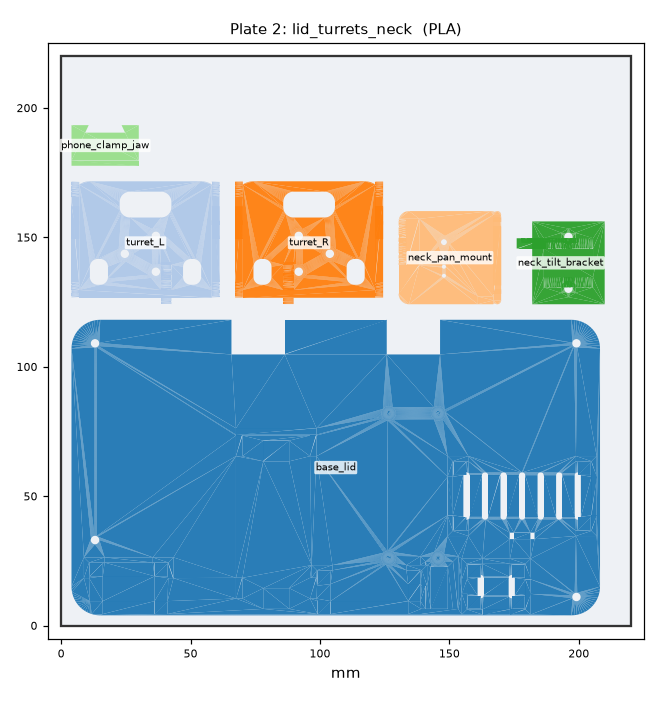
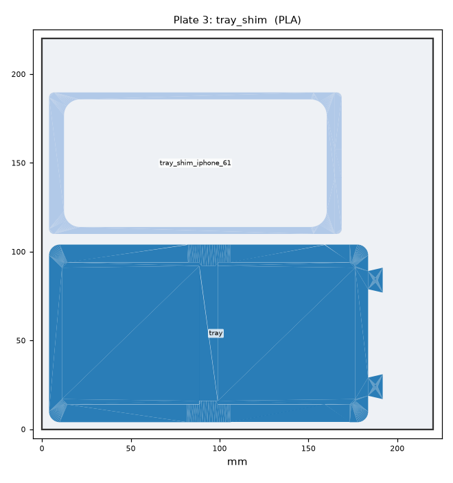

# Print plates (Ender 3 V3 SE, 220 × 220 mm)

The whole robot in **6 prints**. Each plate already has every part in its final quantity, laid out
and oriented. Each plate uses one Cura profile.

**In Cura:** File → Open → `plateN_*.3mf`, apply that plate's settings below, then slice. The 3MF
keeps the layout as separate objects. The `.stl` of the same name is the identical layout merged
into one mesh, for any other slicer.

| # | File | Parts (all quantities included) | Cura settings | Est. filament | Est. time* |
|---|------|------------------------------|---------------|---------------|-------------|
| 1 | `plate1_base_column_clamp.3mf` | base ×1, column ×1, phone_clamp ×1 | PLA, 0.20 mm, 3 walls, 20% gyroid, **adhesion: skirt**, no supports | ~105 g | ~7 h |
| 2 | `plate2_lid_turrets_neck.3mf` | base_lid ×1, turret_L ×1, turret_R ×1, neck_pan_mount ×1, neck_tilt_bracket ×1, phone_clamp_jaw ×1 | PLA, 0.20 mm, 4 walls, 30% gyroid, no supports | ~70 g | ~4.5 h |
| 3 | `plate3_tray_shim.3mf` | tray ×1, tray shim ×1 (iPhone 6.1") | PLA, 0.20 mm, 3 walls, 20% gyroid, no supports | ~50 g | ~3 h |
| 4 | `plate4_arm_links.3mf` | forearm ×2, upper_arm ×2, wrist_link_a ×2, wrist_link_b ×2, linkage_rod ×2, elbow_triangle ×2, elbow_drive_link ×2 | PLA, 0.20 mm, 4 walls, 40% gyroid, no supports | ~40 g | ~2.5 h |
| 5 | `plate5_gears_stylus.3mf` | yaw_gear_turret ×2, yaw_gear_servo ×2, stylus_holder_L ×1, stylus_holder_R ×1, stylus_plunger ×2 | PLA, **0.12 mm**, 4 walls, **100% infill**, **tree supports: touching buildplate** | ~30 g | ~3 h |
| 6 | `plate6_cable_clips_PETG.3mf` | cable_clip ×12 | **PETG**, 0.20 mm, 3 walls, 100% infill, no supports | ~8 g | ~0.7 h |
| | **Total** | **45 pieces** | | **~300 g** | **~21 h** |

\* Rough estimates for the V3 SE's stock Cura "Standard" speeds. Cura shows the real time after
slicing. Plate 1 takes longest because the column is 180 mm tall.

 
 
 

## Notes

- **Plate 1:** the 210 mm base leaves only 5 mm per side, so a brim won't fit. Use skirt and a
  clean bed (glue stick helps the column's foot). Don't let Cura auto-arrange this plate.
- **Plate 3 / other iPhones:** the default shim is for the iPhone 15/15 Pro/16/16 Pro (6.1").
  To regenerate for another phone, run `--shim 67` (iPhone Plus / 15 Pro Max) or `--shim se`. The
  iPhone 16 Pro Max needs no shim.
- **Plate 5:** only the two stylus holders need support (under the pin plate). After printing, ream
  the stylus-holder bores with a 7 mm drill. Lightly sand the plungers until they slide freely. The
  20T gears are a light press fit onto the SG90 spline.
- **Plate 6 in PLA:** works but the clips may crack. PETG flexes.
- **First-arm-only test** (the v0 plan): plate 4 and plate 5 already contain both arms. Assemble
  one arm first. The second set is simply spare until you build the other arm.

## Regenerate

```bash
cd hardware/cad
uv run --with trimesh --with numpy --with matplotlib --with networkx --with lxml python plates.py            # 6.1" shim
uv run --with trimesh --with numpy --with matplotlib --with networkx --with lxml python plates.py --shim 67  # 6.7" shim
```

The script packs the per-part STLs from `stl/` (made by `build.py`). It fails if anything overflows
the bed or overlaps.
