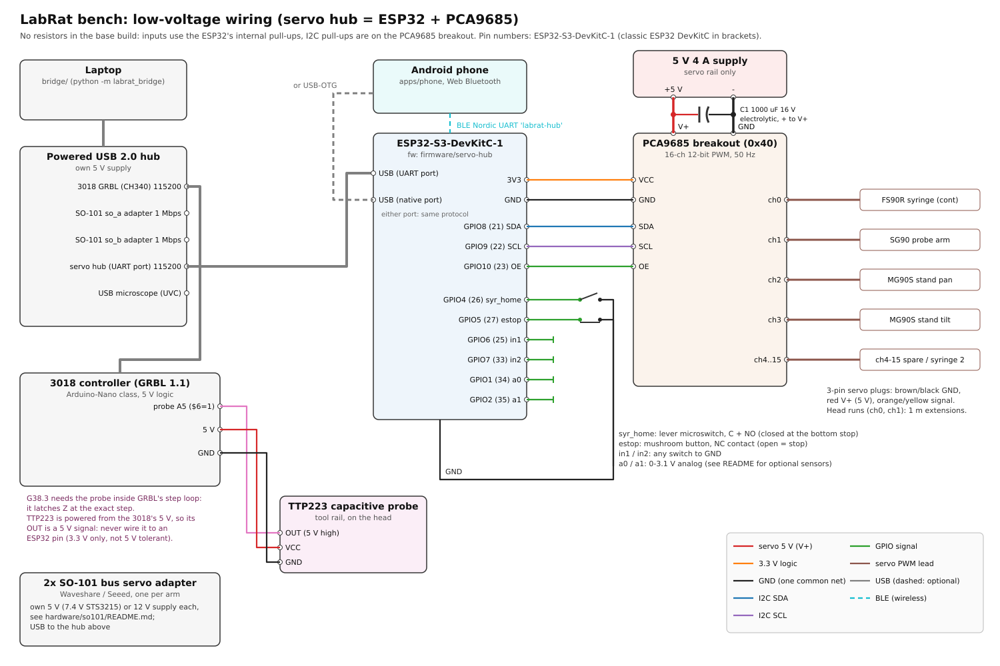

# Electronics: the bench's low-voltage side

Everything below 24 V on the LabRat bench, built around the **servo hub**: an ESP32 DevKit and a PCA9685 servo
breakout running [`firmware/servo-hub`](../../firmware/servo-hub). The hub drives the 9 g hobby servos and reads a few
switches. The laptop bridge talks to it over USB serial; the phone can drive it over BLE (or USB-OTG). The protocol is
[`docs/protocol.md`](../../docs/protocol.md) §4.



| file | what |
|---|---|
| [`wiring.svg`](wiring.svg) | wiring diagram (generated) |
| [`pin_map.csv`](pin_map.csv) | hub GPIOs for both boards + servo channels (generated) |
| [`bom.csv`](bom.csv) | parts, cheap generic choices (generated) |
| [`power_budget.md`](power_budget.md) | 5 V servo-rail budget (generated) |
| [`gen_wiring.py`](gen_wiring.py) | the generator. `python3 gen_wiring.py` (stdlib only). It fails if the pin map disagrees with `firmware/servo-hub/include/board.h`, if a channel default disagrees with the firmware, or if a label overlaps another |

**Resistors: none in the base build.** You have only a few, so nothing here needs one. The switches use the ESP32's
internal pull-ups. The I2C pull-ups (and the 220 Ω output resistors) are already on the PCA9685 breakout. There is no
multiplexing and no level shifting. Some optional sensors need one or two resistors; the
[table below](#optional-sensors) lists the exact count for each.

## Pin map

| signal | ESP32-S3-DevKitC-1 | ESP32 DevKitC | goes to | notes |
|---|---|---|---|---|
| I2C SDA | GPIO8 | GPIO21 | PCA9685 SDA | pull-up is on the breakout (to its VCC = 3V3) |
| I2C SCL | GPIO9 | GPIO22 | PCA9685 SCL | 400 kHz |
| PCA_OE | GPIO10 | GPIO23 | PCA9685 OE | high = all outputs off (estop, boot). Optional wire: the breakout pulls OE low |
| syr_home | GPIO4 | GPIO26 | lever microswitch C+NO to GND | 1 = closed = plunger at its bottom stop |
| estop | GPIO5 | GPIO27 | mushroom button **NC** contact to GND | 1 = open = **stop**. No button: a jumper wire to GND |
| in1 | GPIO6 | GPIO25 | any switch to GND | spare, event `in1` |
| in2 | GPIO7 | GPIO33 | any switch to GND | spare, event `in2` |
| a0 | GPIO1 (ADC1_CH0) | GPIO34 (ADC1_CH6) | 0-3.1 V analog | `read` → `adc.a0` mV |
| a1 | GPIO2 (ADC1_CH1) | GPIO35 (ADC1_CH7) | 0-3.1 V analog | `read` → `adc.a1` mV |
| 3V3 | 3V3 | 3V3 | PCA9685 **VCC** | logic only, ~10 mA |
| GND | GND | GND | PCA9685 GND (and through it the servo supply −), switch commons | one common ground |
| 5V | — | — | **nothing** | never feed the servo supply in here |

Pins avoided on purpose: S3 strapping pins 0/3/45/46, native USB 19/20, flash/PSRAM 26-37, UART0 43/44, RGB LED 38/48.
Classic: strapping 0/2/5/12/15, flash 6-11, input-only 34-39 for switches (they have no pull-ups), and ADC2 for
analog (ADC2 does not work while the radio is on).

## Servo channels (PCA9685)

| ch | servo | job | firmware default `cfg` | wired to |
|---|---|---|---|---|
| 0 | FS90R continuous | syringe plunger, through the 12:1 train ([`hardware/tool-head`](../tool-head)) | `cont`, 700-2300 µs, rest 1500 (neutral) | head, 1 m extension |
| 1 | SG90 | swings the capacitive probe down for a probe and back up out of the way | `pos`, 500-2500 µs = 0-180° | head, 1 m extension |
| 2 | MG90S (SG90 works) | phone stand pan (about Z) | `pos` | phone stand, 50 cm extension |
| 3 | MG90S (SG90 works) | phone stand tilt (about X) | `pos` | phone stand, 50 cm extension |
| 4-15 | — | spare: a second syringe (`cfg kind:"cont" rest_us:1500`), more arms | `pos` | — |

Servo plugs go on the breakout's 3-pin headers: GND (brown/black) to the outer row, V+ (red) in the middle, signal
(orange/yellow) on the PWM row. The PCA9685 drives the signals at its VCC (3.3 V), which every 9 g servo accepts.
The cloud DO owns what the channels mean (pipette dead reckoning, probe deploy angles, stand aiming). It sends the
`cfg` for its channels on first use, and the hub stores it in flash.

## Power

[`power_budget.md`](power_budget.md) has the numbers. In short:

- **Servo rail: 5 V 4 A supply → the PCA9685's V+ screw terminal.** A typical step draws ~1 A, homing into the
  syringe stop ~1.4 A, and all four servos stalled ~3.4 A. Six stalled servos (with both spares fitted) would draw
  ~4.9 A, which is more than the supply, but only for an instant.
- **1000 µF / 16 V electrolytic across V+/GND at the terminal** (the breakout has a footprint for it: watch the
  polarity). This bulk capacitor stops the rail sagging, and the servos twitching, when several 9 g servos start at once.
- **The ESP32 runs from USB only** (laptop / powered hub / phone OTG / a USB charger). The PCA9685 logic (VCC) runs
  from the ESP32's 3V3. The servo supply and USB meet only at GND. Do not connect the servo supply + to the DevKit's
  5V pin: it would back-feed the laptop's USB port.
- **Common ground:** the servo supply −, the PCA9685 GND and the ESP32 GND are one net, carried by the breakout's
  header. The switch commons go to the same GND.
- Generic PCA9685 clones may lack the reverse-polarity FET of the original: check the supply polarity before plugging in.

## What connects where

### USB topology
```
laptop ── powered USB 2.0 hub ─┬─ 3018 controller (CH340, GRBL 115200)          -> bridge `cnc`
                               ├─ SO-101 adapter A (1 Mbps Feetech bus)          -> bridge `so_a`
                               ├─ SO-101 adapter B                               -> bridge `so_b`
                               ├─ servo hub ESP32 (DevKit UART port, 115200)     -> bridge `hub`
                               └─ USB microscope (UVC)                           -> bridge `microscope`
phone (on the stand) ── BLE "labrat-hub" (Nordic UART) ── servo hub              -> phone page provides `hub`
```
- Use a **powered** hub: the arms' adapters, the microscope LEDs and the ESP32 together exceed one laptop port.
- On the ESP32-S3-DevKitC-1, either connector works: the **UART** port (USB-UART bridge, `/dev/ttyUSB*` /
  `/dev/ttyACM*`) or the native **USB** port (CDC). The firmware serves the protocol on both, and on BLE at the
  same time. Plug in only one cable.
- **Phone instead of laptop:** the phone page pairs with the hub over Web Bluetooth and becomes the `hub` provider.
  The phone can also power and drive it over a USB-OTG cable into the S3's native USB port. That needs an app that
  speaks USB-CDC serial, because the phone page itself uses BLE. In phone-only mode, power the ESP32 from a USB
  charger (or the OTG cable).
- The bridge finds the hub by sending `{"id":1,"cmd":"hello"}` to every port and looking for a reply whose `fw`
  starts with `servo-hub`.

### syr_home (plunger bottom stop)
Lever microswitch on the tool head, **C + NO** to `syr_home` and GND. It closes when the carriage reaches the bottom.
The DO homes with `pulse {ch:0, us, ms, until:"syr_home"}`. The firmware ends the drive the moment the switch reads 1,
so a stalled FS90R never pushes against the stop for long. The switch is optional: without it the DO homes by
dead-reckoned overtravel.

### estop
A 22 mm mushroom button with an **NC** contact, wired between `estop` and GND. Pressing it, or a cut or unplugged
wire, opens the contact. The firmware stops every servo by itself (all outputs off, OE high), fails the running
motions with `err:"estop"`, sends `{"ev":"estop","v":1}`, and refuses motion until the button is released. **No
button fitted? Put a jumper wire from the estop pin to GND**, or the hub stays stopped (`hello` shows `"estop":1`). It
fails safe on purpose. The button only covers the hub's servos. The 3018 and the SO-101 arms keep their own power
switches, which act as their hard stops.

### PCA9685 OE (optional wire)
With OE wired, the firmware holds the outputs off from the start of `setup()` and during an estop. The breakout pulls
OE low, so it works without the wire. One limit remains: between an ESP32 reset and `setup()` (~0.3 s), a PCA9685 that
stayed powered keeps its last pulses. A pull-up on OE would close that gap, but it costs a resistor, so it is not part
of the base build.

### TTP223 capacitive probe → 3018 GRBL probe pin (not the hub)
The probe (tool rail, swung down by the ch1 arm) stays wired to the **3018 controller's probe header**:
TTP223 VCC → header 5 V, GND → GND, OUT → probe pin (A5), and `$6=1` once in GRBL (the TTP223's OUT is active-high,
and GRBL's probe input expects active-low).
- **Why GRBL and not the hub:** `cnc.probe` runs `G38.3`. GRBL samples the probe pin inside its step generator and
  latches the machine position at the step where it triggers. A probe on the ESP32 would have to travel
  ESP32 → USB → bridge → cloud → bridge → GRBL feed hold. That is tens to hundreds of ms, during which Z keeps
  moving, so the tip would overshoot into the liquid.
- **Power:** from the 3018 board's 5 V (the TTP223 runs on 2-5.5 V). Its OUT then swings to 5 V, so **never wire
  that OUT to an ESP32 pin**. ESP32 GPIOs are 3.3 V and not 5 V tolerant. The hub does not need it: the DO gets the
  result from `cnc.probe`. A second TTP223 for the hub would have to be powered from 3V3 ([optional sensors](#optional-sensors)).
- The probe lead runs with the ch0/ch1 servo leads along the gantry to the head.

### SO-101 arms
Each arm has its own Feetech/Waveshare bus adapter, its own supply (5 V for the 7.4 V STS3215, 12 V for the 12 V
variant) and its own USB cable to the laptop. See [`hardware/so101/`](../so101) for the supply choice and the adapter
jumpers. None of this touches the servo hub. Keep the arms' supplies separate from the 5 V servo rail. They share
ground with everything else only through USB.

## Optional sensors

| sensor | wiring | resistors |
|---|---|---|
| extra limit / reed / door switch | switch from `in1` or `in2` to GND | **0** |
| 10 kΩ potentiometer (a manual knob) | ends to 3V3 and GND, wiper → `a0` | **0** |
| second TTP223 touch pad, for the hub | VCC **3V3**, OUT → `in1`; bridge the pad marked **A** (active-low output, so touch reads 1) | **0** |
| I2C module with on-board pull-ups (INA219 rail current, VL53L0X distance, SHT31 temperature/humidity) | SDA/SCL/3V3/GND in parallel with the PCA9685 | **0** (the firmware does not read these yet) |
| LDR (light) | LDR 3V3 → `a0`, fixed 10 kΩ `a0` → GND | **1** |
| 10 kΩ NTC thermistor | NTC 3V3 → `a1`, fixed 10 kΩ `a1` → GND | **1** |
| servo-rail voltage monitor | 5 V → 10 kΩ → `a1` → 10 kΩ → GND (2.5 V at 5 V) | **2** |
| any 5 V-output sensor (e.g. HC-SR04 echo) | OUT → 10 kΩ → pin → 20 kΩ → GND | **2**, or pick a 3.3 V part (RCWL-1601) and use 0 |

The ADC reads 0 to ~3.1 V (11 dB attenuation). More than about three I2C modules, each with its own pull-ups, puts
too much pull-up on the bus: cut the extra pull-ups off the extra boards rather than adding parts.

## Bring-up checklist
1. Flash the hub (`firmware/servo-hub`, `pio run -e esp32s3 -t upload`). With no servo supply connected, run
   `{"id":1,"cmd":"hello"}`. It should show `"pwm":true` (the PCA9685 answered) and `"estop":0` (button closed, or
   the jumper fitted).
2. `{"id":2,"cmd":"read"}`: press `syr_home` and check that it reads 1.
3. Connect the 5 V supply (capacitor fitted, polarity checked). Then `{"id":3,"cmd":"servo","ch":2,"deg":90,"ms":800}`.
4. FS90R: `{"id":4,"cmd":"pulse","ch":0,"us":1500,"ms":2000}`. If it creeps, trim its pot until it stands still, or
   set the DO's `cal:pipette.neutral_us`.
5. Stop pinging and wait 2 s: `{"ev":"wd"}` arrives and every servo goes limp.
6. Press the estop: `{"ev":"estop","v":1}` arrives and nothing moves until you release it.
