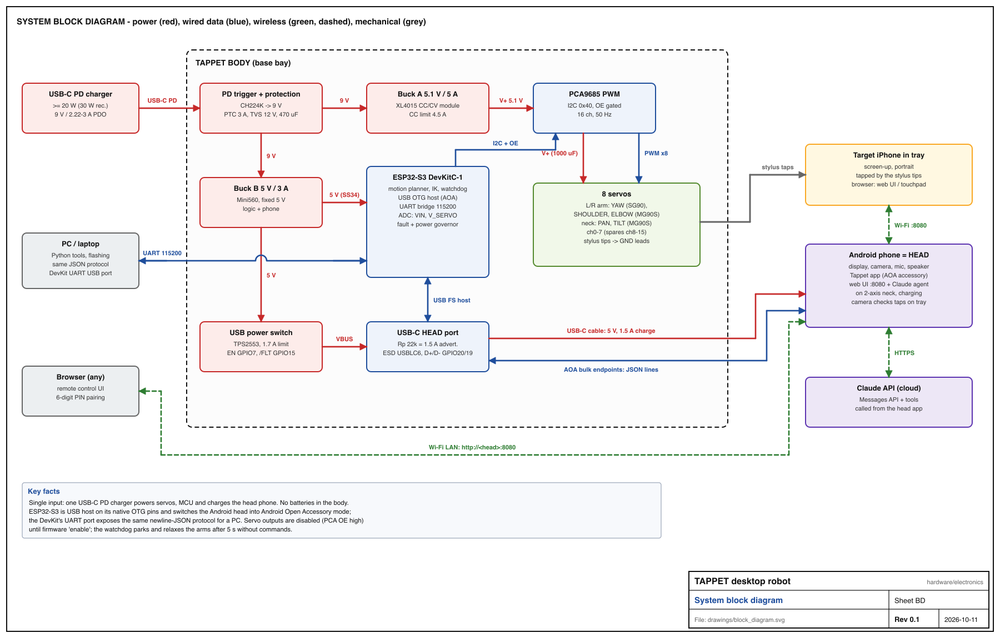
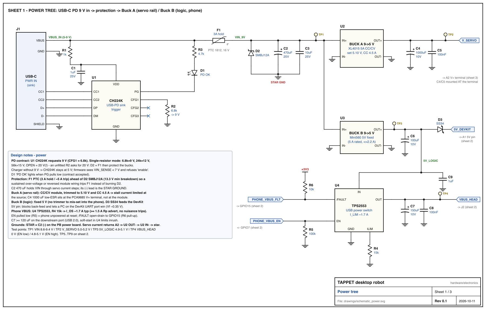
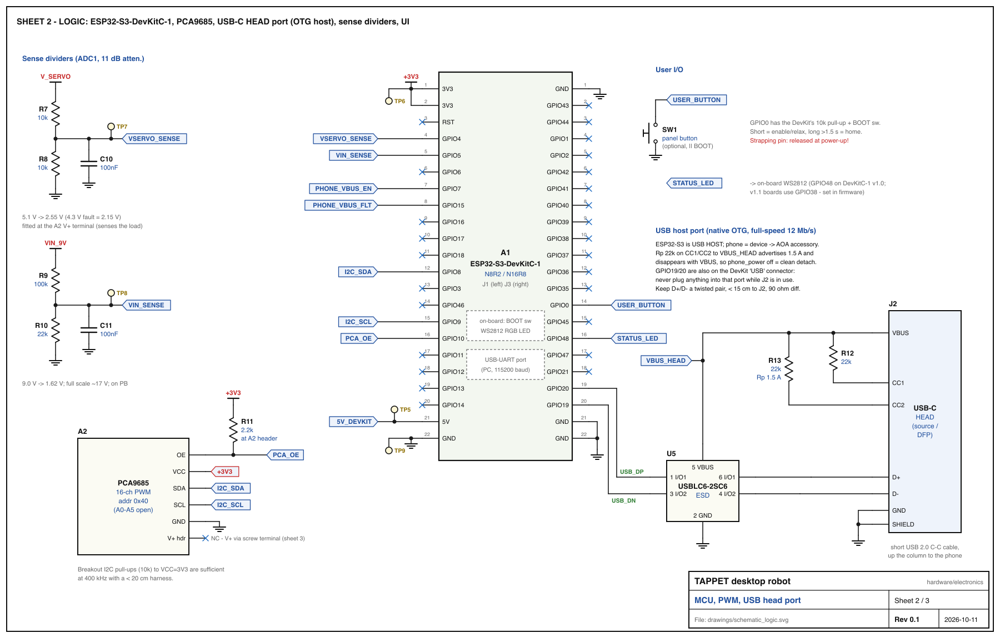
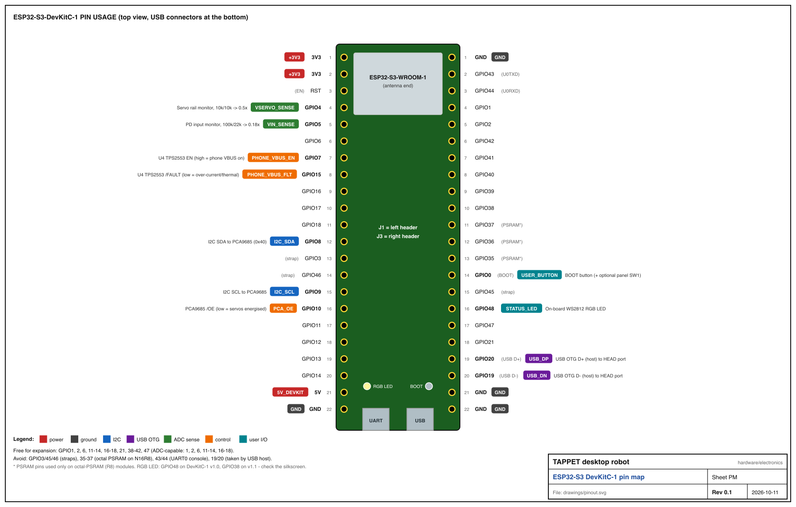
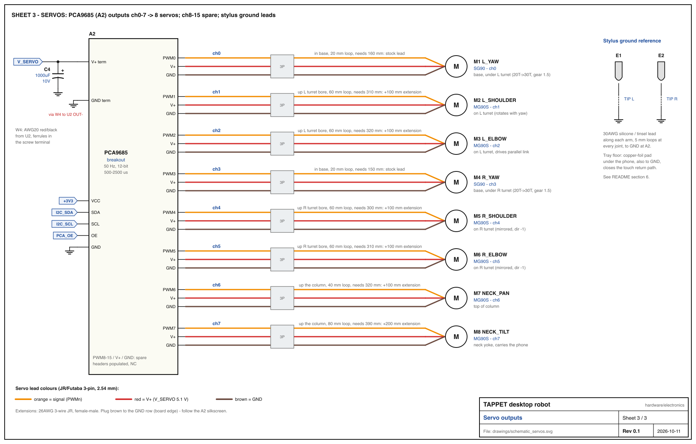
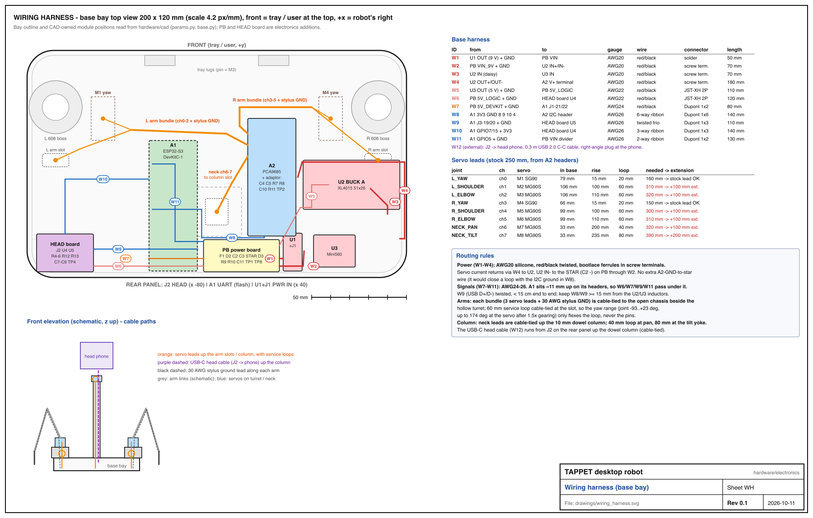

# Tappet electronics (rev 0.1, 2026-10-11)

This directory holds the electronics design for the Tappet body: schematics, a wiring harness drawing, the pin map,
the netlist, the BOM and the power budget. All of it is generated from one description in
[`gen_drawings.py`](gen_drawings.py):

```sh
python3 hardware/electronics/gen_drawings.py     # stdlib only; PNGs need rsvg-convert, ImageMagick or cairosvg
```

The generator **exits non-zero** if any of these checks fail:

* every GPIO in the design matches `config/robot.json` → `electronics.pins` (in both directions), and every signal
  lands on a real DevKit header pin
* the sense-divider resistors match `electronics.dividers` and are wired to the right sense net
* servo channel → joint mapping matches `joints.*.ch`, the servo count matches, and the PCA9685 address is 0x40
* every component in the design appears on a drawing, every drawn reference exists in the design, and every
  component is in the BOM
* every net has at least two connections (the on-board LED net is the one listed exception)
* layout: no two labels overlap, no wire crosses a label, and no text leaves the sheet frame

| file | contents |
|---|---|
| `drawings/schematic_power.svg/.png` | Sheet 1: USB-C PD input, protection, Buck A/B, phone VBUS switch |
| `drawings/schematic_logic.svg/.png` | Sheet 2: ESP32-S3 DevKitC-1, PCA9685, USB-C HEAD port, sense dividers, UI |
| `drawings/schematic_servos.svg/.png` | Sheet 3: PCA9685 outputs → 8 servos, wire colours, stylus grounding |
| `drawings/block_diagram.svg/.png` | System block diagram (body, Android head, iPhone, Claude API, PC) |
| `drawings/wiring_harness.svg/.png` | Base-bay layout (top view), harness list, servo lead lengths, front elevation |
| `drawings/pinout.svg/.png` | ESP32-S3-DevKitC-1 pin usage |
| `drawings/power_budget.svg/.png` | Input power by scenario |
| `netlist.csv` | `net,ref,pin` for every pin in the design |
| `pin_map.csv` | `gpio,signal_net,direction,function,devkit_header_pin,notes` |
| `bom_electronics.csv` | BOM with example MPNs, marketplace descriptions, and 1k-qty and single-unit cost estimates |
| `power_budget.md` | Load model, scenarios, headroom, brownout/governor behaviour, thermal notes (generated) |

---

## 1. System overview



One USB-C PD charger powers everything. A CH224K asks the charger for 9 V. Behind the input protection (PTC, TVS
and bulk capacitor) the 9 V bus feeds two bucks:

* **Buck A** makes the servo rail (5.1 V, up to 5 A). It feeds the PCA9685 V+ terminal and the eight servos.
* **Buck B** makes 5 V for logic. It feeds the ESP32-S3 DevKit through a Schottky diode, and the Android head phone
  through a current-limited USB power switch.

The ESP32-S3 is the **USB host** on its native OTG pins (GPIO19/20). It puts the head phone into Android Open
Accessory mode and streams the newline-JSON body protocol. The DevKit's second USB port (the UART bridge) carries
the same protocol for a PC.

## 2. Power tree (sheet 1)



| block | choice | why |
|---|---|---|
| PD sink | **CH224K**, CFG1 = 6.8 kΩ → 9 V | Cheapest single-chip PD trigger, about $0.25. 9 V is the highest voltage every ≥ 18 W charger offers, and at 9 V a 20 W charger delivers 2.22 A. In v0 this is a CH224K "decoy" module with its jumper set to 9 V. |
| fallback | firmware reads `VIN_SENSE` (GPIO5, 100k/22k) | If the charger has no 9 V PDO, the CH224K stays at 5 V. Both bucks then drop out, so firmware refuses `enable` (`no_pd`) when VIN < 7 V. **Caution:** if CFG1 is left open the CH224K asks for **20 V**. D2 + F1 then protect the bucks, but always fit R2. |
| fuse | **F1 PTC 1812, 3 A hold, ≥ 16 V** | Caps sustained input at about 27 W. It sits ahead of the TVS, so a sustained over-voltage *or reversed module wiring* (D2 conducts forward) trips F1 instead of burning D2. |
| TVS | **D2 SMBJ12A** | 12 V stand-off sits just above 9 V. It clamps hot-plug ringing and a mis-negotiated 12 V+ contract below the 20 V limit of the Mini560. |
| bulk | **C2 470 µF/25 V + C3 10 µF** | Holds VIN through servo current steps. **C2's negative lead is the star ground.** |
| Buck A | **XL4015 5 A CC/CV module**, trimmed to **5.10 V / CC 4.5 A** | The adjustable CC limit is a free hardware stall limiter. 5.1 V gives MG90S/SG90 full torque without exceeding their 6 V rating. For v1, use a TPS565208-class 5 A synchronous buck. |
| servo bulk | **C4 1000 µF/10 V low-ESR + C5 100 nF at the PCA9685 V+ terminal** | Fitted at the load, not at the buck, so the supply loop for servo current spikes is short. |
| Buck B | **Mini560 fixed 5 V** (5 A rated, ≤ 2.2 A used) | It has no trimmer, so it cannot be mis-set into the phone. It is synchronous (about 92 %). |
| DevKit feed | **D3 SS34** into the DevKit 5V pin | Blocks back-feed. Its 0.35 V drop lets a PC on the DevKit UART port "win" while you flash, so our rail never drives the PC's VBUS hard. The DevKit LDO still regulates at 4.65 V in. |
| phone VBUS | **U4 TPS2553**, R_ILIM 15 kΩ → I_OS ≈ 1.7 A typ, EN = GPIO7 (100k pull-down), /FAULT = GPIO15 (10k pull-up) | Soft start, current limit, thermal shutdown and reverse blocking. The phone stays unpowered while the ESP32 resets. `phone_power` toggles EN. C7 150 µF meets the USB 2.0 rule of ≥ 120 µF on a downstream port. |

Grounding uses a **star at C2(−)** on the PB power board. Servo current returns PCA9685 GND → W4 → U2 OUT− → U2 IN− → W2
→ star. There is deliberately **no** extra PCA9685-GND-to-star wire, because it would close a loop with the I²C
ground. Logic grounds reach the star through the DevKit feed (W7).

## 3. Logic (sheet 2)



* **I²C:** GPIO8 (SDA) and GPIO9 (SCL) at 400 kHz to the PCA9685 at 0x40. The breakout has 10k pull-ups to VCC =
  3V3. Keep the harness under 20 cm.
* **PCA9685 /OE = GPIO10, with R11 = 2.2 kΩ pull-up to 3V3.** The outputs stay off (servos limp) through reset,
  boot and flashing until firmware `enable` drives OE low. The value is 2.2 k rather than 10 k because Adafruit-style
  breakouts fit a **10 kΩ pull-down on OE**. A 10k/10k pair would leave OE at 1.65 V, which is undefined, while
  2.2 k/10 k gives 2.7 V, a valid high. If your breakout has no pull-down, 2.2 k is still fine (1.5 mA when enabled).
* **USB-C HEAD port (J2)** is a source/DFP:
  * **Rp = 22 kΩ** on CC1 and CC2 advertises 1.5 A.
  * The Rp resistors are tied to the *switched* VBUS_HEAD. When firmware drops VBUS, the phone sees a full detach
    and re-enumerates cleanly, which is how `phone_power` and the AOA restart work.
  * D+/D− (GPIO20/19) run through **U5 USBLC6-2SC6** at the connector.
  * The link is full-speed USB (12 Mb/s), which the ESP32-S3 OTG supports.
  * GPIO19/20 are also wired to the DevKit's "USB" connector, so **nothing may be plugged into that connector while
    J2 is in use.** Flash through the "UART" connector.
* **Sense dividers** feed ADC1, which keeps working while Wi-Fi is on. Use 11 dB attenuation and the eFuse
  calibration.

  | signal | divider | reading at nominal | notes |
  |---|---|---|---|
  | `VSERVO_SENSE` (GPIO4) | 10k/10k (×0.5) | 5.1 V → 2.55 V | Fitted *at the PCA9685 V+ terminal*, so it measures the voltage the servos actually see. Brownout threshold 4.3 V = 2.15 V. |
  | `VIN_SENSE` (GPIO5) | 100k/22k (×0.18) | 9 V → 1.62 V | Full scale is about 17 V. |

  Both sense nodes carry a 100 nF filter capacitor.
* **User I/O:** the BOOT button (GPIO0, on-board 10k pull-up) is the user button. SW1 is an optional panel button
  wired in parallel. GPIO0 is a strapping pin, so the button must be released at power-up. The status LED is the
  on-board WS2812 on GPIO48.

  > **Board revision caveat:** ESP32-S3-DevKitC-1 **v1.0** wires the RGB LED to **GPIO48**, but **v1.1** moved it to
  > **GPIO38**. `config/robot.json` says 48. Check the silkscreen, and make the LED pin a firmware build option.



## 4. Servos (sheet 3)



| ch | joint | servo | location |
|---|---|---|---|
| 0 | L_YAW | SG90 (M1) | base, under the L turret (20T → 30T, gear 1.5) |
| 1 | L_SHOULDER | MG90S (M2) | on the L turret |
| 2 | L_ELBOW | MG90S (M3) | on the L turret, drives the parallel link |
| 3 | R_YAW | SG90 (M4) | base, under the R turret |
| 4 | R_SHOULDER | MG90S (M5) | on the R turret (mirrored, dir −1) |
| 5 | R_ELBOW | MG90S (M6) | on the R turret (mirrored, dir −1) |
| 6 | NECK_PAN | MG90S (M7) | top of the column |
| 7 | NECK_TILT | MG90S (M8) | neck yoke; carries the phone, so it needs metal gears |
| 8–15 | spare | – | headers populated, not connected |

Servo leads use JR/Futaba 3-pin 2.54 mm connectors: **brown = GND, red = V+ (5.1 V), orange = signal**. Plug them
in to match the A2 silkscreen, with GND toward the board edge on common breakouts. The PCA9685 outputs swing 3.3 V,
which SG90/MG90S servos accept. 50 Hz, 500–2500 µs, per `config/robot.json`.

## 5. Wiring harness and placement



The bay geometry and the positions of A1, A2, U1, the buck standoffs, the column and the bearings are **read from
the CAD sources** (`hardware/cad/tappet_cad/params.py` and `parts/base.py`, parsed statically). The harness drawing
therefore follows the real 210 × 120 mm base, with a 27 mm clear interior under the 30 mm deck. The generator fails
if an electronics-only board overlaps a CAD module or the wall.

**Placement**

| item | position | notes |
|---|---|---|
| U1 (+J1) | rear edge of the chassis, x = 40 | PD trigger module |
| U2 (Buck A) | on the first CAD buck station | |
| U3 (Buck B) | on the second CAD buck station | U3 is fed by daisy-chaining from U2's input terminal (W3) |
| A1 (DevKit) | CAD position, USB end at the rear | sits about 11 mm up on its pin headers; W6, W7, W9 and W11 pass underneath |
| A2 (PCA9685) | CAD position | servo headers on its −x long edge, V+ terminal on the +x edge facing U2 |
| A2 adaptor | on A2 | carries C4, C5, R7, R8, C10, R11 and TP2 |
| **PB power board** (40 × 17 mm) | rear centre, x −7…33, y −47…−30 | F1, D2, C2, C3 = STAR, D3, R9, R10, C11, TP1, TP8 |
| **HEAD board** (30 × 20 mm) | rear left, x −95…−65, y −47…−27 | J2 at the rear edge (x = −80), plus U4, U5, R4–R6, R12, R13, C7–C9, TP4 |

**Gauges**

| wires | gauge |
|---|---|
| VIN and servo rail (W1–W4) | AWG20 silicone |
| 5 V logic (W5, W6) | AWG22 |
| DevKit feed (W7) | AWG24 |
| signals (W8–W11) | AWG26 ribbon / twisted |
| servo leads | stock 26–28 AWG, with JR extensions where the harness model calls for them (`power_budget.md` §7) |

**Cable routing**

* **Arms:** each bundle (3 servo leads plus the stylus GND lead) rises through its deck "arm slot" behind the turret
  into the hollow turret. It is cable-tied at the slot with a **60 mm service loop**, so yaw rotation only flexes the
  loop, never the connector pins. With 1.5× gearing the yaw servo turns up to 174° across the joint range.
* **Column:** the neck leads rise through the column cable slot, with a 40 mm loop at pan and 80 mm at the tilt yoke.
  The 0.3 m USB 2.0 C-to-C head cable (W12) runs from J2 up the column's rear cable channel and ends in a
  right-angle plug at the phone.

**CAD changes needed for this electrical design** (reported, not made, because `hardware/cad` is outside this
directory):

1. The CAD's "HEAD" rear cut-out at x = −30 exposes the **DevKit's native USB connector**. The head phone must
   connect to **J2 on the HEAD board** (cut-out at x = −80), never to the DevKit's native port. That port has 5.1 kΩ
   Rd sink resistors and no current limit, so a dual-role phone would back-power the DevKit through it. Its D+/D−
   are also already in use by J2. Keep only the UART cut-out, and verify which DevKit connector sits at which x.
2. The buck standoffs use the LM2596 pattern (30 × 15.2 mm diagonal). Buck A is an XL4015 5 A module (about 51 ×
   26 mm) and Buck B is a Mini560 (22 × 17 mm). Either move the standoffs to match, or use a printed adapter plate.
   An LM2596 (3 A, ~80 %) is **not** adequate for the servo rail.
3. Add standoffs or clips for PB (40 × 17 mm) and the HEAD board (30 × 20 mm) at the positions above.

## 6. Capacitive styluses: why the tips are grounded

A phone's projected-capacitance touchscreen registers a touch when a conductive object near the glass pulls some of
the drive field away from the sense electrodes. That only happens if the object has a large capacitance relative to
the phone's own ground. A finger works because the human body is about 100–200 pF to the surroundings, and that
couples back to the phone through the hand, the desk and the mains. A bare 6 mm conductive tip on an insulating
plastic arm has about 1 pF. It either does not register at all or registers intermittently, depending on the phone,
the case and the humidity.

The design gives each tip a ground reference:

* **E1/E2:** a conductive rubber/fibre tip (≥ 6 mm, with the compliant stylus travel from `tool.stylus_travel`) is
  wired through a **30 AWG silicone or tinsel lead** running along the arm, with a 5 mm loop at every joint. The lead
  lands at **circuit GND at the A2 GND terminal**. This adds the capacitance of the whole robot: planes, harness, the
  DevKit, and the charger's Y-capacitor to mains earth. That is tens to hundreds of pF, enough for reliable
  single-finger registration.
* **Tray copper pad (optional, recommended):** a copper-foil pad on the tray floor under the target phone, also tied
  to GND. It couples the phone's chassis to robot ground (about 20–50 pF through the case) and closes the return path.
  This matters most with a 2-prong, floating charger.
* **Alternative: tip-to-body coupling.** Leave out the wire and make the arm conductive (conductive PLA or copper
  tape) so the tip couples to the servo bodies and frame. This gives only about 5–15 pF. It is marginal and
  phone-dependent, and works mainly when someone is touching the robot. It is not recommended as the default.
* **Future option, "electronic tap":** switch each tip between GND and floating with a small MOSFET on a spare GPIO
  (e.g. GPIO6/GPIO16). A hovering tip can then register and release a touch with no Z motion, which allows faster
  taps and double-taps.
* **ESD:** the leads are exposed. A discharge into a tip flows down its lead to GND at A2, never through a signal
  pin. Keep the stylus leads out of the I²C and USB bundles.

## 7. v0 assembly (perfboard carrier + modules)

1. **Set the bucks before anything is connected.** Power each module alone from a bench supply at 9 V with a 0.3 A
   limit.
   * **U2:** set CV to **5.10 V ± 0.03 V**. Then, with the output shorted through an ammeter, set CC to **4.5 A**
     (raise the supply limit for this step only).
   * **U3** is fixed. Just verify 4.95–5.10 V.
   * Mark the U2 trimmers with nail varnish.
2. **U1:** bridge the 9 V solder jumper, or fit R2 = 6.8 kΩ. Verify 9 V out with the PD charger before wiring it in.
3. **PB power board** (40 × 17 mm double-sided perfboard):
   * Place C2 first, and make its (−) pad the star.
   * Run every ground return to it in AWG20 or solid bus wire.
   * F1 goes between the VIN input pair and the VIN_9V bus; D2 goes across VIN_9V and the star (band to VIN_9V).
   * D3: anode to 5V_LOGIC, band toward the DevKit feed.
   * Add turret-style test points for TP1 and TP8.
   * TP3 (5V_LOGIC) is a loop on the U3 output terminal; TP5, TP6 and TP9 are wire loops at the DevKit end of W7/W8.
4. **HEAD board** (30 × 20 mm):
   * Solder U4 (SOT-23-6) and U5 on SOT-23-6 → DIP adaptor boards, or dead-bug them on the offcut.
   * Use a 16-pin USB-C receptacle breakout for J2 that exposes CC1/CC2 separately. **Do not** use a "5.1k Rd"
     power-only breakout: it has sink resistors fitted. Remove them, or buy the bare type.
5. **PCA9685 adaptor:**
   * Solder C4 (observe polarity) directly across the V+ screw terminal (Adafruit 815 has a footprint for it).
   * Solder R7/R8/C10 in the I²C/OE header shell. R11 goes between VCC and OE.
6. **Harness:**
   * Crimp ferrules on all screw-terminal wires and twist the red/black pairs.
   * Heat-shrink every splice.
   * Label each Dupont housing with its W-number.
7. Mount everything on M2/M3 nylon standoffs, with at least 10 mm of air above U2. The chassis is open (no enclosure), so airflow is free; keep loose wires off U2.

## 8. v1 carrier PCB (recommended)

Use a 2-layer FR-4 board, **70 × 50 mm**, 1.6 mm thick. Put 2 oz copper on the power side, or 1 oz with a solid
bottom ground plane plus pours.

* **Rear edge (50 mm side):** J1 and J2, mid-mount 16-pin USB-C receptacles with through-hole shell pegs. CH224K and
  TPS2553 sit beside them. USBLC6 goes ≤ 5 mm from J2.
* **Left third (power):**
  * F1 and D2.
  * C2 as a 10 × 12 can at the star.
  * **TPS565208** (5 A sync buck, 4.5–17 V in) with a 3.3 µH 7 × 7 inductor and 3 × 22 µF output capacitors, for
    the servo rail.
  * A 3 A sync buck (TPS563201-class) for 5V_LOGIC.
* **Right/front:**
  * The PCA9685 (TSSOP-28) on board, replacing the breakout.
  * A **2 × 8 × 3 servo header block** (2.54 mm) on the front edge, with C4 as a 1000 µF can right behind it.
  * Servo V+ and GND carried as ≥ 3 mm pours.
* **DevKit mounting:** the DevKitC-1 plugs in on top through 2 × 22 female headers, piggy-back, with its USB
  connectors overhanging the rear edge. No components taller than 8 mm go under it.
* **Copper:**
  * Keep the bottom-layer ground plane unbroken.
  * Make the star connection a single via cluster at C2(−).
  * Keep buck switch nodes small and away from the D+/D− pair (90 Ω differential, ≤ 30 mm).
* **Test points:** pads for TP1–TP9 on the top layer edge.
* **A KiCad project would contain:**
  * `tappet-carrier.kicad_pro`
  * a hierarchical `.kicad_sch` with the three sheets drawn here (power / logic / servos)
  * `.kicad_pcb`
  * a project `sym-lib-table`/`fp-lib-table` with LCSC/EasyEDA-imported symbols (CH224K, TPS2553, TPS565208,
    USBLC6, PCA9685)
  * net classes (POWER 1.0 mm/0.3 mm clearance, USB 90 Ω diff pair, default 0.25 mm)
  * DRC rules for JLCPCB 2-layer
  * a BOM + CPL export for SMT assembly
  * `fab/` with gerbers, drill and assembly drawing
  * a check script that diffs the KiCad netlist against `netlist.csv`

## 9. Bring-up and test procedure

Use a bench supply or USB-PD charger, a DMM and a USB-C PD tester if available. Do not connect servos or the phone
until step 6.

| # | step | expected |
|---|---|---|
| 1 | Unpowered: resistance VIN_9V–GND, V_SERVO–GND, 5V_LOGIC–GND, VBUS_HEAD–GND | > 1 kΩ after the caps charge (no shorts); diode test D3 ≈ 0.3 V forward |
| 2 | Plug in a PD charger (≥ 20 W). D1 "PD OK" | lit |
| 3 | TP1 VIN_9V | **8.6–9.4 V** |
| 4 | TP2 V_SERVO (no servos) | **5.05–5.15 V** |
| 5 | TP3 5V_LOGIC / TP5 5V_DEVKIT / TP6 3V3 | **4.95–5.10 V / 4.55–4.80 V / 3.25–3.35 V** |
| 6 | TP7 VSERVO_SENSE / TP8 VIN_SENSE | **2.50–2.60 V / 1.55–1.70 V**; `status` reports `vservo` 5.1 ± 0.1 V and `vin` 9.0 ± 0.3 V (adjust ADC scale in calibration if needed) |
| 7 | TP4 VBUS_HEAD at boot | **0 V** (EN low). After `{"cmd":"phone_power","on":true}`: **4.8–5.1 V** |
| 8 | PCA OE pin before `enable` | **≥ 2.5 V** (outputs off); after `enable`: < 0.4 V |
| 9 | I²C scan (firmware `i2c_scan` or Arduino scanner) | **0x40** (PCA9685) and **0x70** (PCA9685 all-call; normal) |
| 10 | Connect one servo at a time to ch0..7. `enable`, then `servo_raw ch 1500` → 1000 → 2000 | smooth motion; `vservo` stays > 4.9 V; no resets |
| 11 | All servos: `home`, then a 3-servo simultaneous move | `vservo` dip < 0.4 V; `vin` stays > 8.5 V on a 30 W charger |
| 12 | Phone: plug the head phone into J2, `phone_power on` | phone shows "charging"; AOA handshake completes (app auto-launches) |
| 13 | Phone fault test: 3.3 Ω 5 W load on J2 instead of the phone, then a hard short | ≈ 1.5 A flows; with the short, U4 limits to ~1.7 A, /FAULT (GPIO15) goes low, firmware emits `fault{phone_ocp}` |
| 14 | Brownout test: bench supply on VIN, ramp 9 → 7 V | `fault{brownout}` before servos misbehave; `no_pd` below 7 V; ESP32 never resets |
| 15 | Touch test: the target phone runs `touchpad.html`, robot taps a 3 × 3 grid | 9/9 taps registered with the tip GND leads; repeat with the tray pad removed to judge margin |

## 10. Safety notes

* **Current limits:**
  * The charger PDO and F1 (about 5 A trip) protect the input.
  * The U2 CC limit (4.5 A) protects the servo rail.
  * U4 (about 1.7 A) protects the phone port.
  * The phone can never see more than 5 V: Buck B is a fixed 5 V buck behind a USB power switch, and VBUS_HEAD has no
    path from the 9 V bus.
* **Never back-power the phone or the PC:**
  * Never connect J2 to a PC or a charger. It is a *source*, and U4 provides reverse blocking only.
  * Never plug anything into the DevKit's "USB" (OTG) connector while the head is attached.
  * D3 keeps the robot's 5 V off the PC's VBUS when the PC is on the UART port.
* **Reverse polarity:**
  * The USB-C inputs are keyed.
  * Inside the bay, the risks are module screw terminals and Dupont plugs. Use red/black wire only, check polarity
    with the DMM before first power-up, and remember that reversed 9 V wiring will (by design) trip F1 through D2.
  * The Adafruit PCA9685 V+ terminal has its own reverse-polarity MOSFET.
* **Mis-negotiation:** an open CFG1 asks for 20 V. Always verify TP1 = 9 V before connecting the bucks.
* **ESD:** the stylus tips and leads are exposed and grounded. ESD goes to GND at A2, not into signals. U5 protects
  the HEAD port data lines. Handle the DevKit by its edges.
* **Mechanical:** the servos are enabled only by an explicit `enable`. OE is pulled high at boot and the watchdog
  relaxes the arms after 5 s with no commands. Keep fingers out of the turret gears while the arms are enabled.
* **Thermal:** typical heat in the bay is about 2.5 W, and up to about 4 W in a stall fault. Keep the area above
  U2 clear and never run the robot inside a closed box.

## 11. Deviations from the original brief (and why)

1. **OE pull-up is 2.2 kΩ, not 10 kΩ.** Common PCA9685 breakouts already pull OE *down* with 10 kΩ, so a 10 k
   pull-up would leave it at mid-rail.
2. **Rp (22 kΩ) is tied to the switched VBUS_HEAD, not to the always-on 5 V.** A VBUS-off then becomes a full detach
   for the phone.
3. **The TPS2553 limit is set to ~1.7 A typ (R_ILIM 15 kΩ)** rather than exactly 1.5 A. That stays above the 1.5 A
   advertisement, so a phone drawing its full allowance does not nuisance-trip.
4. **Buck A is a CC/CV module set to 5.10 V / 4.5 A**, using its current limit as stall protection. **Buck B is a
   fixed-output Mini560**, so the phone rail cannot be mis-trimmed.
5. **The neck pan/tilt servos are MG90S** (the spec leaves them open), because tilt carries the phone.
6. **The board is split into a PB power board, a HEAD board at the rear-left panel, and a small adaptor on the
   PCA9685,** to fit the CAD base (210 × 120 mm, not the 240 × 150 mm in the brief). The VSERVO divider senses at the
   PCA9685 V+ terminal.
7. **There is no separate PCA9685-GND-to-star wire.** Servo return goes through Buck A to the star, which avoids a
   ground loop through the I²C ground.
8. **A 30 W charger is recommended; 20 W is the minimum.** On a 20 W charger, acceleration peaks with the phone
   charging sit at the limit. The firmware power governor (`power_budget.md` §5) drops phone VBUS while VIN sags.
9. **The STATUS_LED pin (GPIO48) is only right for DevKitC-1 v1.0;** v1.1 uses GPIO38. This is flagged rather than
   changed, because `config/robot.json` is outside this directory.
10. **The tray copper ground pad is optional** and is added to make touch registration robust.
