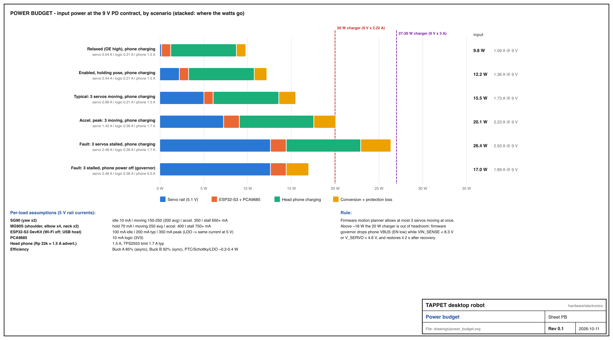

# Tappet power budget (rev 0.1, 2026-10-11)

*Generated by `gen_drawings.py` from the load model in that file - edit the model, not this file.*

## 1. Input

* USB-C PD, CH224K requests **9 V**. A 20 W charger offers 9 V x 2.22 A = **20.0 W**; a 27-30 W charger offers 9 V x 3 A = 27 W. **Minimum 20 W, recommended 30 W.**
* F1 3 A-hold PTC limits sustained input to ~27 W regardless of charger; it trips at ~5 A.
* No 9 V PDO (5 V-only charger, or a USB-A to C cable): CH224K stays at 5 V. Buck A then drops out (~3.5 V servo rail) and Buck B is below its 7 V minimum. Firmware reads `VIN_SENSE` < 7.0 V and refuses `enable` (`fault{code:"no_pd"}`), keeping only the ESP32 alive for diagnostics over UART.

## 2. Per-load currents

| load | rail | idle | moving (avg) | accel. peak | stall | source / note |
|---|---|---|---|---|---|---|
| SG90 (L/R yaw, x2) | V_SERVO 5.1 V | 10 mA | 150-250 mA (200) | 350 mA | 650+ mA | yaw has no gravity load |
| MG90S (shoulders, elbows, x4) | V_SERVO | 70 mA holding | 250 mA | 400 mA | 750+ mA | holds arm weight |
| MG90S (neck pan / tilt, x2) | V_SERVO | 10 / 70 mA | 250 mA | 400 mA | 750+ mA | tilt carries the phone |
| ESP32-S3 DevKitC-1 | 5V_DEVKIT -> LDO 3V3 | 100 mA | 200 mA | 350 mA (radio TX burst, if Wi-Fi is used) | - | ESP32 Wi-Fi normally off: networking lives on the head |
| PCA9685 | +3V3 | 10 mA | 10 mA | 10 mA | - | |
| Head phone | VBUS_HEAD 5 V | 1.5 A | 1.5 A | 1.7 A (U4 limit) | - | Rp 22k advertises 1.5 A |

Duty assumption: the firmware motion planner moves **at most 3 servos simultaneously**; the others hold. Enabling (`OE` low) staggers channels 80 ms apart so the 8 servos never seek at once.

## 3. Scenarios (computed)

Efficiencies: Buck A (XL4015, asynchronous) 85%, Buck B (Mini560, synchronous) 92%; fixed overhead 0.15 W (CH224K, LEDs, dividers) plus I^2R in F1/D3/U4.

| scenario | I servo | I logic | I phone | P servo | P logic | P phone | P loss | **P in** | I in @ 9 V | 20 W charger |
|---|---|---|---|---|---|---|---|---|---|---|
| Relaxed (OE high), phone charging | 0.04 A | 0.21 A | 1.5 A | 0.2 W | 1.1 W | 7.5 W | 1.1 W | **9.8 W** | 1.09 A | OK |
| Enabled, holding pose, phone charging | 0.44 A | 0.21 A | 1.5 A | 2.2 W | 1.1 W | 7.5 W | 1.4 W | **12.2 W** | 1.36 A | OK |
| Typical: 3 servos moving, phone charging | 0.99 A | 0.21 A | 1.5 A | 5.0 W | 1.1 W | 7.5 W | 1.9 W | **15.5 W** | 1.73 A | OK |
| Accel. peak: 3 moving, phone charging | 1.43 A | 0.36 A | 1.7 A | 7.3 W | 1.8 W | 8.5 W | 2.5 W | **20.1 W** | 2.23 A | **over** |
| Fault: 3 servos stalled, phone charging | 2.48 A | 0.36 A | 1.7 A | 12.6 W | 1.8 W | 8.5 W | 3.5 W | **26.4 W** | 2.93 A | **over** |
| Fault: 3 stalled, phone power off (governor) | 2.48 A | 0.36 A | 0.0 A | 12.6 W | 1.8 W | 0.0 W | 2.6 W | **17.0 W** | 1.89 A | OK |

## 4. Headroom

* Typical operation draws **15.5 W** - 4.4 W (22%) headroom on a 20 W charger.
* Acceleration peaks (~100-200 ms) reach **20.1 W**: at the limit of a 20 W charger, comfortable on 30 W. PD sources tolerate short excursions (OCP is typically 110-150 % of the PDO), and C2 absorbs the sub-millisecond part.
* A 3-servo stall with the phone charging is **26.4 W** - over a 20 W budget. This is a fault case (jammed arm); see the governor below.
* Buck A: average 1-1.5 A, peaks 2.5 A, CC limit 4.5 A; 8 servos all stalled (~5.8 A) is clamped by the CC limit -> V_SERVO collapses -> `brownout` fault -> firmware relaxes (OE high).
* Buck B: <= 2.1 A (phone 1.7 A worst + logic 0.36 A) on a module rated 5 A: no heatsink needed.

## 5. Brownout behaviour and power governor (firmware)

1. `V_SERVO` (GPIO4, x2 divider) sampled at 100 Hz, 8-sample median. < **4.3 V** for 30 ms -> `fault{code:"brownout"}`, queue paused, servos hold (not relaxed) unless it persists > 500 ms, then OE high.
2. `VIN` (GPIO5, x(122/22) divider) < **8.3 V** for 50 ms while the phone is charging -> the charger is folding back: firmware drops `PHONE_VBUS_EN` for 2 s (phone sees a detach, keeps running on its battery), then re-enables. This keeps servo motion alive on a marginal 20 W charger.
3. `VIN` < 7.0 V at boot -> PD not negotiated -> refuse `enable`, LED amber blink, status `faults:["no_pd"]`.
4. `PHONE_VBUS_FLT` low (GPIO15) -> U4 tripped (short in the head cable / phone) -> `fault{code:"phone_ocp"}`, EN low, retry after 5 s, give up after 3 tries.
5. The ESP32-S3 brown-out detector (2.7 V on 3V3) is the last line: D3 + DevKit LDO keep 3V3 in regulation down to ~4.0 V on 5V_LOGIC, far below any servo-induced dip, because servos are on a separate buck.

## 6. Thermal notes

* Buck A at 5.0 W out / 85%: ~0.9 W dissipated typical, ~2.2 W in the stall case. XL4015 module is fine up to ~2 W without extra heatsinking; give it 10 mm clearance and vent slots above it.
* Buck B: ~0.7 W. U4 TPS2553: R_on 85 mOhm x 1.5^2 = 0.19 W (SOT-23-6, fine). D3: 0.35 V x 0.2 A = 0.07 W.
* DevKit LDO: (4.65 - 3.3) V x 0.2 A = 0.27 W - normal.
* Servo bodies: an MG90S holding the phone on NECK_TILT dissipates ~0.35 W continuously; `relax` when idle if the head is balanced (park pose is chosen to be gravity-neutral).
* Total heat in the base bay, typical: ~2.5 W. The 240x150 mm bay with vents needs no fan.

## 7. Servo lead lengths (from harness model)

| joint | needed (mm) | stock lead 250 mm | extension |
|---|---|---|---|
| L_YAW | 160 | OK | none |
| L_SHOULDER | 310 | too short | +100 mm |
| L_ELBOW | 320 | too short | +100 mm |
| R_YAW | 150 | OK | none |
| R_SHOULDER | 300 | too short | +100 mm |
| R_ELBOW | 310 | too short | +100 mm |
| NECK_PAN | 320 | too short | +100 mm |
| NECK_TILT | 390 | too short | +200 mm |
