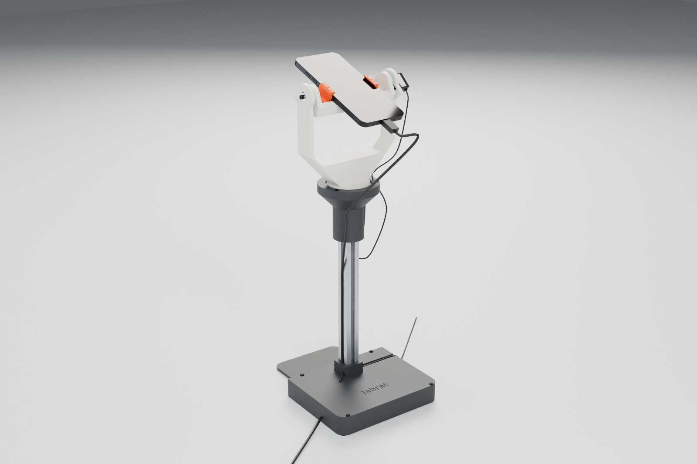
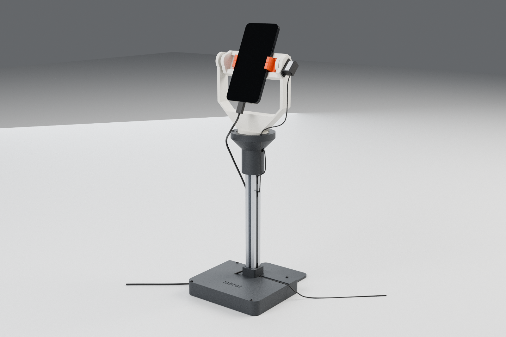
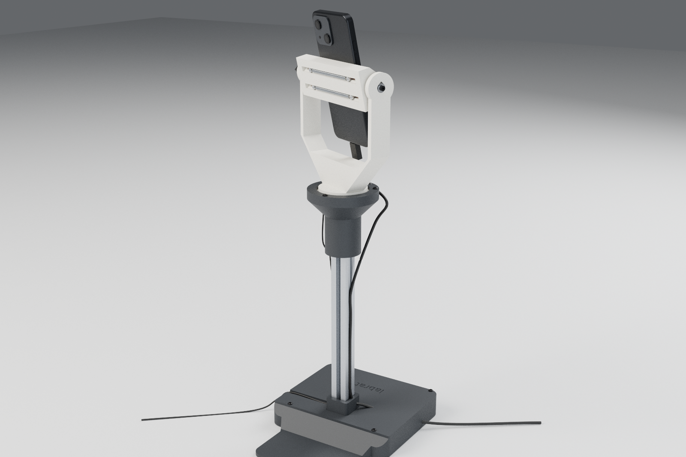
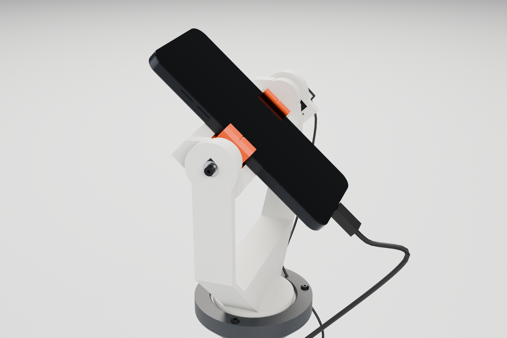
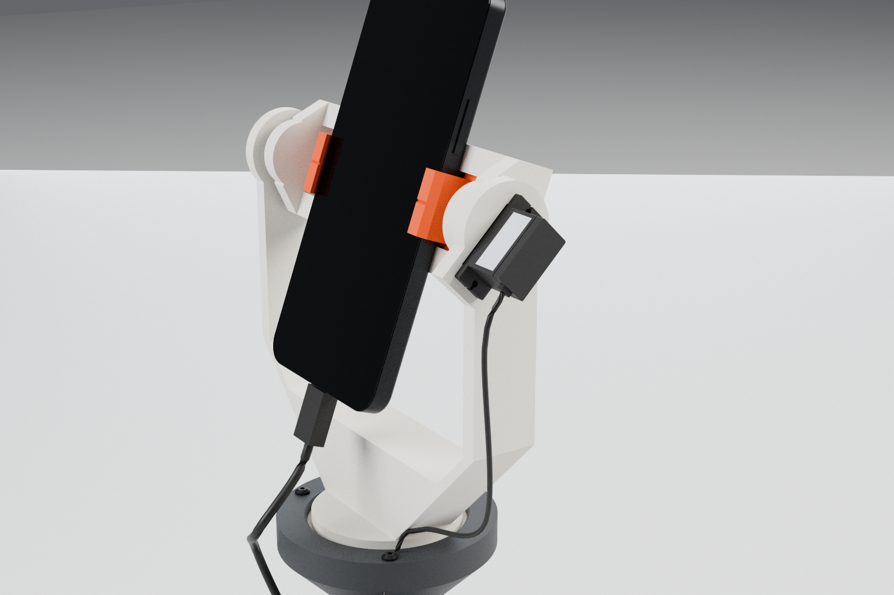
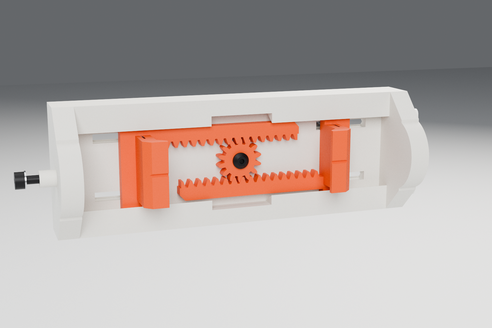
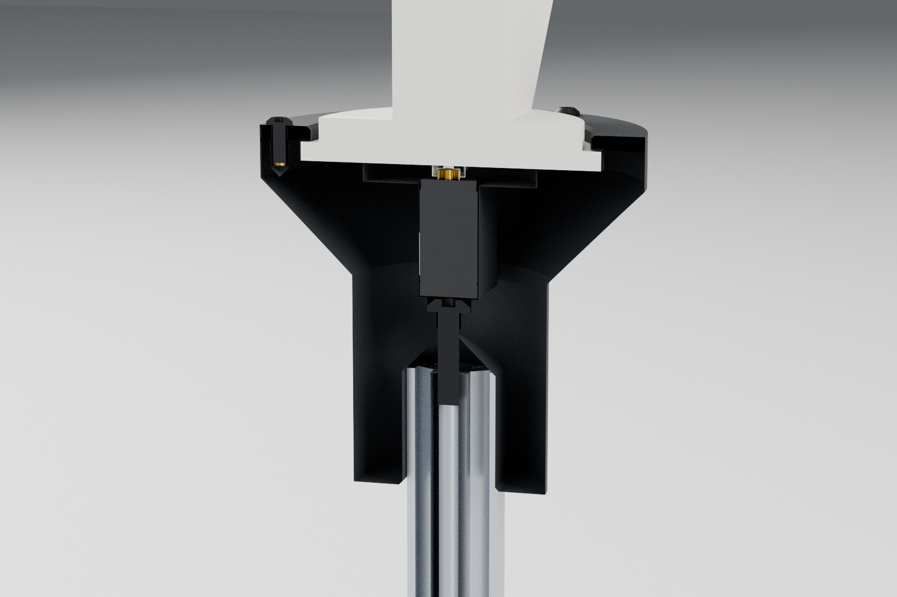
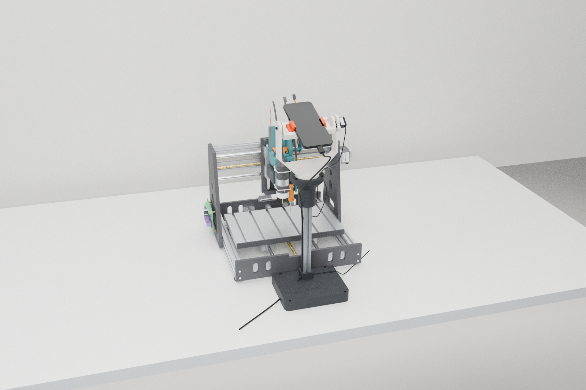
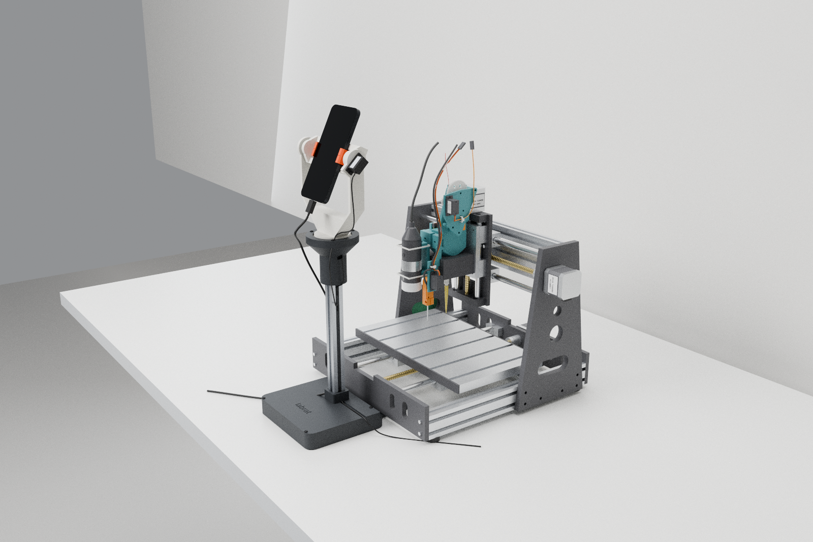

# Phone stand: motorised pan/tilt for the LabRat phone (PS-1xx)



The phone is the agent's face, eyes and ears. This stand holds it front-centre on the bench, in front of the 3018,
and turns it with two 9 g servos on the servo hub: **pan about Z (ch 2)** and **tilt about X (ch 3)**. The agent aims
it at the deck to take photos and at the operator while it talks.

The design is parametric **build123d** in [`pstand/`](pstand). Every file below is generated from it with one
command (see [Rebuild](#rebuild)). The build also checks the design and fails if a check fails
(`build/report.json`).

## How it works

- **The phone stands in portrait. Its screen is the face and its rear main camera is the eye.** At pan 0 the screen
  faces the operator and the rear camera faces the machine. To photograph the deck, the stand tilts the phone forward
  (camera elevation -66°). To talk, it brings the phone up to face the operator (-25° for a standing operator's face).
  Both jobs need the same pan direction, so the servo's 180° of pan travel covers them: ±85° is used, about 0 =
  square to the machine. The stand never has to turn the phone round to face backwards.
- **The tilt axis runs through the phone's centre.** It lies in the phone's mid-plane at mid-length. The rack-and-pinion
  clamp centres any phone from 60 to 85 mm wide on that axis, so the servo only works against offsets (2.6 mm for the
  whole tilt group) and against the cable. The axis has a support at each end: the servo horn on the right, and a
  623ZZ with an M3 axle on the left.
- **The pan turntable is a plain thrust ring.** The yoke's Ø64 disc sits on the housing's annular thrust face, inside
  a 0.3 mm journal rim. A screwed retainer ring stops it lifting (0.3 mm play). The pan horn is screwed to the disc and
  slides onto the servo spline **with no screw into the spline** (0.4 mm axial float). The spline therefore carries
  only torque. The tilt horn is mounted the same way on the cradle.
- **The clamp is spring-loaded and needs no screws.** Two identical jaws slide in a dovetail channel in the cradle.
  Their racks mesh a central m1 14T pinion, so the jaws always move symmetrically and the phone stays centred. Two
  extension springs run in V-roofed lanes on the back of the cradle and pull the jaws together. Each jaw has a 45° lip
  that hooks over the screen edge and pushes the phone back onto the two rest bars (a V grip). To fit a phone, pull
  the jaws apart and drop it in. The camera (top) and the USB-C port (bottom) are both clear, because the jaws grip
  only the middle 22 mm of the sides, below the side buttons.
- **The base is weighted, not clamped.** A pocket under the lid holds about 1.5 kg of 4.5 mm steel shot. A 4 mm
  tongue slides 60 mm under the 3018's front end plate, with 3 mm clearance below the plate's 8 mm-high bottom edge.
  The tongue extends the tipping edge on the machine side without touching the machine, so no stepper vibration
  reaches the camera.

```
stack (bench up)                         z (mm above the bench)
  1 mm silicone pads, PS-100 base + PS-101 lid (ballast)      0 .. 28 (2020 socket boss to 44)
  2020 post, 250 long                                         4 .. 254
  PS-110 pan housing (pan servo, thrust face, rim)            229 .. 302.5   thrust face 298.15
  PS-120 yoke (disc under the PS-111 retainer, U arms)        298.15 .. 445
  tilt axis                                                   429.35
  phone (upright)                                             355 .. 503
```

| | |
|---|---|
| tilt axis | **429.4 mm above the bench**, on the pan axis, 225 mm in front of the deck centre line (twin three `(0, 429.4, -225)`) |
| footprint | base 164 × 130, tongue 110 × 62 under the 3018; envelope x ±82, y −100 … +112 (S frame) |
| phone | 60–85 wide, ≤ 9.5 thick (≤ 170 long clears the yoke at any tilt), ~230 g |
| servos | 2 × MG90S (SG90 fits and passes the torque check) |
| pan | ±85° mechanical (servo ±90° about 1500 µs); the protocol range is −90.6 … +79.4° because the reference is the deck-centre aim |
| tilt | camera elevation −95° (beyond straight down) … +40° (screen tipped down); the servo spans −130 … +50° |
| mass | 2.42 kg total, of which ~1.49 kg is steel shot; pan group 399 g; tilt group (with phone) 303 g |

## Checks

| check | result |
|---|---|
| **FOV** (main camera ~55° across × 70° along the phone, rear camera aimed at the deck centre) | the 300 × 180 deck plane fits with **4.9° margin** (bed at machine y = 90). It uses 22.6° of the 27.5° half-angle across and 14.5° of the 35° along. Beaker rims (51 mm up): 2.1°. With the bed at y = 0: 7.2° (rims 5.1°). With the bed at y = 180, the deck plane fits (3.0°) but the near rims are 0.4° outside the frame |
| **tilt torque** | tilt group 303 g with its CG 2.6 mm off the axis (0.08 kg·cm), plus allowances: phone 8 mm off-centre along its length 0.18, thickness 0.04, USB-C cable 0.10. Holding torque **0.40 kg·cm**, plus 0.10 to swing 90° in 0.6 s. **Margin 3.6×** on an SG90 (1.8 kg·cm), **4.4×** on an MG90S (2.2) |
| **pan torque** | 399 g on the thrust ring: dry PETG friction 0.32 kg·cm, lead loop 0.15, 170° in 0.6 s 0.34. Total **0.81 kg·cm**: **2.2×** (SG90), **2.7×** (MG90S). Grease the ring (μ ≈ 0.15) to roughly halve the friction term |
| **tipping** | worst case (panned 85°, phone flat): a **4.0 N** horizontal push at the phone tips it toward the operator. Static tip angle 37° |
| **sweeps** | a 85 × 170 × 9.5 phone in fully open jaws clears the yoke by **≥ 4.9 mm through a full 360° of tilt**. Cradle ≥ 3.0, jaws ≥ 11, horn ↔ servo tower 0.7 by design. Pan ±90°: ≥ 5.9 mm to the static parts |
| **layout** | SO-101 pan axes (twin ±250, −300) are 261 mm from the stand axis and 166 mm outside the phone's sweep sphere. They are within an SO-101's ~350 mm reach, so `stand.json` gives a keep-out for the arm planners. The base ramp ends 2 mm short of the 3018 front plate |
| **print** | all 9 printed parts are support-free. The check tessellates each part in its print orientation and flags downward faces flatter than 45° (+3° tessellation allowance): all 0 mm², except PS-110 at 0.08 mm² (facet noise) |

Two things the checks do not cover:
- **Occlusion by the machine.** With the bed centred, the syringe head and Z carriage hide a strip of deck behind
  them. For full-deck photos, park the head at an X end at Z = 0, or move the bed forward (machine y 120–180).
- **The phone itself.** The checks use a nominal 6.1″ phone with its main camera 22 mm right of centre and 60 mm
  above centre. Measure yours and enter it in `stand.json` → `camera`.

## Parts and printing

PETG (or PLA), **0.2 mm layers**, 0.4 mm nozzle. Use 4 walls; 5 on PS-110 and PS-120. Infill 15–25 %, and 100 % on
the jaws and the pinion. Print with no supports and no brim, except an optional brim on the yoke. Holes that run
parallel to the bed are teardrops. Downward faces are 45° chamfers, flares, pyramids, V roofs or 45° windows.

| part | prints | notes |
|---|---|---|
| `PS-100` base | flat | ballast pocket, 2020 socket (40 deep, 45° lead-in), M5 countersink from below, 4× M3 inserts, 45° ramp + 4 mm tongue. 164 × 212: prints alone |
| `PS-101` lid | flat | lead groove from the post to the right edge, engraved name |
| `PS-110` pan housing | upright, socket down | 45° pyramid over the post end (the post's edges seat on it), pan-servo pocket (case toward +x), pointed-roof lead tunnel (fits the 3-way connector), thrust face, rim with 3× M3 inserts |
| `PS-111` retainer | flat | |
| `PS-120` yoke | upright, disc down | disc, neck, 45° underside, U floor at −90 (r 85 phone + 5), arms. Right arm: 45° servo window and tab pilots (teardrops). Left arm: 623ZZ seat (teardrop, press) |
| `PS-130` cradle | on its back | rest bars, 60° dovetail channel with a drop-in gate at the centre, floor insert for the pinion, spring lanes with V roofs, ears (M3 insert left, horn pilots right) |
| `PS-131` jaw ×2 | on its back | dovetail block, finger with a 45° lip and a centre mark, rack arm m1 20°, 2 spring-post pilots |
| `PS-132` pinion | flat | m1 14T, bore 4.15 for the brass sleeve |
| `PS-133` spacer | on end | |

Build plates and G-code: [`../print`](../print). `stl/` holds each part alone, already in its print
orientation. `step/` holds the editable solids (design frame) and `phone_stand_assembly.step`.

**Buy** (the full list is in [`bom.csv`](bom.csv)):
- 2 × MG90S (or SG90) with horns and screws;
- a 2020 B-type extrusion, 250 mm, tapped M5 at both ends;
- a 623ZZ bearing;
- 2 × extension springs, OD 5 × 0.6 wire × 60 mm (~0.15 N/mm, ~2 N initial tension);
- ~1.5 kg of 4.5 mm steel BBs;
- 1 mm silicone sheet (base pads, jaw pads);
- 2020 slot cover;
- 2 × 300 mm servo extension leads;
- 9 × M3 heat-set inserts;
- fasteners: M5×12 countersunk, M5×20 button head, 8 × M3×8 button head, M3×16 SHCS with a DIN 433 washer, and
  4 × M2.5×12 pan head;
- a 4 mm brass tube (K&S 9220) for the pinion sleeve.

Clamp force with the nominal springs is about 6 N per jaw on a 60 mm phone and about 13 N on an 85 mm phone. With
the silicone jaw pads (μ ≈ 0.6), the grip holds the phone's weight upright with about 3× margin. Bare PETG on glass
gives about 1.5×, so fit the pads.

## Assembly

1. **Inserts.** Base: 4 × M3. Housing rim: 3 × M3. Cradle: left ear M3 (along x), and pinion M3 (in the channel
   floor).
2. **Base.** Cut the 2020 to 250 mm and tap M5 at both ends. Fix it into the base with the M5×12 countersunk screw
   from below. Fill the pocket with steel shot; a few drops of thin CA stop it rattling. Screw on the lid with
   4 × M3×8. Stick the four 1 mm pads under the corners.
3. **Housing.** Put it on the post top and fix it with the M5×20 button head through the servo pocket floor.
4. **Pan servo.** Feed its lead, connector first, out through the tunnel. Drop the servo in with the case toward the
   tunnel and fix the tabs with 2 × M2×8. Run the lead down the post's +x slot and press the slot cover in over it.
5. **Centre both servos at 90°** with the hub (`servo {ch:2,deg:90}`, `servo {ch:3,deg:90}`, i.e. 1500 µs) before
   any horn goes on.
6. **Turntable.** Screw a double-arm horn to the underside of the yoke disc, arms along the yoke's arms, with 2 horn
   screws at r = 12. **Do not fit the centre screw.** Grease the thrust face. Lower the yoke onto the spline so the
   tilt-servo arm (right) is on the operator's right and the U opens square to the machine. Fit the retainer with
   3 × M3×8. The yoke should turn freely with about 0.3 mm of end play.
7. **Tilt servo and bearing.** Slide the tilt servo through the right arm's 45° window from outside, case pointing
   down toward the operator. Fix it with 2 × M2×8. Press the 623ZZ into the left arm from outside.
8. **Clamp.**
   1. Drop one jaw's block into the cradle's centre gate and slide it out to the left. Turn the second jaw 180° and
      do the same to the right.
   2. Put the brass sleeve through the pinion, set it on the floor insert, and fix it with an M3×8 button head. The
      jaws now move together.
   3. From the back, drive the 4 M2.5×12 spring posts through the floor slots into the jaws, leaving about 1.5 mm
      under each head.
   4. Hook the two springs into the back lanes.
   5. Stick 1 mm silicone on the jaw faces.
9. **Tilt horn.** Screw a double-arm horn to the right ear's outer face, arms along the phone length, with 2 horn
   screws.
10. **Cradle into the yoke.**
    1. With ch 3 still at 90° (el = −40°), hold the cradle tipped about 40° (top toward the machine). Push it toward
       the left arm, then slide it right so the horn engages the spline.
    2. From the left, fit the M3×16 SHCS with a DIN 433 washer through the 623ZZ inner ring and the spacer, into the
       ear insert. Tighten it. The cradle turns with the inner ring.
11. **Leads.** Tie the tilt lead along the right arm. Leave a ~100 mm service loop around the neck (enough for ±90°
    of pan), then tuck it into the post slot. Both leads leave through the lid groove. Extend them with 300 mm leads
    to the hub: **ch 2 = pan, ch 3 = tilt**.
12. **Place the stand front-centre.** The pan axis goes on the deck centre line, 225 mm in front of the deck centre
    with the bed at y = 90 (52 mm in front of the 3018 front plate). The tongue goes under the plate.

## Calibration: servo zero offsets

The cloud's `stand` driver (`cloud/src/devices/stand.ts`) reads `cal:stand`. [`stand.json`](stand.json) →
`cloud_cal_stand` holds the design values: `pan_center_deg` 84.4, `tilt_center_deg` 63.9, `pan_dir` −1,
`tilt_dir` +1, the limits, `pivot` and `operator`. A spline tooth is about 17°, so the horns can sit up to ±9° off.
Find the real offsets as follows.

1. **Direction.** `stand.aim {pan: 20}` must turn the rear camera toward the operator's left (so_a, machine x = 0).
   `aim {tilt: 20}` must raise it. If either turns the wrong way, flip `pan_dir` / `tilt_dir`. Servo brands disagree
   on which way a longer pulse turns.
2. **Tilt offset (absolute).** The phone page can read the phone's own pitch. In portrait, `DeviceOrientationEvent.beta`
   is 90 when the phone is upright and 0 when it lies flat, so **el = beta − 90**. Command ch 3 to two angles (say 60°
   and 120°) and read `beta` at each. The slope gives the degrees per servo degree (it should be 1.0; if it isn't, set
   the hub's `cfg {ch:3, min_us, max_us}`). The intercept gives the true el at 90°:
   `tilt_center_deg = 90 + tilt_dir · (el0 − el_at_90)`, with el0 = −66.1.
3. **Pan offset, and fine tilt.** Put the bed at y = 90 and a target (a coin, or a printed crosshair) on the deck
   centre. Run `stand.look {at: "deck"}` and view the frame with a centre crosshair. Adjust `pan_center_deg` until the
   target is centred horizontally and `tilt_center_deg` until it is centred vertically. Then check a corner well
   (`look {at: "A1"}`, `"F7"`). With the driver's single-pivot model, the residual is ≤ 2.3° over the deck.
4. Save the values in `cal:stand` from the console.

For exact aiming (no pivot approximation), use the full kinematics in `stand.json`: pan pivot, tilt pivot, the
camera offset in the tilt frame, and the servo conventions. `pstand/kin.py` → `aim()` is a reference implementation:
a fixed-point iteration that puts the target on the camera axis.

## Files

| file | what |
|---|---|
| `pstand/` | `spec.py` parameters and layout · `parts.py` printed parts and print orientations · `vendor.py` purchased parts (servo, horn, 623ZZ, 2020, springs, fasteners, phone placeholder) · `assembly.py` instances, motion groups, BOM data · `kin.py` aiming, FOV, torque, tipping, sweep and print checks · `build.py` exports · `glb.py` glTF writer · `render.py` + `blender_scene.py` Cycles stills |
| `stand.json` | kinematics in the stand frame S, the bench three frame and the cloud's deck coords. Covers pan/tilt pivots and axes, the camera offset in the tilt frame, servo zero/direction conventions, limits, the deck/operator reference aims, `cloud_cal_stand`, and an arm keep-out |
| `../../apps/console/models/phone_stand/phone_stand.glb` | twin model (three.js frame, Y up, mm). Nodes: `phone_stand` (root) → `stand_base`, `pan` (origin on the pan pivot) → `tilt` (origin on the tilt axis) → `phone` (placeholder), `clamp` → `clamp_jaw_l/r`. Each printed part is its own mesh node with glTF extras `{pn, print_up, material, layer_mm}`; `print_up` is the layer normal in that node's frame |
| `../../apps/console/models/phone_stand/rig.json` | `{pan:{node,axis,pivot}, tilt:{node,axis,pivot}, zero, limits, clamp, cameras}` in the stand root's three frame. Place the root at `(0, 0, -225)` |
| `bom.csv`, `step/`, `stl/`, `renders/` | outputs (`build/report.json` is the check report, not tracked) |

The console twin loads both through `apps/console/twin/rigs.js` (`loadPhoneStand`).

## Rebuild

```
cd hardware/phone-stand
uv run python -m pstand.build          # exports + twin + stand.json + checks (~10 min; checks fail the build)
uv run python -m pstand.render         # Cycles stills -> renders/ (Blender 4.0 on PATH; CPU, ~30 min; --draft is fast)
```

`pyproject.toml` pins the environment: build123d, trimesh, networkx, lxml, scipy, shapely and mapbox-earcut. Without it, run
`uv run --with build123d --with trimesh --with networkx --with lxml --with scipy --with shapely --with mapbox-earcut python -m pstand.build`.
Rendering uses CPU by default. The Blender 4.0 build here has no CUDA kernels for the GB10 and renders black on the
GPU (`--gpu` to try anyway). It also has no OpenImageDenoise, hence 256 samples.

## Renders

| | |
|---|---|
|  |  |
| screen to the operator (el −25°) | from the machine side: springs, rack lanes, the 623ZZ idler |
|  |  |
| clamp and V lips | tilt servo in the 45° window, horn on the ear |
|  |  |
| clamp without a phone (64 mm): racks, pinion, drop-in gate, V lips with centre marks | section: thrust face, floating horn, retainer, pyramid socket |
|  |  |
| on the bench, front-centre of the 3018, aimed at the deck | facing the operator; the tongue runs under the front plate |

## Notes, limits, open points

- Aim `(0, 0)` = **rear camera on the deck centre** (pan 5.6°, el −66.1° mechanical). Straight down is tilt −23.9.
- `look operator` turns the **screen** toward the operator (the driver already does this). The rear camera then
  points at the machine.
- The cloud driver models the camera as one point. The best such point (near the tilt axis, in `cloud_cal_stand.pivot`)
  leaves ≤ 2.3° of error over the deck. Using the camera offset from `stand.json` removes it.
- The springs are generic assortment springs. If a phone feels loose, use a stiffer spring (0.2–0.25 N/mm) or more
  initial tension. The posts take any 5 mm OD spring with a 60 ± 5 mm hook length.
- Phone CG and camera position vary by model; enter yours in `stand.json` → `camera`. The torque check allows for an
  8 mm length misplacement (centre marks on the jaw lips).
