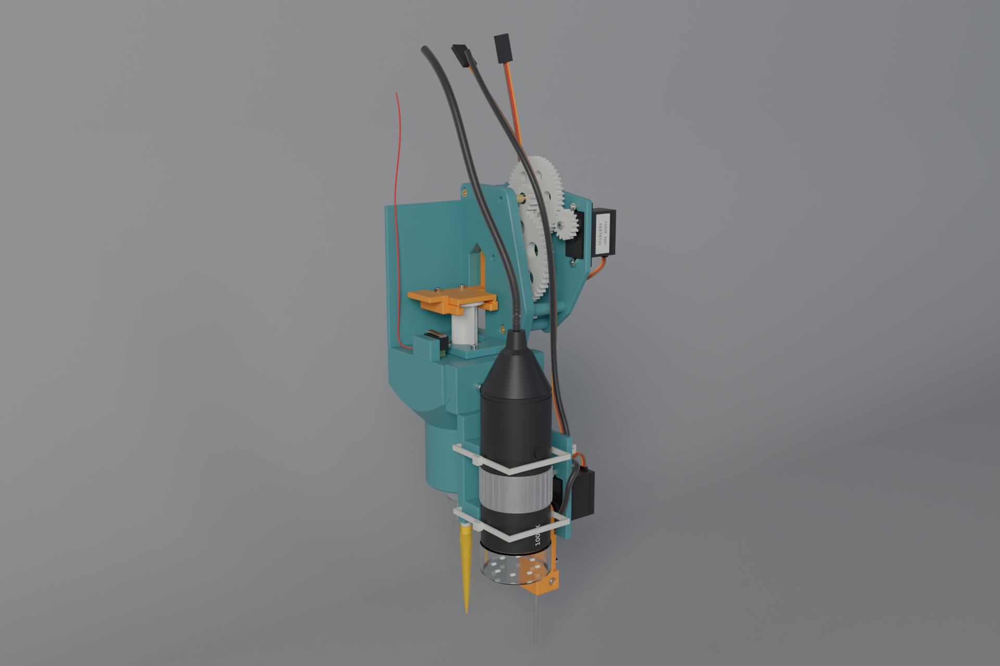
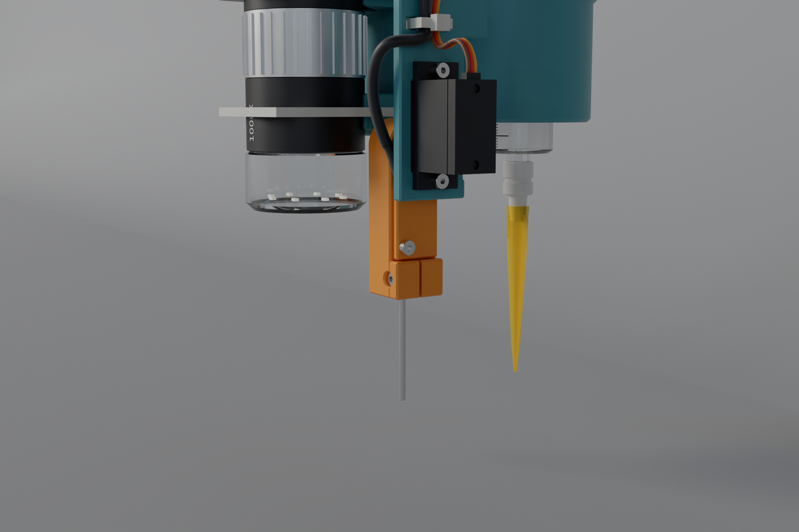
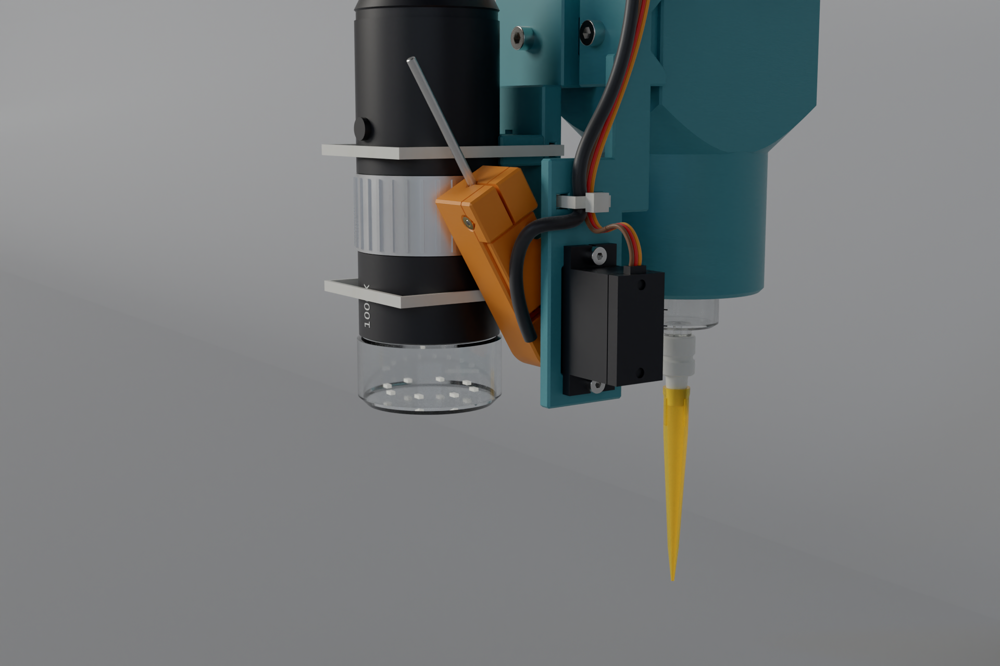
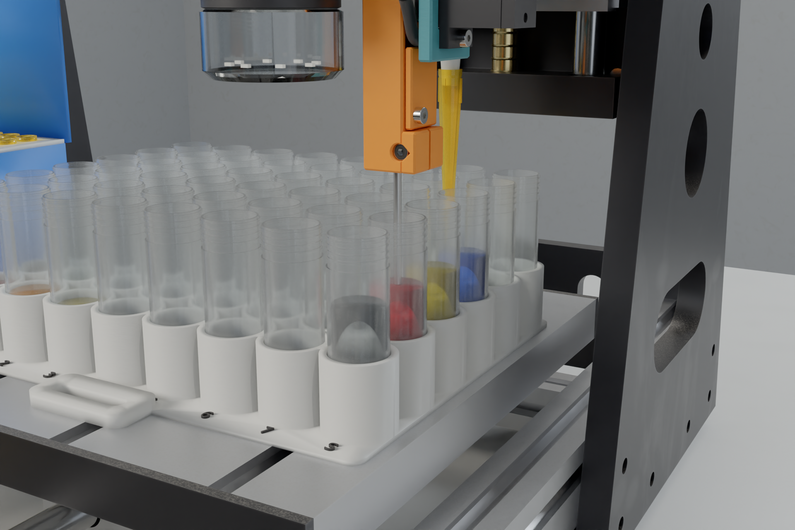

# 3018 tool head: 12:1 geared syringe + tool rail (microscope, servo-deployed capacitive probe), every printed part support-free



This head replaces the 3018's spindle motor. A disposable 12 mL luer-slip syringe sits in the 3018's motor holder
(Ø42.0 × 34), on the spindle axis. A turned adapter carries a 200 µL tip on the syringe's luer nozzle. A
continuous-rotation FS90R servo drives the plunger through a **12.01:1 printed gear train** and a rack on a carriage
that **slides on its own back** against a rib right behind the mesh (no purchased guide). A **tool rail** on the front of the head takes
interchangeable modules: a **USB microscope** and a **capacitive liquid-level probe** that a 9 g servo swings down
(deployed) for probing and up out of the way (retracted) for pipetting. A **`syr_home` microswitch** reports the plunger's
bottom stop.

The design is parametric **build123d** in [`syrhead/`](syrhead), and every exported file is generated from it. Each
part has a part number, material, process and, for purchased parts, a vendor family; purchased parts are modelled as
the product itself. The build and its checks are pure build123d. The optional microfab design checks and the Cycles
renders use the pipeline of `~/Documents/microfab_3d_atlas_bundle`; without it they are skipped.

## Layout

```
z-stack (bottom -> top)
  plug  Ø41.9 x 34 in the motor holder              (the syringe barrel runs through it)
  mid body  50 x 50 mm block, 38 tall               (barrel bore, flange pocket, flange clamp)
  top section, an x-stack (-X -> +X):
     carriage + plunger | gear plate 1 (+ the rack's guide rib) | gears | gear plate 2 | servo
  front of the mid body: tool rail (x -28 .. +19.5) with modules hanging in front of the holder
  mid body's -X edge, on the table: syr_home microswitch (the carriage's finger presses its lever at the bottom stop)
```

- The **gear axes run along X**, between gear plate 1 (part of the body) and gear plate 2 (a separate print with three
  integral standoffs). Each compound gear turns on two MR63ZZ bearings on a Ø3 dowel that is pressed into gear plate 2
  and slips into gear plate 1.
- The **carriage is an L**: jaw (holds the thumb disc), arm and rack bar. The arm runs through a window in gear
  plate 1, so the rack sits in the gear plane next to the output pinion.
- The **plug flares out at 45°** at the top of the holder. The cone seats on the holder's bore edge, which centres
  the head, sets its height and leaves no flat ledge to print over.
- **Guide: the rack slides on its own back.** There is no rail and no guide far from the load. The rack's back face
  carries a 90° V-groove, and it rides a matching V-ridge on a rib of gear plate 1 directly behind the rack, at the
  pinion's height, spanning the mesh over the whole stroke (0.15 mm clearance). The gear's separating force pushes
  the rack straight onto its support, so it creates no moment. The V locates the rack sideways, and the spur mesh
  has no axial load. Both parts print without support: the rib prints upright with the body, and the groove's 45°
  walls are on the carriage's bed face. Print in PLA (PLA on PLA slides well) and put a smear of PTFE or silicone
  grease on the ridge.
- **Tool rail.** The front of the mid body carries a plain trapezoid rail (45° flanks, flat front for the inserts), running along X, with M3 heat-set inserts
  at five index positions (x = −24, −16, −7.5, 3, 11). A module's saddle slides on from a rail end. One M3×10 into an
  insert pulls the saddle's matching groove onto the two 45° flanks: a V seat that sets Y and Z, while the screw
  sets X. Every module's tool point has an offset from the
  syringe tip (`tools.json` → server `deck_cal` tools), so the CNC moves the spindle to `target − offset`.

| | |
|---|---|
| plunger travel | 30 mm (7.5 mL of the 12 mL syringe; bore 17.8 mm estimated → **249 µL/mm**) |
| drive | FS90R → G1 17T : G2 50T (m0.8) → G3 12T : G4 49T (m1.0) → G5 12T pinion (m1.0, r 6 mm) → rack |
| ratio | **12.01 : 1** → **0.50 mm of plunger per servo radian**, ≈ 2.17 µL per servo degree |
| speed | ≈ 5.8 mm/s at the servo's 110 rpm no-load; ≈ 1.4 mm/s at the default 25 % command |
| pressure angle | 25° throughout (12T pinions mesh with 49T and the rack without undercut interference) |
| contact ratios | 1.38 (G1/G2), 1.36 (G3/G4), 1.42 (G5/rack), including the 0.08 mm backlash centre-distance offset |
| guide | the rack's back: a 90° V-groove on a V-ridge of gear plate 1, directly behind the mesh, 0.15 mm clearance |
| tools | syringe (tool 0, on the spindle axis); TM-110 USB microscope (lens at x −16, y −63, **52 mm** above the tip end); TM-120 capacitive probe (deployed electrode tip at x 9.5, y −47.5, level with the tip end) |
| probe arm | SG90 on PCA9685 ch 1; swings **150°** about an X axis 70 mm above the electrode tip; deployed on a hard stop (servo 15°, stop met at 18°), retracted at 168° |
| home switch | `syr_home` lever microswitch, closed by the carriage ~0.5 mm before the stopper bottoms |
| tip height | tip end **55.0 mm** above the bed at CNC z = 0 (3.8 mm over the beaker rims of [`../deck`](../deck)) |
| tip XY | on the spindle axis: `deck_cal` `pipette_offset` = 0, 0, 0 |
| envelope | x −37 … +65 (servo), y −80 (microscope; −87 with the probe retracted) … +25, z −110 (tip, deployed electrode) … +134 from the holder's top face |

## The probe arm (TM-120)

| deployed | retracted |
|---|---|
|  |  |



**Mechanism: a swing, not a slide.** A positional SG90 on the bracket's plate turns the arm directly (horn in a pocket,
M2×16 into the spline): no linkage, no guide. The arm swings about a machine-X axis at (y −47.5, z −40), 70 mm above
the electrode tip, from **deployed** (hanging straight down) **150° forward and up** to **retracted** (electrode tip at
y −82.5, z +20.6). A slide would need a rack or crank plus a stiff guide to move 50+ mm with a 9 g servo; the swing gets
131 mm of lift from the servo's own output and, because the arm is vertical when deployed, the tip *height* is
insensitive to the arm angle to first order (70 × (1 − cos 3°) = 0.1 mm).

**Repeatable deployed position.** The arm's back face lands on the bracket's **hard stop** (a block behind the arm,
8.5–13.5 mm below the pivot). The stop is met at servo ≈ 18°; `deployed_deg` = 15° drives 3° past it, so the servo
presses the arm lightly onto the stop and the stop, not the servo, sets the angle. Gravity keeps the arm on the same
side of the spline's play. Retracted (168°) has no stop: the servo holds it, and nothing depends on that angle.
Calibrate once: lower `deployed_deg` from 18° until the arm just stays on the stop when pushed, then 2–3° more.

**The TTP223 rides on the arm.** The sensing lead (pad → electrode top, 25 mm) never moves relative to the electrode,
so its stray capacitance and the TTP223's baseline do not change when the arm swings. The lead that crosses the joint
is the **3-core silicone cable** (GND, 5 V, OUT), as a ~40 mm slack loop in front of the hub; it is not
capacitance-sensitive. Note the TTP223 calibrates its baseline at power-up: power it with the electrode in air.

**Probe position (rail index 11, electrode at x 9.5, y −47.5 from the tip).** The electrode and the syringe tip are
level, so while the probe goes down into a beaker the tip goes down beside it. At (9.5, −47.5) ≡ (+9.5, +9.5) mod the
19 mm pitch, the tip falls in the gap between four beakers (5.8 mm from each wall), or outside the matrix for rows
E–F, so it clears the 11.2 mm holder. The probe can go down to **23.8 mm above the bed** (`tools.json`
`probe_floor_h`), where the deployed arm is 2.6 mm over the beaker rims. Liquid below that cannot be probed (it can
still be pipetted).

**Operation (DO rules, [`docs/protocol.md`](../../docs/protocol.md)).** `probe.deploy` / `retract` only with the electrode
above the rims (the arc's lowest point is the deployed position, so deploying anywhere the deployed tip clears is
safe); never swing it while the electrode is inside a beaker: lift first. `cnc.probe` only while deployed; retract
before any pipette move below safe Z.

**Wiring.**

| lead | from | to |
|---|---|---|
| probe cable `SYR-313` (3 × 28 AWG) | TTP223 VCC / GND / OUT | 3018 board 5 V / GND / **probe pin A5** (GRBL `$6=1`: HIGH = triggered) |
| SG90 lead `SYR-241` | probe servo | servo hub **PCA9685 ch 1** (`probe` device) |
| syr_home lead `SYR-251` (2 × 26 AWG) | microswitch COM + NO | servo hub **`syr_home`** input and GND (switch to ground, internal pull-up, no resistor) |

The hub's pin map is in [`../electronics`](../electronics).

## Deck clearance (worst cases)

`python -m syrhead.build` checks every head module against the deck labware of [`../deck`](../deck) (`deck` rows in
`build/report.json`, 0.5 mm height maps, ≥ 2 mm required):

| case | head | adapter | TM-110 microscope | TM-120 probe |
|---|---|---|---|---|
| tip in every beaker at CNC z −45 (tip end 10 above the bed) | 15.6 | 5.1 | 5.0 | 15.3 (retracted) |
| tip over every tip-rack hole at CNC z −45 | 9.8 | (enters the tip) | 5.0 | 9.5 (retracted) |
| probing every beaker down to 23.8 above the bed | 39.2 (tip: 12.0 over the holder) | | 18.8 | 2.6 (arm over the rim; deployed) |
| travel at CNC z 0, over the 57 mm tip rims | 54.8 | | 50.0 | 54.5 retracted / 28.0 deployed |

Still open (deck layout, [`../deck`](../deck)): the syringe tip and the
deployed electrode end 55 mm above the bed at z 0, below the 57 mm rims of the tips standing in the rack. The tip
rack's lid as `deck.py` models it (folded back, standing 127 mm high) is taller than everything at z 0: nothing can
pass over it, and with the tip in a column-1 beaker at z −45 the head body clears it by 0.2 mm and the microscope hits
it.

## Printing: no supports, anywhere

Each printed part is 2.5D in its print orientation. Every layer sits on the one below it. Holes that run parallel to
the bed are teardrops (45° roof), and the downward faces are 45° chamfers or cones. `python -m syrhead.build` checks
this: its **print** check tessellates every FDM part in the orientation below and fails on any downward face flatter
than 45°.

| part | prints | notes |
|---|---|---|
| `SYR-100` head body | upright, on the plug | plug, flare, mid body, tool rail, back wall, gear plate 1 with its carriage window and the rack's guide rib |
| `SYR-101` gear plate 2 | on its outer face, standoffs up | servo cut-out + tab slots, dowel seats (press), cable-tie slots |
| `SYR-102` flange clamp | upside down | relief pocket up |
| `SYR-103` plunger carriage + rack | on its back face (+Y) | an L; the m1 rack teeth stand up from the bar, the guide V-groove is on the bed face |
| `SYR-105` thumb-disc cap | upside down | pocket up |
| `SYR-110` G1 | gear face down, horn pocket up | no counterbore: the M2 horn screw's head bears on the face |
| `SYR-111` G2/G3 | G2 on the bed | G3 stands straight on G2's face (no neck); one Ø6 bore with a bearing pressed flush into each end |
| `SYR-112` G4/G5 | G4 on the bed | G5 stands straight on G4's face (no neck); same bore |
| `TM-110` microscope module | on its side | saddle, arm and two 90° V-cradles are one side profile; cable-tie tunnels run along X |
| `TM-120` probe bracket | on its +X face (servo plate on the bed) | saddle, SG90 plate (cut-out and tab slots along Z of the print), deployed stop; index-screw hole is a teardrop |
| `TM-122` probe arm | on its −X face | horn pocket and TTP223 pocket open upward, diamond (45°) electrode bore, pinch slit open at the top, teardrop pinch-screw holes |
| `TM-121` probe lid | flat | |

PLA (or PETG), 0.2 mm layers, 0.4 mm nozzle, 6 walls on the gears and the carriage. Build plates and G-code for every
part: [`../print`](../print).

## Parts
This is a summary. [`bom.csv`](bom.csv) has the full list with quantities, vendors and costs.

**Make:**
- `SYR-100` **head body** (above), with heat-set inserts: 2× M2 for the flange clamp, 3× M3 in gear plate 1 for the
  standoff screws, and an M3 at each tool-rail index you use.
- `SYR-101` **gear plate 2**: the servo (tabs on its outer face, 2× M2×8 + nuts), the two dowels (press), three Ø6.6
  standoffs (3× M3×30 to gear plate 1) and the cable-tie slots.
- `SYR-102` **flange clamp**: 2× M2×8 clamp the finger flange into the table pocket. The flange's long axis runs
  along Y.
- `SYR-103` **plunger carriage** with the m1 25° rack (0.04 mm backlash per flank). The rack's back V-groove rides the rib behind it.
- `SYR-105` **thumb-disc cap**: 2× M2×8 into inserts in the jaw. Its pocket lands on the disc and clears the jaw by
  0.1 mm, so tightening the screws clamps the disc with zero backlash.
- `SYR-110` **G1** 17T m0.8 on the servo's cross horn. Trim the horn arms to r = 4.6 mm. An M2×6 screw goes through G1
  and the horn into the output spline.
- `SYR-111` **G2/G3**: 50T m0.8 + 12T m1, with 2× MR63ZZ.
- `SYR-112` **G4/G5**: 49T m1 + 12T m1 output pinion, with 2× MR63ZZ.
- `SYR-104` **luer-to-tip adapter**, turned POM. A bare luer slip nozzle cannot seal in a 200 µL tip, so the adapter
  has a female ISO 80369-7 socket and a 5.8→4.6 cone that the tip seals on.
- `SYR-130-*` **bearing spacers**, cut from Ø4 × 0.45 brass tube (K&S 9220). They bear on the bearing inner rings
  only.
- `TM-110` **microscope module**: saddle, arm and two V-cradles for the generic Ø33 "1000x 8-LED" USB microscope,
  held by 2× 200 mm cable ties through tunnels in the arm. The lens front sits 58 mm below the holder top, which is
  52 mm above the syringe tip (see [Deck clearance](#deck-clearance-worst-cases)).
- `TM-120` **capacitive probe** (see [The probe arm](#the-probe-arm-tm-120) above): `TM-120` bracket
  (rail saddle, SG90 plate, deployed hard stop), `TM-122` arm and `TM-121` lid. The arm carries a TTP223 touch module
  in a pocket, its pad wired (`SYR-312`, 25 mm) to a Ø2 × 48 stainless electrode (`SYR-311`) pinched in the arm's
  foot (M2×12 across a slit).
- `SYR-250` **`syr_home` microswitch**: a subminiature hinge-lever switch (Omron D2F-01L class / "KW10",
  12.8 × 5.8 × 6.5, 2 × Ø2.1 holes on 6.5) on a boss at the mid body's −X edge (2× M2×10 into inserts). A finger on
  the carriage presses its lever 0.5 mm past the operating point at pos 0, so it closes about 0.5 mm before the
  stopper bottoms.

**Buy:**
- Feetech FS90R servo (syringe) and a TowerPro SG90 positional servo (probe arm);
- a subminiature hinge-lever microswitch (D2F-01L / KW10 class) and 2-core lead (syr_home);
- 12 mL luer-slip syringe;
- 200 µL tips;
- a generic USB digital microscope ("1000x 8-LED", Ø33 body; Jiusion / DEPSTECH / Mustool);
- a TTP223 touch module (15 × 11 mini), Ø2 stainless rod, 3-core 28 AWG silicone cable (the lead that crosses the arm joint);
- 4× MR63ZZ bearings;
- 2× ISO 2338 3m6×30 dowels;
- ruthex heat-set inserts: 8× M2×4, 5× M3×5.7 (+1 M3 per extra rail index you use);
- ISO 4762 A2 screws: M2×6/8/10/12/16, M3×10/30;
- 4× ISO 4032 M2 nuts;
- cable ties: two 100 mm (servo leads) and two 200 mm (microscope).

## Assembly
1. **Inserts.** Heat-set the inserts at 230 °C (200 °C for PLA):
   - body: 2× M2 in the table, 3× M3 in gear plate 1's outer face, M3 in the tool rail at x = −16 and 11;
   - body: 2× M2 in the switch boss (from its +X face);
   - carriage: 2× M2 in the jaw;
   - probe arm: M2 in the clamp's back face (pinch) and M2 in the +X face below the TTP223 pocket (lid).
2. **Guide.** Grease the V-ridge on the rib behind the rack window lightly.
3. **Syringe.** Drop the barrel through the table into the bore, with the flange's long axis along Y. Fit the flange
   clamp (2× M2×8).
4. **Carriage.** Pass the carriage's arm through gear plate 1's window from the jaw side, with the rack's V-groove on
   the rib's ridge. Draw the plunger up, slide the thumb disc into the jaw pocket from the front, and fit the cap
   (2× M2×8).
5. **Adapter and tip.** Press the adapter onto the luer nozzle with a quarter turn, then push a 200 µL tip onto the
   adapter cone.
6. **Gear plate 2.** Press the two dowels into gear plate 2 flush with its outer face. Press a bearing flush into
   each end of G2/G3 and G4/G5. Stack the spacers and gears onto the dowels in this order:
   - dowel C: 9.0 spacer, G4/G5 (G4 toward plate 2), 1.0 spacer;
   - dowel B: 4.0 spacer, G2/G3 (G2 toward plate 2), 8.0 spacer.
7. **Servo.** Trim the cross horn to r = 4.6, press it on the spline and screw G1 over it (M2×6). Push the servo
   through gear plate 2's cut-out from outside, with its tabs on the outer face, and fit 2× M2×8 with the nuts
   inside. G1 meshes G2.
8. **Close the gearbox.** Offer gear plate 2 to the body so the dowels enter gear plate 1 and G5 meshes the rack,
   which holds the rack against its ridge.
   Rock the carriage a little to let the teeth find each other. Fix it with 3× M3×30 through the standoffs. Tie the
   servo lead to gear plate 2 and run it up to the servo hub's PCA9685 ch 0 ([`docs/protocol.md`](../../docs/protocol.md)).
9. **Home switch.** Screw the microswitch to the boss (2× M2×10, lever toward +Y, terminals down), solder the 2-core
   lead to COM and NO, run it along the table and up the back wall's front face, and plug it into the servo hub's
   `syr_home` input. Push the plunger to the bottom by hand: the switch must click just before the stopper bottoms.
10. **Into the machine.** Remove the spindle motor, drop the plug into the 42 mm holder until the cone seats on the
   bore edge, and tighten the holder.
11. **Tool modules.** Slide each module onto the tool rail from its end and fix it with an M3×10 at its index:
    the microscope at x = −16, the probe bracket at x = 11. Lay the microscope in the V-cradles with the "Snap" button
    facing forward and tie it.
12. **Probe arm.** Push the SG90 through the bracket's cut-out from the +X side (tabs on the plate's +X face, case
    up, lead at the top) and fit 2× M2×8 with the nuts on the −X face. Set the servo to `set {deg: 18}` (hub ch 1),
    trim a cross horn to r = 4.6 and press it into the arm's horn pocket, offer the arm to the spline hanging straight
    down with its back face on the stop, and fit the M2×16 from the arm's −X face. Press the TTP223 into its pocket
    (pads toward the hub), feed the sensing lead through the hole in the pocket floor, push the electrode up the bore,
    wrap and solder the lead to its top, and fit the lid (M2×6). With the arm on the stop, slide the electrode until
    its tip is level with the syringe tip and pinch it (M2×12). Leave a 40 mm slack loop of the 3-core cable in
    front of the hub, then tie it with the servo lead on the plate's +X face (100 mm tie).
13. **Calibrate.** Set the pipette's neutral, direction, speed, backlash and volume gain (`cal:pipette`) and the
    probe's angles (`cal:probe`) through `/api/cal/{pipette|probe}` ([`docs/architecture.md`](../../docs/architecture.md#8-calibration)).
    Then teach the deck ([`../deck`](../deck)) and the tool offsets: jog the microscope or the probe over a
    mark, then the syringe tip over the same mark (`deck_cal` `tools`).

## Checks
The build fails if any of these checks fails.

**`python -m syrhead.build`** (pure build123d) writes `build/report.json`:
- **spec:** tip height, ratio, mm per servo radian, stroke volume, contact ratios, rack coverage of the stroke with
  ±1.5 pitch, and jaw clearance above the flange clamp.
- **print:** every FDM part in its print orientation needs no support (above).
- **mesh:** the coupled drive train (rack → G5/G4 → G3/G2 → G1) swept over the stroke with exact OCCT booleans. Every
  mesh must have zero overlap **and** stay engaged, with a working gap of ≤ 0.35 mm.
- **sweep:** every moving part against every static part and every other motion group, over 25 poses. The only
  exceptions are contacts the design declares: bearings on pins and spacers, stopper in the barrel.
- **sweep** also turns the probe arm through its 150° at 12 poses against every static part.
- **deck:** clearances above.
- **machine:** clearance to the 3018 (probe deployed and retracted):
  - above the Z-stepper line, nothing goes further back than y = 24.9 (the stepper's front face is at 26);
  - beside the Z plate, y < 31;
  - for information, the usable spindle X travel next to the gantry uprights of the repo's 3018 model, given the
    head's width.

**microfab checks** (optional: `python -m syrhead.check_mf` with microfab's venv, or `python -m syrhead.build
--mf-checks`, which skips them when the bundle is missing; results in `build/mf_checks.json`):
- static interference of every pair;
- fastener stacks: clearance, receiver tap or insert, thread engagement ≥ 1 d, head seating;
- every hole has a fastener or a declared purpose;
- joint sweeps at 401 poses with 1 mm running clearance;
- geometry (walls, slivers);
- manufacturability;
- edge breaks.

[`checks.yaml`](checks.yaml) lists, each with a reason:
- the permitted sharp edges: tube-cut spacers, gear and rack teeth, and the tool rail's lower 45° apex (a chamfer
  there would be a flat, unsupported facet);
- one accepted problem: the rack-teeth walls;
- the reviewed warnings: the FS90R's own Ø2.2 tab and horn holes, and microfab's part-frame overhang note, which the
  print check above replaces.

## Files

| path | |
|---|---|
| `step/` | STEP for every make part, plus `syringe_head_assembly.step` (all parts at pos 0) |
| `stl/` | FDM parts in print orientation (packed onto plates in [`../print`](../print)) |
| `bom.csv` | bill of materials, rolled up by product |
| `tools.json` | tool offsets from the syringe tip (pipette, microscope, probe) + the tool-rail index positions |
| `twin/` | meshes per motion group and finish (printed parts one mesh each, with `print_up`), and `rig.json` (pivots, motion per mm, the probe arm's axis / pivot / servo angles), for `../cnc3018` and the web twin |
| `renders/` | Cycles stills (microfab pipeline: Blender 4.0 CUDA, OIDN, AgX, metered exposure) |

## Rebuild

```bash
cd hardware/tool-head
# exports + checks (pure build123d; no microfab needed)
uv run --python 3.12 --with build123d==0.13.0 --with bd_warehouse==0.4.0 --with trimesh --with networkx \
    --with lxml --with numpy --with pyyaml python -m syrhead.build
#   add --mf-checks / --render to run the optional steps below (skipped with a note without the bundle)
# microfab design checks + photoreal renders (needs ~/Documents/microfab_3d_atlas_bundle and its venv)
MF=~/Documents/microfab_3d_atlas_bundle/.venv/bin/python
$MF -m syrhead.check_mf
$MF -m syrhead.render --quality final        # studio (probe deployed + retracted) + bench stills -> renders/
# then the twin: ../cnc3018/cnc3018.py -> apps/console/models/cnc3018.glb + syringe_rig.json
```

## Still open
- **Measurements.** `spec.py` marks what is measured and what is assumed.
  - Measured: barrel OD 20.2 and length 80, and the motor holder (Ø42.0 × 34).
  - To measure: bore (17.8 assumed), flange 34×24×2.2, disc Ø20×2, rod span 15, and the stopper-bottomed disc height (8).
- **Force.** At full duty, the FS90R's stall torque × 12 ÷ 6 mm is about 280 N at the rack. That is more than the
  printed m1 teeth (≈ 100 N for PETG, 6 mm face) or the syringe should see. The cloud's pipette driver homes at 12 %
  duty and moves at 25 % (`PIPETTE_DEFAULTS`). Keep the servo current-limited, or add a slip clutch, before running unattended.
- **FDM tolerances.** Bearing bores, dowel seats and insert holes are modelled at their nominal sizes (press fits).
  Print a test coupon for your printer and adjust `parts.py` (`M2_INSERT`, `M3_INSERT`, `PIN_SLIP`, `S.brg_D`).
- **Tip pick-up** does not fit the 3018's 45 mm of Z with a standard rack: see [`../deck`](../deck).
- **Microscope dimensions** are a representative model of the generic "1000x 8-LED" USB microscope (Ø33 body, about
  118 mm long). Measure yours and update `tools.MIC` before printing TM-110.
- **Probe arm, to verify on hardware:** the SG90's direction (if increasing pulse turns it the other way, mount the
  horn so the arm hangs straight down at 162° and set `deployed_deg` / `retracted_deg` to 165 / 12 in `cal:probe`),
  the stop angle, and the TTP223 sensitivity with a 48 mm electrode and the 3-core cable
  (the module's sensitivity capacitor may need changing for liquids in PP beakers).
- **syr_home switch dimensions** are a representative D2F / KW10 class; measure the hole height and operating
  point of yours and update `vendor.SW`.
- **More modules.** A second syringe module, a light or a stirrer reuse `tools.module_plate`. Add an entry to
  `tools.TOOLS` for its tool point.
